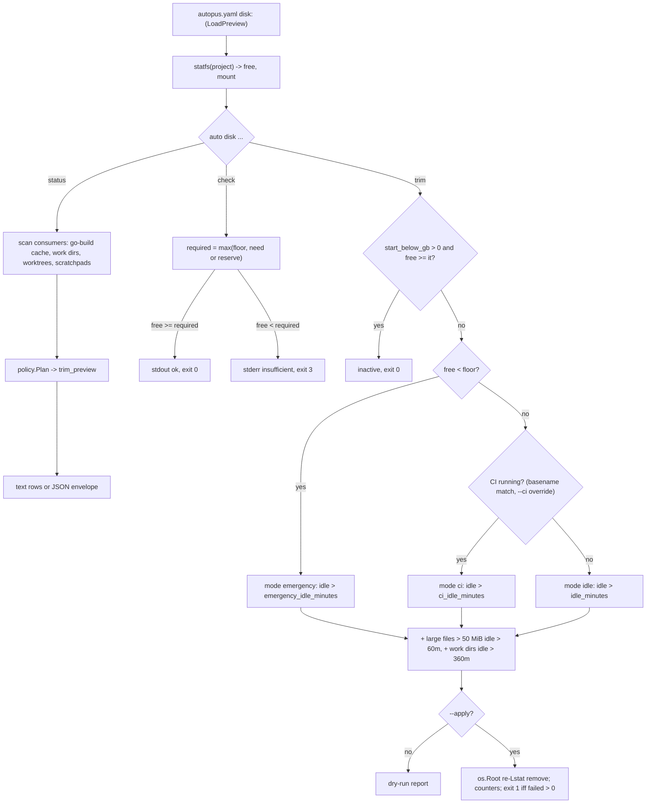

# SPEC-DISK-001 Implementation Plan

Statement classes used below: `requirement_invariant` (fixed by `spec.md`), `implementation_assumption` (how the code is expected to behave, probed before fan-out), `verified_fact` (confirmed by an execution recorded in `research.md`).

## Tasks

- [ ] T1: Add `[NEW] pkg/config/schema_disk.go` with `DiskConf`, `DiskTrimConf`, `DiskGoBuildTrimConf`, `DiskWorkDirTrimConf`, every field `omitempty` (the `schema_health_band.go` precedent: older binaries decode strictly and reject keys they do not declare), a `Disk DiskConf` field on `HarnessConfig`, a `Validate()` enforcing REQ-DISK-CFG-02 with the dotted key in every error, and one `Effective()` accessor returning resolved values (10 GiB floor, no reserves, `start_below_gb` 0, `["Runner.Worker"]`, 1 MiB over 120/180/60 idle minutes, 50 MiB over 60 idle minutes with `large_file_below_gb` 0, work dirs 360). Do not add the section to `DefaultFullConfig`; a fresh `autopus.yaml` must keep loading on older binaries. Tests in `[NEW] pkg/config/schema_disk_test.go`.
- [ ] T2: Create `[NEW] pkg/diskspace` with `Free(path) (Space, error)` returning available bytes, block unit, and mount point: `free_darwin.go` (`Bsize`, `Mntonname`), `free_linux.go` (`Frsize` then `Bsize`, mount from `/proc/self/mounts` longest prefix), `free_other.go` (`ErrUnsupported`). Mirror the arithmetic of `internal/cli/react_band_localpatch_disk_darwin.go` and `_linux.go` rather than importing them; leave the local-patch code untouched. Add `format.go` for `GiB`/`MiB` strings with one decimal.
- [ ] T3: Add consumer scans: `gobuild.go` resolves the cache root per REQ-DISK-STATUS-02 (`$GOCACHE`, `go env GOCACHE` with a 5 s `exec.CommandContext`, `os.UserCacheDir()/go-build`), canonicalizes with `EvalSymlinks`, requires the `README` marker, and lists entries matching `^[0-9a-f]{2}/[0-9a-f]{64}-d$` with `Lstat` size, allocated bytes, and mtime; `workdirs.go` resolves `$GOTMPDIR` then `os.TempDir()` and lists `^go-build[0-9]+$` directories; `scratchpads.go` reports `EvalSymlinks("/tmp")/claude-<uid>`; `sizes.go` walks with `Lstat`, same-device, no symlink following, summing `st_blocks*512`.
- [ ] T4: Add `worktrees.go`: run `git --no-optional-locks worktree list --porcelain` (parse like `pkg/workflow/merge_discover.go::parseWorktreeList`, adding `detached`, `locked`, `prunable`), classify each linked worktree with `status --porcelain=v1 -z --untracked-files=normal` and `merge-base --is-ancestor HEAD <base>` over the base ladder `origin/HEAD`, `origin/main`, `main`, `master`, size it, sum `target` directories whose parent holds `Cargo.toml` within depth 6, and set `harness` for paths under `.autopus/worktrees/`, `.claude/worktrees/`, `.worktrees/` of the main worktree. Discard git stderr as `internal/cli/git_porcelain_snapshot.go::runSyncGit` does. No mutation of any kind.
- [ ] T5: Add `policy.go`: a pure `Plan(inputs)` taking free bytes, floor, CI state, resolved config, and the scanned entries, returning the mode (`emergency`, `ci`, `idle`), the active rules, candidates per rule, bytes per rule, the `start_below_gb` inactivity verdict, and the symlink skip counts. Add `ci.go`: `ProcessLister` interface, darwin lister over `ps -axo comm=`, linux lister over `/proc/<pid>/comm` and `/proc/<pid>/exe`, exact basename matching, `Forced(running|idle)` override, and the lister-error-means-running rule.
- [ ] T6: Add `apply.go`: open `os.Root` on each canonical root, re-`Lstat` every candidate immediately before `root.Remove` or `root.RemoveAll`, classify `skipped_refreshed` (mtime or size changed), `skipped_symlink`, `vanished` (`ErrNotExist`), `failed`, and refuse roots per REQ-DISK-TRIM-06 (no `README`, `/`, `$HOME`, project dir). The only `go` subprocess in the package is `go env GOCACHE`; a test records every `exec` call and asserts no `clean` argument.
- [ ] T7: Add `[NEW] internal/cli/disk.go` (`newDiskCmd`, registered in `root.go` next to `newGuardCmd`), `disk_status.go`, `disk_check.go`, `disk_trim.go`. Load config through `config.LoadPreview` only. Use `addJSONFlags`, `resolveJSONMode`, `writeJSONResult`, and `writeJSONResultAndExit` from `internal/cli/output_json.go`. Define `exitCodeDiskInsufficient = 3` with an `exitCoder` error type as `internal/cli/fix_lock.go` does; in JSON mode pass that error as the `cause` of `writeJSONResultAndExit`, whose `jsonFatalError` unwraps to it so `exitCodeForError` still yields 3 (verified_fact: `output_json.go` lines 65-75). Inject `Free`, the process lister, and the clock through package-level seams so tests fix free space and CI state.
- [ ] T8: Add `[NEW] internal/cli/doctor_disk.go` with `checkDiskText` and `collectDiskCheck`, advisory like `checkContextWeight` (never touches `allOK`, never flips the envelope status), called from `runDoctorText` after the Context Weight block and from `collectDoctorJSONReport` after `collectContextWeightChecks`. Check id `doctor.disk.free_space`, fields `free_bytes`, `floor_bytes`, `mount`.
- [ ] T9: Wire the preflight into the guidance sources named by REQ-DISK-GUIDE-01, run `make generate-templates`, and add `[NEW] templates/disk_check_surface_test.go` modeled on `templates/risk_first_probe_surface_test.go` pinning `auto disk check` on each surface and asserting the old `df` bullet is gone from `delegation.md`. Never edit `.claude/**`, `.codex/**`, `.gemini/**`, `.opencode/**`, `.omp/**`, `.agents/**`.
- [ ] T10: Write `[NEW] docs/disk-management.md` (configuration keys, units, mode selection, the N minus 60 idle semantics, exit codes, what is never deleted) and add the `auto disk` row to the `All Commands` table in `README.md`.
- [ ] T11: Run the focused tests, `go run ./cmd/source-lines --max 300 --ext .go` over the new files, `go build ./... && go vet ./...`, `auto spec validate .autopus/specs/SPEC-DISK-001 --strict`, then capture live evidence on the dev Mac: `auto disk status --json` against `df -k`, `auto disk check --need 30`, a dry-run `auto disk trim`, and `--apply` only with `GOCACHE` pointed at the scratch cache the A1 probe built, followed by a successful rebuild from that cache.

## Implementation Strategy

The trim policy is the script's policy with its numbers made configurable and one default moved: the no-CI idle threshold defaults to 120 minutes instead of 60, because probe A1 showed the 60-minute rule deleting an archive a running build had already looked up. Every other value (1 MiB, 50 MiB over 60 minutes, 180 minutes during CI, 60 minutes below the floor, 360 minutes for work dirs) is the script's. `idle_minutes: 60` reproduces the script exactly for an operator who accepts that window.

Safety is layered rather than argued. Candidates are selected by name shape, so markers and action files are unreachable; deletion goes through `os.Root`, so a path outside the root is unrepresentable; a second `Lstat` before unlink skips anything Go touched since the scan, shrinking the lookup-to-read window further; roots without Go's `README` marker are refused outright. CI detection matches executable basenames because probe A3 showed full-command-line matching counting the detector's own shells.

The status command reuses the same scan and policy code as trim, so `trim_preview` in status is the dry-run plan, not an estimate. Worktree work is read-only git plus a size walk; the suggestion line is text the operator can paste, never an action.

## Visual Planning Brief

Preflight placement in the generated guidance: worker hygiene (before a heavy build or suite), the full-suite run, `git worktree add` in the supervisor flow, and parallel fan-out in the worktree-isolation bodies.

## Feature Completion Scope

This single Primary SPEC closes the Outcome Lock. T1 and T2 give the budget and the measurement, T3 to T6 give the consumers, the policy, and contained deletion, T7 and T8 expose them as `auto disk` and the doctor row, T9 puts the preflight where heavy steps start, T10 documents it, and T11 supplies the evidence. No sibling SPEC is created and no Completion Debt is carried; the issue's remaining asks (consumer registry, automatic worktree and scratchpad reclamation, disk tokens, alerts to every agent) are explicit non-goals of this slice, listed in `research.md` `## Evolution Ideas` without identifiers.

## Risk-First Integration Probe

| assumption_id | class | risk | boundary | input | oracle | isolation | status | reason | evidence |
|---------------|-------|------|----------|-------|--------|-----------|--------|--------|----------|
| A1 | implementation_assumption | high | shared Go build cache under a concurrent `go build` (the script's no-CI rule: files over 1 MiB idle over 60 min) | fresh `GOCACHE`, warm build of a two-import module, every cache file backdated 58 min, main compile held 240 s via `-toolexec`, trim at T+190 s (mtime age 61 min) with `find -size +1M -mmin +60 -delete`; control run identical with `-mmin +120` | the held build exits 0 under both rules | scratch `GOCACHE` under the session scratchpad; the user's cache was not touched | FAIL | the 60-minute rule deleted 21 of 21 files over 1 MiB and the held build failed with `could not import fmt (open .../aa/<id>-d: no such file or directory)`, exit 1; the 120-minute control deleted 0 files and the build exited 0. Plan revised once: default `idle_minutes` is 120, apply re-stats before unlink, and the N minus 60 window is printed | `research.md` `## Probe Evidence (2026-10-31)` A1; `<scratchpad>/disk-probe/probe-a1.log`, `build-+60.log`, `build-+120.log` |
| A2 | implementation_assumption | medium | `statfs` on the project path versus `df` on the macOS Data volume (firmlinked `/Users`) | `syscall.Statfs` of the worktree path, `/System/Volumes/Data`, `/tmp`, and `$TMPDIR`; `df -k` of the same paths within the same second | all four report mount `/System/Volumes/Data`; `Bavail*Bsize` equals `df -k Available * 1024` within 1 MiB | read-only probe binary in the scratchpad | PASS | project path 158571536384 B versus `df` 154855288 KiB: a 272 KiB difference inside the 1 MiB tolerance while builds were writing; every path resolved to the Data volume | `research.md` `## Probe Evidence (2026-10-31)` A2 |
| A3 | implementation_assumption | medium | CI detection against the live process table with 2 `Runner.Worker` jobs and 6 `Runner.Listener` daemons running | `ps -axo command` substring count versus `ps -axo comm=` basename count for `Runner.Worker` | both counts equal 2 | read-only `ps` | PASS | command-line matching counted 4 (two `zsh -c` shells whose arguments mentioned the name); `comm=` basename matching counted exactly 2 and Listener never matched, so REQ-DISK-TRIM-08 fixes exact basename matching | `research.md` `## Probe Evidence (2026-10-31)` A3 |

Gate applicability for the handoff is read from `{SPEC_DIR}/gate-applicability.json` written by `auto spec gates`, never declared here. The change set deletes files, so the classifier will keep `security`, `validation`, `data_loss`, and `deterministic_oracle` `required`; `accessibility` and `ux_verification` have no UI path in this change set and are expected to classify `not_applicable`; `spec_authoring` and `risk_first_probe` are `required` for this full SPEC.

## Verification

| Step | Command | Gate |
|------|---------|------|
| Config | `go test ./pkg/config -run 'Disk'` | defaults, validation errors with dotted keys, omitempty round trip |
| Package | `go test ./pkg/diskspace/...` | measurement, scans, policy table, containment fixture, CI matcher, worktree classification |
| CLI | `go test ./internal/cli -run 'Disk\|DoctorDisk'` | exit codes and exact messages, JSON envelope, read-only config, doctor projection |
| Surfaces | `go test ./templates -run TestDiskCheckSurfaceParity` and `make generate-templates` leaving a clean diff | preflight token on every guidance surface |
| Size | `go run ./cmd/source-lines --max 300 --ext .go pkg/diskspace internal/cli/disk*.go internal/cli/doctor_disk*.go pkg/config/schema_disk*.go` | every file at or under 300 lines |
| Build | `go build ./... && go vet ./...` | clean |
| SPEC | `auto spec validate .autopus/specs/SPEC-DISK-001 --strict` | zero error findings |
| Live | S11 of `acceptance.md` on the dev Mac | status matches `df`, dry run deletes nothing, scratch-cache apply followed by a successful rebuild |
