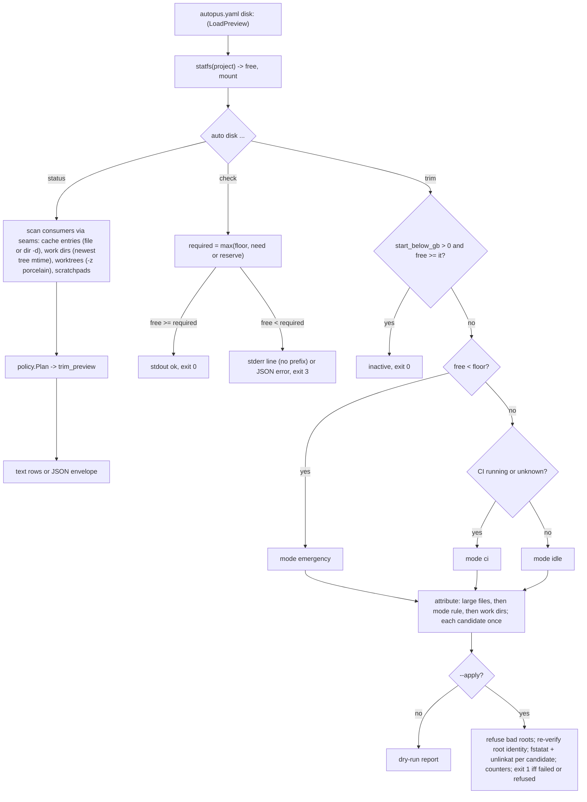

# SPEC-DISK-001 Implementation Plan

Statement classes used below: `requirement_invariant` (fixed by `spec.md`), `implementation_assumption` (how the code is expected to behave, probed before fan-out), `verified_fact` (confirmed by an execution or a source read recorded in `research.md`).

## Tasks

- [ ] T1: Add `[NEW] pkg/config/schema_disk.go` with `DiskConf`, `DiskTrimConf`, `DiskGoBuildTrimConf`, `DiskWorkDirTrimConf`, every field `omitempty` (the `schema_health_band.go` precedent: older binaries decode strictly), a `Disk DiskConf` field on `HarnessConfig`, `Validate()` enforcing REQ-DISK-CFG-02 with the dotted key in every error (minimum 60 for every `*idle_minutes`), one `Effective()` accessor returning the defaults of REQ-DISK-CFG-01 (120, 180, 120, 120 for the four idle thresholds), and `BelowRecommendedIdle() []string` listing the dotted keys below 120 for the REQ-DISK-CFG-04 warning. Do not add the section to `DefaultFullConfig`. Tests in `[NEW] pkg/config/schema_disk_test.go`.
- [ ] T2: Create `[NEW] pkg/diskspace` with `Free(path) (Space, error)` (`free_darwin.go`: `Bsize`, `Mntonname`; `free_linux.go`: `Frsize` then `Bsize`, mount from `/proc/self/mounts`; `free_other.go`: `ErrUnsupported`) mirroring the arithmetic of `internal/cli/react_band_localpatch_disk_darwin.go` and `_linux.go` without touching them, plus `format.go` for one-decimal `GiB`/`MiB`. Add the `[NEW] alreadyReported` marker: an interface in `internal/cli/output_json.go` that `jsonFatalError` implements, and a `runRootCommand` check in `internal/cli/root.go` that prints nothing for an error carrying it (`verified_fact`: today `root.go` line 208 skips printing only for `isJSONFatalError`).
- [ ] T3: Add consumer scans behind a `ScanOptions` struct carrying the seams of REQ-DISK-STATUS-04 (scratchpad root, free function, process lister, clock, uid, cache and work roots): `gobuild.go` resolves the cache root per REQ-DISK-STATUS-02 (`go env GOCACHE` only when `$GOCACHE` is unset), requires the `README` marker, and lists entries as regular files or directories named `<xx>/<64 hex>-d` with `Lstat` identity `(dev, ino, size, mtime)`, sizing a directory entry by a bounded no-follow tree walk; `workdirs.go` resolves `$GOTMPDIR` then `os.TempDir()`, lists `^go-build[0-9]+$` directories, and computes idle from the newest tree mtime (bound 100000 entries, depth 32, `skipped_unbounded` beyond it); `scratchpads.go` reports the injected or production root with count, bytes, oldest and newest age; `sizes.go` walks with `Lstat`, same device, summing `st_blocks*512`.
- [ ] T4: Add `worktrees.go`: parse `git --no-optional-locks worktree list --porcelain -z` (NUL-separated records, so paths with spaces, quotes, and newlines survive; keep `detached`, `locked`, `prunable`), classify per REQ-DISK-WT-01 (`clean` needs exit 0 and empty output; `merged` maps exit 0, exit 1, other to true, false, unknown), size each worktree, sum `target` directories whose parent holds `Cargo.toml` within depth 6, set `harness`, and build the suggestion with POSIX single-quote escaping and control-character replacement per REQ-DISK-WT-02. Discard git stderr as `internal/cli/git_porcelain_snapshot.go::runSyncGit` does. No mutation of any kind.
- [ ] T5: Add `policy.go`: a pure `Plan(inputs)` taking free bytes, floor, CI state, resolved config, and scanned entries, returning the mode, the active rules in attribution order (`go_build_large_files`, `go_build_files`, `go_build_work_dirs`), each candidate attributed to its first matching rule exactly once, bytes per rule, the union total, the `start_below_gb` inactivity verdict, and the skip counters. Add `ci.go`: `ProcessLister` interface, darwin lister over `ps -axo comm=`, linux lister over `/proc/<pid>/comm` and `/proc/<pid>/exe`, exact basename matching, `--ci` override, and the lister-error rule (`ci=unknown`, warning `treating CI as running`, mode still `emergency` below the floor).
- [ ] T6: Add `apply.go` and `remove_unix.go`: open each root once, record its identity, re-verify it before the first removal (`root_changed` refusal), refuse roots per REQ-DISK-TRIM-06 and REQ-DISK-TRIM-10 (`/`, home, project dir, relative, foreign uid, missing `README` for the cache root) before deleting anything from either root; for file candidates `fstatat(AT_SYMLINK_NOFOLLOW)` through the root fd and `unlinkat` only on identical `(dev, ino, size, mtime)` (`skipped_changed` otherwise); for directory candidates a pre-walk with `openat(O_NOFOLLOW|O_DIRECTORY|O_CLOEXEC)` and `fstatat(AT_SYMLINK_NOFOLLOW)` that skips the whole candidate as `skipped_symlink` or `skipped_device` on any symlink, device change, or special file, then bottom-up `unlinkat` with per-directory identity re-checks (`failed` on a mid-removal anomaly, `vanished` on `ENOENT`), `skipped_owner` for a foreign uid, using `golang.org/x/sys/unix` (already in `go.mod`); `os.Root` may wrap the handles but no guarantee rests on it. The only `go` subprocess in the package is `go env GOCACHE`; a test records every `exec` call per resolution branch.
- [ ] T7: Add `[NEW] internal/cli/disk.go` (`newDiskCmd`, registered in `root.go` next to `newGuardCmd`), `disk_status.go`, `disk_check.go`, `disk_trim.go`. Load config through `config.LoadPreview` only. Use `addJSONFlags`, `resolveJSONMode`, `writeJSONResult`, and `writeJSONResultAndExit` from `internal/cli/output_json.go`. Check outcomes write their single diagnostic line themselves and return an exit-coded (`3` for insufficient, `1` otherwise) already-reported error so no `Error: ` prefix appears; in JSON mode they pass that error as the `cause` of `writeJSONResultAndExit`, whose `jsonFatalError` unwraps to it so `exitCodeForError` keeps the code (`verified_fact`: `output_json.go` lines 65-75, 110-133). Print the REQ-DISK-CFG-04 warnings from status and trim. Thread every `ScanOptions` seam from package-level variables tests can override.
- [ ] T8: Add `[NEW] internal/cli/doctor_disk.go` with `checkDiskText` and `collectDiskCheck`, advisory like `checkContextWeight` (never touches `allOK`, never flips the envelope status), covering the unsupported-OS WARN line, called from `runDoctorText` after the Context Weight block and from `collectDoctorJSONReport` after `collectContextWeightChecks`. Check id `doctor.disk.free_space`, fields `free_bytes`, `floor_bytes`, `mount` or `reason`.
- [ ] T9: Finish the guidance wiring per REQ-DISK-GUIDE-01. Already landed in commit 48267539: the two agent-pipeline references, the Claude body, both shared bodies, the regenerated gemini mirror, and `templates/disk_check_surface_test.go`. Remaining: add the preflight step to the `Parallel Safety Gate` list in `codexWorktreeIsolationSkillBody` (`pkg/adapter/codex/codex_extended_skill_rewrites_worktree.go`), which `make generate-templates` never produces because `codexOwnsNativeSkillTemplate` skips it; reword every surface to the three-way exit semantics (proceed only on exit 0, stop on 3, stop on any other exit); extend the parity test with the codex body (through `normalizeCodexExtendedSkill("worktree-isolation", ...)`) and the `exit 0` token; rerun `make generate-templates` and re-record the TUIUX goldens as the lead's commit did. Never edit `.claude/**`, `.codex/**`, `.gemini/**`, `.opencode/**`, `.omp/**`, `.agents/**`.
- [ ] T10: Align `docs/disk-management.md` (defaults 120/180/120/120, executable entries, counters, residual-risk statement, exit semantics) and the `README.md` and `docs/README.ko.md` rows with the revised requirements.
- [ ] T11: Run the focused tests, `go run ./cmd/source-lines --max 300 --ext .go $(git diff --name-only origin/main -- '*.go')`, `go build ./... && go vet ./...`, `auto spec validate .autopus/specs/SPEC-DISK-001 --strict`, then capture S11 on the dev Mac with `export GOCACHE=<scratch>/gocache GOTMPDIR=<scratch>/gotmp TMPDIR=<scratch>/tmp` in force for the whole sequence (status, check, dry run with `--list`, apply, rebuild).

## Implementation Strategy

The policy is the script's policy with its numbers made configurable and its two defects corrected: every default idle threshold is at least 120 minutes, and cached executables are trimmed as the directory entries Go actually stores, by the directory's own mtime. The script's values stay reachable (`idle_minutes: 60` passes validation) but every key below 120 prints a warning on each run. Probe A1 fixes what the thresholds mean: the 60-minute rule deleted an archive a held build had already looked up and the build failed; the 120-minute rule deleted nothing at the same point. That is a demonstration of the failure mode and of the window, not a proof of safety: mtime trimming bounds the risk to a running build and cannot remove it, and the second `Lstat` narrows the scan-to-unlink window without closing the lookup-to-read race inside Go. The documents say so wherever the policy is described.

Containment is layered and none of the layers is `os.Root`: candidates are selected by name shape, roots are refused by identity and ownership, every removal goes through fd-relative no-follow operations bound to the root opened at scan time, every file is re-identified by `(dev, ino, size, mtime)` immediately before unlink, and a directory candidate is pre-walked and skipped whole on the first symlink, device change, or special file. CI detection matches executable basenames (probe A3). Status reuses the scan and policy code, so `trim_preview` is the dry-run plan. Worktree handling is read-only git over NUL-separated porcelain plus a size walk; the suggestion is a shell-quoted command the operator pastes, never an action.

## Visual Planning Brief

Preflight placement in the generated guidance: worker hygiene and the full-suite run (references, every platform), `git worktree add` in the supervisor flow (gemini, opencode), the Claude fan-out, the OMP fan-out, and the codex `Parallel Safety Gate` list; each proceeds only on exit 0.

## Feature Completion Scope

This single Primary SPEC closes the Outcome Lock. T1 and T2 give the budget, the measurement, and the error-reporting path, T3 to T6 give the consumers, the policy, and identity-checked contained deletion, T7 and T8 expose them as `auto disk` and the doctor row, T9 finishes the preflight on every shipping surface including the codex native body, T10 aligns the documentation, and T11 supplies the evidence. No sibling SPEC is created and no Completion Debt is carried: the residual lookup-to-read risk is a stated property of mtime-based trimming with a user-visible warning, not an unfinished item, and the issue's remaining asks are explicit non-goals listed in `research.md` `## Evolution Ideas` without identifiers.

## Risk-First Integration Probe

| assumption_id | class | risk | boundary | input | oracle | isolation | status | reason | evidence |
|---------------|-------|------|----------|-------|--------|-----------|--------|--------|----------|
| A1 | implementation_assumption | high | shared Go build cache under a concurrent `go build` (the script's no-CI rule: files over 1 MiB idle over 60 min by mtime) | fresh `GOCACHE`, warm build of a two-import module, every cache file backdated 58 min, main compile held 240 s via `-toolexec`, trim at T+190 s (mtime age 61 min) with `find -size +1M -mmin +60 -delete`; control run identical with `-mmin +120` | the held build exits 0 under both rules | scratch `GOCACHE` under the session scratchpad; the user's cache was not touched | FAIL | the 60-minute rule deleted 21 of 21 files over 1 MiB and the held build failed with `could not import fmt (open .../aa/<id>-d: no such file or directory)`, exit 1; the 120-minute control deleted 0 files and the build exited 0, which shows the window, not safety in general. Plan revised once: every default idle threshold is at least 120, keys below 120 warn, apply re-identifies entries before unlink, and the residual risk is stated rather than claimed away | `research.md` `## Probe Evidence (2026-10-31)` A1; `<scratchpad>/disk-probe/probe-a1.log`, `build-+60.log`, `build-+120.log` |
| A2 | implementation_assumption | medium | `statfs` on the project path versus `df` on the macOS Data volume (firmlinked `/Users`) | `syscall.Statfs` of the worktree path, `/System/Volumes/Data`, `/tmp`, and `$TMPDIR`; `df -k` of the same paths within the same second | all four report mount `/System/Volumes/Data`; `Bavail*Bsize` equals `df -k Available * 1024` within 1 MiB, allowing for writers active between the two samples | read-only probe binary in the scratchpad | PASS | project path 158571536384 B versus `df` 154855288 KiB: a 272 KiB difference while builds were writing; every path resolved to the Data volume | `research.md` `## Probe Evidence (2026-10-31)` A2 |
| A3 | implementation_assumption | medium | CI detection against the live process table with 2 `Runner.Worker` jobs and 6 `Runner.Listener` daemons running | `ps -axo comm=` basename count and `ps -axo command` substring count for `Runner.Worker` | the basename count equals the live `Runner.Worker` process count (2); the command-line count may exceed it | read-only `ps` | PASS | basename matching counted exactly 2 and never matched a Listener; command-line matching counted 4 because two `zsh -c` shells carried the name in their arguments, which is why REQ-DISK-TRIM-08 fixes exact basename matching | `research.md` `## Probe Evidence (2026-10-31)` A3 |

Gate applicability for the handoff is read from `{SPEC_DIR}/gate-applicability.json` written by `auto spec gates`, never declared here. The change set deletes files, so the classifier will keep `security`, `validation`, `data_loss`, and `deterministic_oracle` `required`; `accessibility` and `ux_verification` have no UI path in this change set and are expected to classify `not_applicable`; `spec_authoring` and `risk_first_probe` are `required` for this full SPEC.

## Verification

| Step | Command | Gate |
|------|---------|------|
| Config | `go test ./pkg/config -run 'Disk'` | defaults, validation errors with dotted keys, omitempty round trip, below-120 key list |
| Package | `go test ./pkg/diskspace/...` | measurement arithmetic, scans, attribution table, containment fixture (identity, symlink, device, owner, failed), CI matcher, worktree classification and quoting |
| CLI | `go test ./internal/cli -run 'Disk\|DoctorDisk'` | exit codes and exact stderr with no prefix, JSON envelopes, read-only config, doctor projection |
| Surfaces | `go test ./templates -run DiskCheck` and `go test ./pkg/adapter/codex -run 'DiskCheck\|WorktreeIsolation'`; `make generate-templates` leaving a clean diff | preflight tokens on every shipping surface including the codex body |
| Size | `go run ./cmd/source-lines --max 300 --ext .go $(git diff --name-only origin/main -- '*.go')` | every changed or new Go file at or under 300 lines |
| Build | `go build ./... && go vet ./...` | clean |
| SPEC | `auto spec validate .autopus/specs/SPEC-DISK-001 --strict` | zero error findings |
| Live | S11 of `acceptance.md` with scratch `GOCACHE`, `GOTMPDIR`, `TMPDIR` exported for the whole sequence | header `roots:` names only scratch paths; dry-run candidates all still exist afterwards; scratch apply then a successful rebuild |
