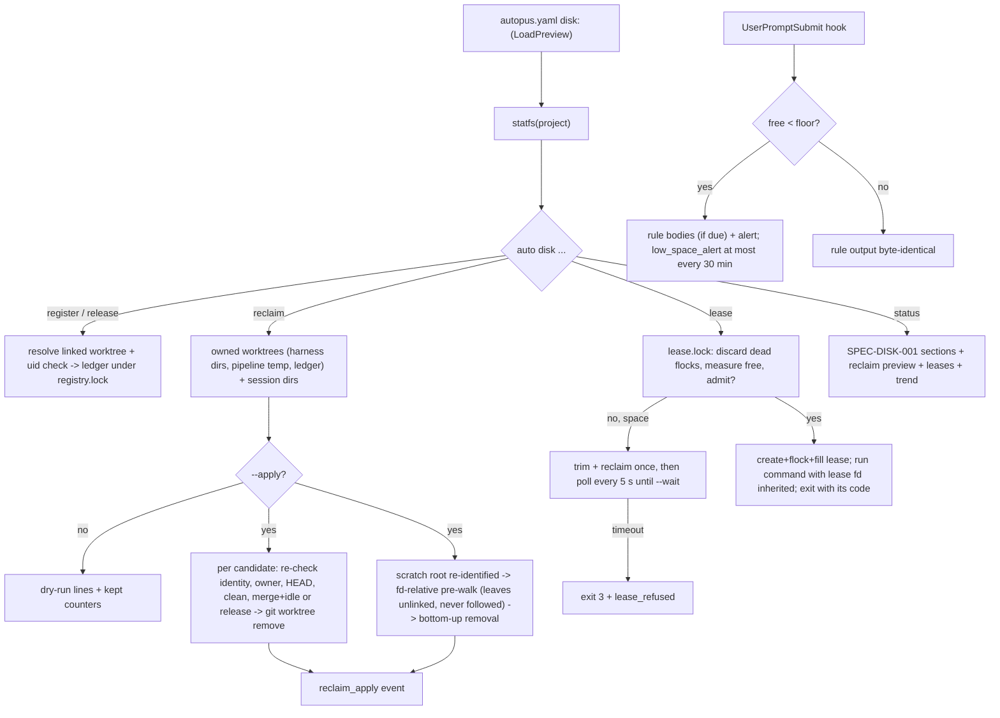

# SPEC-DISK-002 Implementation Plan

Status: draft (revised after codex review round 1)

## Tasks

- T1: `[NEW] pkg/config/schema_disk_reclaim.go` — `DiskReclaimConf`, `DiskLeaseConf`, defaults, validation, `Effective()` fields; tests for defaults, bounds, explicit false, and the omitempty round trip.
- T2: `[NEW] pkg/diskspace/state.go` — state dir resolution, component-by-component creation and refusal (symlink, non-directory, foreign owner, group/other writable), atomic write, checked append and read; `[NEW] internal/cli/disk_state.go` best-effort event and sample helpers; a test-binary guard so no test touches the real state dir.
- T3: `[NEW] pkg/diskspace/ledger.go` + `[NEW] internal/cli/disk_register.go` — ledger load/save under `filelock`, register (linked-worktree and owner checks), release, registry listing, stale pruning, corrupted-ledger refusal; pipeline temp worktrees as harness worktrees in `pkg/diskspace/worktrees.go`.
- T4: `[NEW] pkg/diskspace/reclaim_worktrees.go` — owned-worktree selection across the project repository and ledger repositories, activity time, per-reason re-qualification immediately before `git worktree remove`.
- T5: `[NEW] pkg/diskspace/reclaim_scratch.go`, `treeLimits` in `sizes.go` and `remove_tree_unix.go` — session-dir scan with the large bound, non-directory entries recorded as leaves with their kind and re-identified before unlink, slug cleanup; `[NEW] internal/cli/disk_reclaim.go` dry run, apply, JSON, exit codes, event.
- T6: `[NEW] pkg/diskspace/lease.go` + `[NEW] internal/cli/disk_lease.go` — admission under the lock, liveness by flock, clamped needs, shortage reclaim (space refusals only), waiting, child run with the lease descriptor inherited, signal policy, exit-code mapping.
- T7: `[NEW] pkg/diskspace/events.go`, `samples.go` — locked append, rotation, rate-limited append, tail, per-mount sampling, compaction, trend; `[NEW] internal/cli/disk_log.go`; `[NEW] internal/cli/disk_status_extra.go`; trim apply event; check sample.
- T8: `pkg/rulecond/sticky.go` `StickyOptions` and alert append; `[NEW] internal/cli/rules_sticky_disk.go`; `internal/cli/rules_sticky.go` settings.
- T9: guidance templates, codex native body, docs, README; regenerate goldens; record in `recapture.md`.
- T10: full tests, source-lines gate over the changed Go files, live evidence on scratch copies.

## Implementation Strategy

Reuse SPEC-DISK-001's descriptor-relative removal. The scratchpad removal differs only through `treeLimits`: larger bounds, and non-directory entries recorded as leaves with their file type, re-identified by identity and type before `unlinkat`, never opened. The go-build trim keeps `strictTree`, which still refuses any symlink or special file.

Worktree removal is delegated to git, which already refuses dirty, untracked, and locked worktrees; the harness adds ownership, uid, merge, idle, and release gates in front of it and re-checks each gate right before calling git.

Leases use one admission lock for the measure-decide-create step and one flock per lease for liveness. The command inherits the lease descriptor, so the reservation lives while either process holds it, and a crashed holder frees it with no pid bookkeeping.

## Visual Planning Brief



## Feature Completion Scope

This single Primary SPEC closes the Outcome Lock: T1 and T2 give the configuration and the state dir with its failure policy; T3 to T5 give ownership and the two reclaim kinds with re-qualified, contained removal; T6 gives leases; T7 and T8 give the log, trend, status sections, and the alert; T9 wires every shipping guidance surface and the documentation; T10 supplies the evidence. No sibling SPEC and no Completion Debt: the remaining issue items (scratch databases, VM and container images, other registries) are explicit non-goals in `research.md` `## Evolution Ideas` without identifiers.

## Risk-First Integration Probe

| assumption_id | class | risk | boundary | input | oracle | isolation | status | reason | evidence |
|---------------|-------|------|----------|-------|--------|-----------|--------|--------|----------|
| B1 | implementation_assumption | high | flock lifetime of a lease across a killed wrapper and its still-running command | helper process takes a 30 GiB lease, starts `sleep 60` with the lease file in `ExtraFiles`, prints the child pid; the test SIGKILLs the helper, admits 30 GiB against 50 GiB free and a 10 GiB floor, then kills the child and admits again | the first admission is refused while the child runs; an admission succeeds within 5 s after the child dies; the dead lease file is removed | temp state dir per test | PASS | the inherited open file description keeps the flock; with only the wrapper holding it (`TestAdmit_DiscardsLeaseOfKilledHolder`) the reservation ends at the wrapper's death, which is why REQ-DISK2-LEASE-03 passes the descriptor to the command | `pkg/diskspace/lease_test.go` `TestAdmit_ChildKeepsLeaseAfterWrapperDies`, `TestAdmit_DiscardsLeaseOfKilledHolder` |
| B2 | implementation_assumption | high | `git worktree remove` without `--force` on a clean merged worktree holding an ignored `target/` | S4 fixture: `.worktrees/a` on a branch at `main` with a 3 MiB ignored `target/debug/blob.bin` | the worktree directory and its `target/` are gone, `git worktree list` no longer lists it, branch `br-a` survives | temp repository per test | PASS | git deletes ignored files with the worktree and keeps the branch; dirty and untracked worktrees never reach git because the re-check skips them first | `pkg/diskspace/reclaim_worktrees_test.go` `TestApplyWorktrees_S4RemovesCandidatesKeepsBranches` |
| B3 | implementation_assumption | high | symlink and FIFO inside a session tree under the descriptor-relative removal | S5 fixture: `scratchpad/link -> <outside file>` and a FIFO `scratchpad/pipe`, every mtime 2000 min old | both names are unlinked, the outside file survives, nothing blocks on the FIFO, and the session and its emptied slug are gone | temp root per test, mode 0700 | PASS | non-directories are recorded with their type and unlinked by name; the strict go-build walk still reports them as `symlink` problems | `pkg/diskspace/reclaim_scratch_test.go` `TestScratchReclaim_S5`, `TestScratchReclaim_SpecialFileIsUnlinked`; `remove_unix_test.go` childProblem table |

Gate applicability for the handoff is read from `{SPEC_DIR}/gate-applicability.json` written by `auto spec gates`. The change set deletes files, so `security`, `validation`, `data_loss`, and `deterministic_oracle` stay `required`; there is no UI path, so `accessibility` and `ux_verification` are expected `not_applicable`.

## Verification

```sh
go test ./pkg/config/... ./pkg/diskspace/... ./pkg/rulecond/... ./internal/cli/... ./pkg/content/... ./pkg/adapter/... ./pkg/harneval/...
go test ./...            # before push, serially on a loaded machine
go run ./cmd/source-lines --max 300 --ext .go $(git diff --name-only origin/main -- '*.go')
GOOS=windows go vet ./internal/cli/ ./pkg/diskspace/
```

Live evidence: `research.md` `## Live Evidence`.
