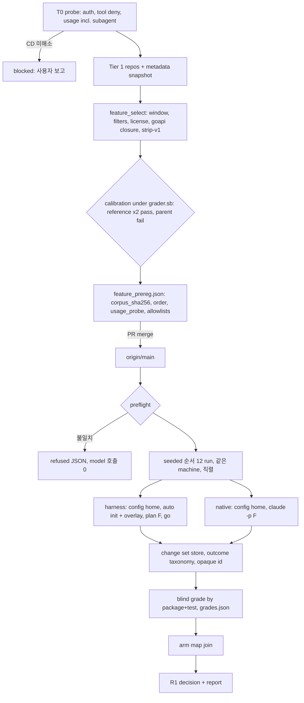

# SPEC-HARNESS-BENCH-002 구현 계획

Status: draft (rev 7)

## Tasks

- [x] T0: 선행 probe(maintainer, T1–T9 구현 전). 2026-11-05 완료: RFP-1 조건부 PASS, RFP-2 FAIL → 사용자 결정 D1·D2(`research.md` `## T0 결과와 결정 (rev 7)`). RFP-1(usage, subagent token 포함)과 RFP-2(fresh config home 인증, 투영된 review argv의 검색 관측과 catalog probe, sandbox·proxy·거부 로그)를 scratch 스크립트로 실행해 결과를 `research.md` CD-1~CD-5에 기록한다. 어느 CD든 닫히지 않으면 T1 이후를 시작하지 않고 사용자에게 보고한다. 새 secret이나 승인 절차는 만들지 않는다.
- [ ] T1: 사전등록 강제와 진입점. 대상은 `[NEW] feature_prereg.py`, `[NEW] feature.py`(`Steps` seam, `golden.Refusal`과 같은 출력), `run.py`의 `--mode feature`(분기 안 import), `[NEW] FEATURE_RUNNER_FILES`다. REQ-HB2-02 검사 순서와 `usage_probe_missing`을 구현한다. test는 `[NEW] test_feature_prereg.py`(S1)다.
- [ ] T2: 기계적 선택과 prompt. 대상은 `[NEW] feature_select.py`, `[NEW] feature_prompt.py`, `[NEW] feature_goapi/main.go`(+`main_test.go`)다.
  - GitHub 메타데이터 snapshot(PR, commits, linked issue)을 받아 SHA-256을 기록한다. selection cache는 repo 밖에 둔다.
  - window 규칙, Tier 순회, filter, license allowlist, `corpus_sha256`을 구현한다.
  - oracle closure와 `strip-v1`, issue 규칙, API 절을 만든다.
  - test는 `[NEW] test_feature_select.py`(S2), `[NEW] test_feature_prompt.py`(S4)다. 기록된 fixture만 쓰고 network를 쓰지 않는다.
- [ ] T3: corpus와 calibration. 대상은 `[NEW] feature_corpus.py`다.
  - 외부 repo bare clone cache, parent workspace(`workspace.snapshot`, `workspace.initialize`)와 모든 깊이의 harness surface 제거.
  - oracle 분류와 구성(REQ-HB2-24), reference 구성 tree id 검사.
  - download 전용 prefetch(`go mod download -json`, `go mod verify`, 읽기 전용). `prepare_grader.prepare`는 부르지 않는다.
  - 빈 build cache와 `[NEW] feature_grader.sb`(`/` 기준 읽기 거부)로 reference 구성 2회, parent 구성 1회 채점한다.
  - test는 `[NEW] test_feature_corpus.py`(S3, S19)다.
- [ ] T4: arm 구동. 대상은 `[NEW] feature_arms.py`, `[NEW] feature_home.py`, `[NEW] feature_shim.py`다.
  - PR #267을 포함한 `auto_source_commit` C에서 pinned `auto` 재현 build, 읽기 전용 `auto` shim, CLI snapshot(claude, codex).
  - `auto init` 동결 argv와 overlay(D1 panel claude+codex), `TASK.md` 전달과 `<F>`.
  - agent·broker config home seed·audit, Keychain에서 `claudeAiOauth`만 꺼낸 claude 인증과 codex `auth.json` 복사·삭제(되쓰기 없음), 만료 검사, redaction.
  - 환경 allowlist(REQ-HB2-22), native 재귀·조상 audit, 정규화 동등성 검사, seeded 순서, fingerprint와 version 재확인.
  - test는 `[NEW] test_feature_arms.py`(S5–S7)다.
- [ ] T5: 격리와 trusted receipt. 대상은 `[NEW] feature_agent.sb`(`/` 기준 읽기 거부, 동결 읽기 목록, preflight canary), `[NEW] feature_broker.py`(argv·cwd 거부, process group kill, D2 codex 명령 관측)와 `[NEW] feature_provider.sb`(claude 전용), trial 동안 DAC 잠금과 `host_solution_copy` preflight, `[NEW] feature_egress.py`(pid·자손 귀속), `[NEW] feature_outcome.py`의 거부 로그·tool 검사다. `process_tree.Tree`로 남은 process를 정리한다. test는 `[NEW] test_feature_isolation.py`(S8, macOS), `[NEW] test_feature_outcome.py`(S18)다.
- [ ] T6: blind 채점. 대상은 `[NEW] feature_grade.py`(git 없이 manifest 비교로 change set 추출, opaque id, `judge_pairs`, 섞인 순서, `grades.json`, 나중 join, `--grade`)와 outcome taxonomy 적용이다. test는 `[NEW] test_feature_grade.py`(S9)다.
- [ ] T7: 측정. 대상은 `[NEW] feature_usage.py`다. usage schema, `not_applicable`, `usage_status`, phase 구간을 구현하고 `observe.py` strict JSON 규칙을 재사용한다. test는 `[NEW] test_feature_usage.py`(S10, S11)다.
- [ ] T8: harness 경로와 review. 대상은 `[NEW] feature_review.py`다. test는 `[NEW] test_feature_review.py`(S5, S12)다.
- [ ] T9: 판정과 보고서. 대상은 `[NEW] feature_decision.py`, `[NEW] feature_report.py`, 처치·남은 편향 절이다. test는 `[NEW] test_feature_decision.py`(S13), `[NEW] test_feature_report.py`(S14), `[NEW] test_feature_readme_guard.py`(S15)다. runner `README.md` 재현 절도 쓴다.
- [ ] T10: 동결 probe(maintainer). 구현된 broker와 #267 포함 pinned `auto`로 RFP-2를 다시 실행해 CD-7을 닫고(T11 전 필수), RFP-1을 다시 실행해 provider별 receipt를 사전등록 `usage_probe`로 만들고, RFP-3을 실행한다.
- [ ] T11: 사전등록 동결.
  1. 동결 model 집합(CD-7이 관측한 `modelUsage` key 포함)의 공개 cutoff(없으면 출시일)와 출처를 조사해 window 시작을 정한다.
  2. selection을 실행하고 6 task의 calibration을 기록한다.
  3. seeded 순서를 계산한다.
  4. version, CLI snapshot digest, C와 `auto` SHA-256(C는 사전등록 PR 전에 고른다), overlay·config home 파일 digest, 환경 allowlist, egress allowlist, usage schema, 남은 편향 목록을 채운다.
  5. `feature_prereg.json`을 PR로 merge하고 origin/main SHA를 기록한다.
- [ ] T12: OPS. maintainer가 아래 명령으로 12 run과 blind 채점을 한 번만 실행한다. 출력 경로는 harness 디렉터리와 `CLAUDE.md`가 있는 디렉터리의 바깥이어야 한다. 멈추면 재시작하지 않고 T13으로 간다(REQ-HB2-02).

```sh
python3 scripts/benchmarks/harness/run.py --mode feature --repo "$PWD" --prereg scripts/benchmarks/harness/feature_prereg.json --output <새 절대 경로>
```

- [ ] T13: `feature_report.py --session <dir> --output docs/benchmarks/harness-feature-<date>`를 실행하고 보고서를 commit한다. README는 `claim_allowed: true`일 때만 바꾼다.
- [ ] T14: `## Verification` 명령 전부를 실행한다.

## Implementation Strategy

mode dispatch는 golden과 같다. `run.py` 분기 외에 pilot 분기, `golden_protocol.RUNNER_FILES`, `grader.py`, `grader.sb`, `prepare_grader.py`, `report.py`는 그대로다. `feature`는 분기 안에서만 import해 `test_golden.py:99-106`의 module 집합이 바뀌지 않는다. golden `runner_sha256`은 세션마다 다시 계산되고 pin하는 test가 없다(T14가 golden test로 확인).

편향 제거 장치는 `research.md` `## Bias Ledger`에 있다. `auto init` surface digest는 task별로 `protocol.json`에 두고, 같은 snapshot의 반복 init digest 동일성은 RFP-2가 본다. `feature_goapi`는 parse 전용이고 surface_driver처럼 따로 build한다.

예상 줄 수(모두 300 이하): `feature.py` 240, `feature_prereg.py` 190, `feature_select.py` 240, `feature_prompt.py` 180, `feature_corpus.py` 260, `feature_arms.py` 250, `feature_home.py` 170, `feature_shim.py` 90, `feature_broker.py` 280, `feature_egress.py` 120, `feature_usage.py` 190, `feature_outcome.py` 180, `feature_grade.py` 230, `feature_review.py` 130, `feature_decision.py` 120, `feature_report.py` 240, `feature_goapi/main.go` 280.

## Visual Planning Brief



## Feature Completion Scope

Primary SPEC 하나가 Outcome Lock을 닫는다.

| Task | 맡는 부분 |
|---|---|
| T0 | 실현성 blocker 선확인 |
| T1 | 사전등록 강제 |
| T2–T3 | 편향 없는 corpus, prompt, oracle |
| T4–T5 | 동등한 arm, 환경, 격리, tool 정책, broker |
| T6 | blind 채점과 outcome 분류 |
| T7–T8 | 지표 |
| T9 | 판정, 보고서, README 가드 |
| T10–T13 | 실제 pilot과 공개 |

sibling 의존성은 없다. CD-1·3·4·6은 조건부로 닫혔고 CD-2·5는 D1·D2로 정리했다. 열린 Completion Debt는 CD-7(재실행) 하나이고, 닫히지 않으면 사용자 결정 없이는 진행하지 않는다.

## Risk-First Integration Probe

| assumption_id | class | risk | boundary | input | oracle | isolation | status | reason | evidence |
|---------------|-------|------|----------|-------|--------|-----------|--------|--------|----------|
| RFP-1 | implementation_assumption | high | 세 provider의 usage 관측(runner pipe와 broker, machine-readable 출력), subagent token | T0: provider마다 한 줄 prompt 1회(동결 argv): top-level `claude -p --output-format stream-json --verbose`(Task subagent 1회 유도), review `claude --print --output-format json`, `codex exec --json`, `agy --print --output-format json`. 그리고 overlay 아래 `auto spec review` 1회. T10에 동결 shim으로 반복 | 모든 call receipt가 schema 적용 field 전부를 정수로 낸다. top-level `result` usage가 subagent token을 포함하거나, subagent별 receipt 경로가 있다(둘 다 없으면 CD-4). broker 경유 여부로 argv·stdin·stdout·exit code가 같다. overlay 아래 `review.md` verdict가 생긴다. agy JSON에 usage가 없으면 CD-1 | scratch 디렉터리, trial형 config home | PASS | 2026-11-05 T0, 조건부. 네 call 모두 usage를 낸다. claude review는 json 출력일 때만이라 PR #267이 C에 있어야 한다. agy는 D1로 panel에서 빠졌다 | research.md CD-1·CD-4, `scratchpad/rfp1/RESULTS.md` |
| RFP-2 | implementation_assumption | high | D1·D2 아래 격리 home 인증, 검색 관측, catalog probe, Seatbelt, proxy, 거부 로그, broker review | CD-7: #267 포함 pinned `auto`, 작은 Go fixture repo에서 두 arm을 축소 deadline으로 1회씩. top-level·subagent claude와, overlay 아래 `auto spec review`가 투영한 claude·codex argv에 web 검색·URL 조회를 요청하는 prompt 1회 | claude·codex가 복사 인증으로 로그인되고 갱신 뒤 access token 수명이 deadline + 30분 이상이며, 강제 refresh 뒤 master가 다시 쓰인다. 두 arm 정상 trial의 `control_violations`가 `[]`이다(`sandbox_denied_credential`·`_other`는 허용). codex 검색이 `web_search` event로 잡힌다. `codex debug models`가 `SSL_CERT_FILE` 아래 5초 안에 끝나 `-m gpt-6-astra`가 유지된다. broker 아래 review가 trial cwd에서 돌고 quorum 2/2를 채우며 각 reviewer가 성공한 read tool 호출(codex `command_execution` exit 0, claude 오류 없는 tool_result)을 1회 이상 한다. codex는 `feature_provider.sb` 없이 자체 sandbox로 shell을 쓰고, DAC 잠금 아래 trial 밖 읽기가 실패한다. sandbox 안 pinned `auto`의 process group SIGKILL이 shim에 닿아 broker가 `client_gone`으로 닫는다. `modelUsage` key가 동결 model 집합 안이다. 같은 snapshot의 두 번 `auto init` digest가 같다 | scratch session, oracle canary | not-run | 2026-11-05 T0는 FAIL(agy 인증 Keychain 전용, 중첩 Seatbelt에서 codex sandbox 불가)이었고 그 결과로 D1·D2를 정했다. 새 조건의 재실행은 #267 병합과 T5 broker 구현 뒤라 아직 하지 않았다 | research.md CD-2·CD-5·CD-7, `scratchpad/rfp2/RESULTS.md` |
| RFP-3 | implementation_assumption | medium | 외부 corpus 적격성(정적 parse와 grader, model 호출 없음) | Tier 1 repo 16개의 window 시작 이후 PR 메타데이터 | 적격 task가 6개 이상이다. 6개 모두 download 전용 cache와 `feature_grader.sb`로 reference 2회 pass, parent fail이다. 제외 사유 분포를 기록한다 | GitHub API 읽기, sandbox 밖 parse·download, grader sandbox | not-run | selection 도구가 아직 없다. T2·T3 구현 뒤 T10에서 실행한다. 6개 미만이면 Tier 2 adapter를 위해 SPEC을 개정한다 | - |

## Plan Statement Classification

| 진술 | 분류 | 근거 |
|---|---|---|
| R1, seeded 순서, `null` 금지, blind 채점, README 가드, outcome taxonomy | requirement_invariant | REQ-HB2-07, 09, 10, 13, 14, 23 |
| top-level `result.modelUsage`가 subagent token을 포함하고 `result.usage`는 top-level만 담는다 | verified_fact | T0 RFP-1(cache_creation 40023 = 17913+775+21335), CD-4 |
| D1·D2와 #267 아래 인증, 기준선 위반 0, broker review, DAC 잠금이 동작한다 | implementation_assumption | RFP-2 재실행, CD-7 |
| 2명 panel의 quorum은 `DefaultMinProviders(2) = 2`이고, Seatbelt `(allow signal (target same-sandbox))`가 macOS profile에 있다 | verified_fact | `pkg/spec/provider_health.go:236-241`, `/System/Library/Sandbox/Profiles/application.sb:771` |
| 로컬 `agy --help`, `claude --help`, `codex --help`, `auto init --help`가 이 SPEC이 쓰는 flag를 나열한다(목록은 `research.md` `## 기존 코드 분석`) | verified_fact | 2026-11-04 로컬 실행(model 호출 없음) |
| planner·spec-writer agent의 `WebSearch`·`WebFetch` 선언, `prepare_grader.py:133`의 sandbox 밖 `go test`, review codex 투영의 `--ignore-user-config`, review 전 `codex debug models`·readiness 명령 실행 | verified_fact | Read(`research.md` `## 기존 코드 분석`, `orchestra_readonly_policy.go:253-258`, `spec_review_readiness.go:62-81`) |
| origin/main `4f21f309`의 `decorateProviderUsage`는 agy를 `Supported=false`로 두고, PR #267(head `0dfcce9c`)이 claude json envelope, agy parse, 결과 뒤 reap를 더한다. 그래서 pinned `auto`는 #267을 포함해야 한다 | verified_fact | `pkg/orchestra/usage.go:39-63`, `git show 0dfcce9c` Read |

## Gate Applicability

`auto spec gates`가 `gate-applicability.json`에 쓴다. 이 문서는 값을 선언하지 않는다.

## Verification

```sh
PYTHONDONTWRITEBYTECODE=1 python3 -m unittest discover -s scripts/benchmarks/harness -p 'test_*.py' -v
go test ./scripts/benchmarks/harness/...
go run ./cmd/source-lines --max 300 --ext .py scripts/benchmarks/harness
go run ./cmd/source-lines --max 300 --ext .go scripts/benchmarks/harness/feature_goapi
git diff --name-only origin/main -- pkg internal content templates evals/harness   # empty
auto spec validate .autopus/specs/SPEC-HARNESS-BENCH-002 --strict
```
