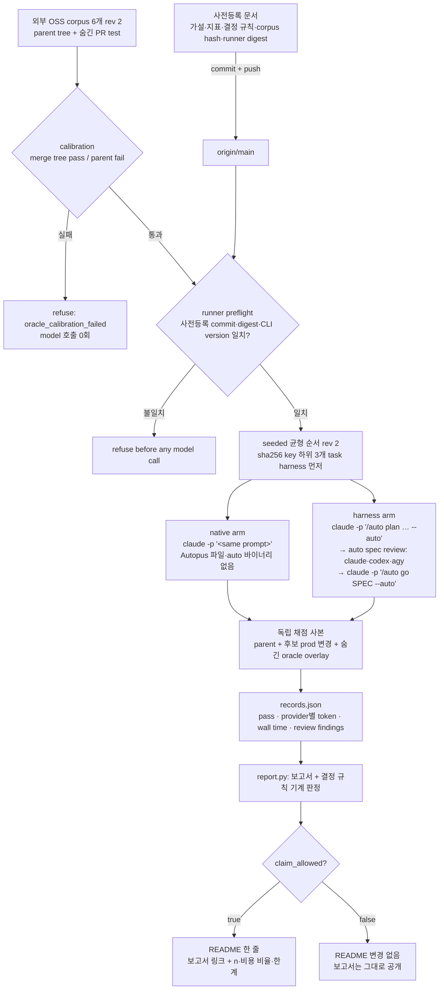

# PRD: Claude Code 전체 harness 경로 vs native 단일 세션 — 중간 규모 기능 pilot benchmark

> Product Requirements Document — Minimal mode (`templates/shared/prd-minimal.md.tmpl`). planner의 Outcome Lock, Visual Brief, Feature Coverage Map, Completion Debt, Evolution Ideas, Sibling SPEC Decision을 덧붙였다.

- **SPEC-ID**: SPEC-HARNESS-BENCH-002 (Primary, sibling 없음)
- **Source**: `/auto plan` 요청 + Plan Intent Ledger(main session 인라인 전달), 2026-11-04 코드 조사
- **Target module**: autopus-adk
- **Author**: Autopus planning workflow (planner)
- **Status**: Draft (rev 2, 2026-11-04 사용자 결정 반영)
- **Date**: 2026-11-04
- **Predecessors**: SPEC-HARNESS-BENCH-001(implemented, Codex 단일 agent 노출 pilot), SPEC-HARNEVAL-001(implemented, golden live lane과 격리 grader)
- **Proposed change class**: `feature`. 다만 runner가 세 provider(Claude, Codex, agy)의 credential을 가진 process를 sandbox로 감싸 실행하고, agent에게 permission 우회 모드를 준다. 그래서 `risk_tier: high`와 Risk-First Integration Probe가 나올 가능성이 높다. 최종 class는 이 PRD가 아니라 `auto spec gates` receipt(`gate-applicability.json`)가 정한다.

**Overview.** 2026-09-20 pilot은 작은 회귀 수리에서 harness의 품질 이득을 보이지 못했다(native 12/12, harness는 token 8.9%~15.3% 더 씀). 이 pilot은 harness가 원래 겨냥하는 영역을 잰다. 중간 규모 기능 작업에서 전체 경로(`/auto plan --auto` → `auto spec review`(claude, codex, agy) → `/auto go --auto`)와 native Claude Code 단일 세션을 같은 모델·마감·격리 조건으로 비교한다. 가설, 지표, corpus hash, README 주장 결정 규칙은 첫 trial 전에 commit·push로 동결한다. 결과 보고서는 결과와 무관하게 그대로 공개한다.

## Revision 2 — 사용자 결정 (2026-11-04)

사용자는 "알려진 편향은 공개가 아니라 제거한다"를 원칙으로 정했다. 아래 결정이 이 PRD의 rev 1 내용과 충돌하면 아래가 우선한다. 정본 요구사항은 `spec.md`의 REQ-HB2-01~20이다.

1. **corpus**: ADK reverse-PR을 버린다.
   - Autopus와 무관한 외부 OSS(Tier 1 Go, 부족하면 Tier 2 Python)에서 model 지식 cutoff 2026-06-30 뒤 merge된 PR을 쓴다. (rev 3: 이 날짜는 하한이다. 실제 기준은 `spec.md` REQ-HB2-03의 단일 window 시작 규칙이다.)
   - 기계적 선택 규칙으로 merge 순 앞 6개를 고른다.
   - harness arm은 snapshot에 pinned `auto init`을 실행한다.
   - license를 기록하고 외부 코드는 commit하지 않는다(REQ-HB2-03, 04, 05, 18).
2. **token**: 어떤 provider도 `null`을 허용하지 않는다.
   - 모든 provider를 machine-readable usage 출력으로 실행하고 sandbox 밖 runner·broker로 잡는다(rev 5, `spec.md` REQ-HB2-25). parse 불가 call은 infra failure로 claim을 막는다.
   - 사전등록 전에 세 provider의 usage probe를 한다. agy JSON에 usage가 없으면 blocker다(REQ-HB2-10, 19).
3. **prompt**: PR 제목·본문(또는 linked issue)에서 동결 template과 strip 규칙으로만 도출한다(REQ-HB2-16).
4. **순서**: seeded 균형 randomisation, interleave, 같은 machine, 직렬, version 기록(REQ-HB2-07).
5. **설정**: 두 arm 모두 trial별 격리 config home을 쓴다. user-level 설정, memory, MCP, plugin은 없다(REQ-HB2-17).
6. **blind 채점**: arm mapping은 모든 grade 기록 뒤에 공개한다(REQ-HB2-09).
7. **처치**: 추가 provider와 agent는 측정 대상인 처치다. 남는 편향은 보고서에 명시한다(REQ-HB2-20, `research.md` Bias Ledger).

---

## Quick Discovery Check

- **Problem**: harness의 비싼 경로(SPEC pipeline + 다중 provider 리뷰)가 중간 규모 기능에서 token·시간 비용만큼 품질을 사는지에 대한 증거가 없다. README는 지금 "illustrative, not a benchmark"라고만 말한다(`README.md:110`).
- **Who**: 1차 사용자는 ADK maintainer(투자·기본값 결정, README 주장 여부 판단). 2차 사용자는 README를 읽고 harness 채택을 판단하는 잠재 사용자.
- **Success metric**: 동결된 사전등록 commit이 origin/main에 올라간 뒤 6 task × 2 arm = 12 run이 사람 개입 0회로 전부 기록된다. 보고서는 12 run 전부(실패 포함)의 hidden-test 통과, provider별 token, wall time, 리뷰 finding을 담는다. README 문구는 기계적으로 계산된 결정 규칙 결과가 `claim_allowed: true`일 때만 존재한다.
- **Not doing**: 통계적 유의성 주장, Claude Code 외 플랫폼 arm, harness 제품 코드(`pkg/`, `internal/`, `content/`, `templates/`) 변경.

Plan Intent Ledger 행을 근거로 재사용했다. 이미 답한 항목은 다시 묻지 않았다.

| Ledger field | Status | Confidence | PRD handoff |
|---|---|---|---|
| goal | answered (user) | high | Outcome Lock |
| scope_boundary | answered (user) | high | §4 Out of Scope (6×1 pilot, 유의성 주장 없음, Claude Code만) |
| constraints | assumed (main session) | medium | REQ-HB2-07, §5 Pre-mortem, Key Q&A Q1. 틀리면 arm 비교가 성립하지 않는다 |
| done_evidence | answered (user+main) | high | Outcome Lock completion evidence, REQ-HB2-13/14 |
| brownfield_impact | assumed (main session) | medium | REQ-HB2-03/04, Key Q&A Q2/Q3. 틀리면 fixture repo가 필요하다 |

Question Audit: `question_transport=AskUserQuestion`(main session), `question_count=1`(규모 → 6×1 pilot), `unresolved_fields=[constraints.model choice, brownfield_impact.corpus source]`. 두 항목은 Key Q&A에 `assumed`로 남긴다. Outcome Lock을 막지 않으므로 추가 질문은 하지 않는다.

---

## Outcome Lock

**Final outcome.** maintainer가 `scripts/benchmarks/harness/`의 확장 runner로 사전등록된 12-run pilot을 실행한다. 그 결과로 `docs/benchmarks/`에 raw-free 보고서(Markdown + JSON)가 commit된다. 보고서는 두 arm의 hidden-test 통과율, provider별(claude, codex, agy) uncached/cached/output token, wall time, 리뷰가 잡은 defect를 task 단위로 보여 준다. 사전등록 결정 규칙의 판정도 함께 싣는다. README 홍보 문구는 그 판정이 `claim_allowed: true`일 때만 들어간다. 문구는 보고서를 링크하고 한계를 밝힌다.

**Mandatory requirements.** REQ-HB2-01 ~ REQ-HB2-15 (모두 P0, §2).

**Explicit non-goals.** §4 Out of Scope와 같다.

**Completion evidence.**
1. **Offline test suite.** `python3 -m unittest discover -s scripts/benchmarks/harness -p 'test_*.py'`가 model 호출 없이 통과한다. 다음을 fixture로 덮는다.
   - 사전등록 거부 경로 전부
   - Claude stream-json·JSON, codex JSON, agy JSON의 usage 파싱. `null`은 없고 parse 불가는 `usage_unparsed`다(rev 2).
   - 채점 overlay
   - 결정 규칙 평가기
   - README 주장 가드
   - 기존 pilot·golden 모드 회귀
2. **Calibration evidence.** 6개 외부 task 모두 grader sandbox 아래에서 검증된다. merge tree에서는 oracle이 2회 연속 통과하고, parent tree에서는 실패한다. 이는 model 호출 전에 기록된다. 사전등록 전 RFP-1 usage probe receipt도 필요하다(rev 2).
3. **사전등록 commit.** 첫 trial 시작 전에 origin/main에서 도달 가능하다. 세션 `protocol.json`이 그 SHA와 digest를 기록한다.
4. **12 run session.** 재시도 없이 전부 기록된다(OPS: maintainer가 실행하고 model quota를 쓴다).
5. **보고서.** `docs/benchmarks/harness-feature-<date>.md`와 `.json`이 결과와 무관하게 commit된다.
6. **README.** `claim_allowed`가 false이면 README 홍보 문구 diff가 0이다. true이면 규칙을 따르는 한 줄이 있고, 가드 테스트가 통과한다.

---

## Visual Brief

UX wireframe gate: 해당 없음. 화면이나 IA가 없는 CLI·script·문서 작업이다(`wireframe intent: n/a`).



```text
command-flow sketch (최종 CLI 문구 아님)
$ python3 scripts/benchmarks/harness/run.py --mode feature --prereg <path> --output /abs/new/session
preflight: prereg commit 3f2a… reachable from origin/main   ok
preflight: claude 2.1.x / codex 0.16x / agy 1.4.x / auto v0.50.x   match
calibration: f01..f06 merge=pass parent=fail                 ok
[01/12] f01 harness  plan 41m  review(claude,codex,agy) 2 rounds  go 52m  hidden=pass
[02/12] f01 native   38m  hidden=fail(3/9 tests)
...
BENCHMARK_COMPLETE  decision: claim_allowed=false (rule R1 not met: +1 < +2)
```

이 sketch는 흐름 설명용이다. 문구와 배치는 REQ-HB2-02, 13, 14가 묶는 범위에서만 요구사항이 된다.

---

## Feature Coverage Map

| Capability | Happy path | Error / recovery | Integration boundary | Verification | Docs / ops |
|---|---|---|---|---|---|
| 사전등록 동결 | REQ-01 | REQ-02 거부 코드 | git(origin/main 도달성), runner digest | 거부 경로 fixture | 사전등록 문서 자체 |
| 외부 OSS corpus (rev 2) | REQ-03 | REQ-04 calibration 거부 | `workspace.snapshot`의 harness 제거, `prepare_grader.py` | calibration 기록 | 선택·제외 사유 목록 |
| harness arm 구동 | REQ-05 | deadline·비정상 종료는 fail로 기록 | `claude -p`, pinned `auto`, `auto spec review` 하위 process | 구동 argv fixture, Risk-First probe | 재현 명령(README of runner) |
| native arm 구동 | REQ-06 | surface audit 실패 시 거부 | Claude Code 설정 소스 | surface audit fixture | — |
| arm 동등성 | REQ-07 | 불일치 시 거부 | CLI version, model, effort | protocol 비교 test | 보고서 "통제 조건" 절 |
| 격리 | REQ-08 | 위반 시 trial fail | Seatbelt profile, 네트워크 허용 범위 | 격리 probe (oracle·원본 읽기 거부) | 한계 절 |
| 채점 | REQ-09 | build fail·timeout·scope 위반은 fail | `grader.py`/`grader.sb` 재사용 | overlay fixture, calibration | — |
| token 측정 | REQ-10 | rev 2: `null` 금지, parse 불가는 infra failure | Claude stream-json, codex JSON, agy | 파서 fixture, usage probe | 지표 정의 |
| wall time | REQ-11 | timeout 포함 | runner monotonic clock | record fixture | — |
| 리뷰 defect | REQ-12 | 원천이 없으면 `unknown` | `review-findings.json`, review receipt, pipeline review 산출물 | 추출 fixture | reported vs verified 구분 |
| 보고서·판정 | REQ-13 | 미완료 run도 포함 | `report.py` 확장 | 결정 규칙 평가기 table test | `docs/benchmarks/` |
| README 가드 | REQ-14 | 규칙 미충족이면 문구 금지 | README ↔ 보고서 JSON | 가드 test | README 한 줄 |
| 기존 모드 보존 | REQ-15 | — | `run.py --mode pilot/golden` | 기존 test 전부 | — |

---

## 1. Problem

harness의 핵심 가치 주장(SPEC 기반 pipeline과 다중 provider 리뷰가 품질을 높인다)은 아직 측정된 적이 없다. 지금 있는 증거는 반대 방향만 가리킨다.

| 근거 | 내용 | 출처 |
|---|---|---|
| 2026-09-20 pilot | Codex 단일 agent, 작은 회귀 수리 12개. native 12/12 accepted, 가장 빠름. compact는 token +8.9%, full은 +15.3%. 품질 이득 없음. oracle 전원 통과로 ceiling effect | `docs/benchmarks/harness-2026-09-20.md` |
| 그 pilot의 한계 | "new-feature delivery test or multiagent evaluation"이 아니다. 다음 평가로 "harder held-out tasks with actual integration acceptance"를 권고 | 같은 문서 Limits 절 |
| assessment | "Next investment: demonstrate net value". 같은 시작 repo·model·effort·도구·권한·acceptance test, AB/BA 순서, 실패 시도 보존, 누락 usage는 unknown | `docs/harness-assessment.md:66-92` |
| README | pipeline 출력 예시가 "illustrative, not a benchmark"라고만 한다 | `README.md:110` |
| 기존 runner | Codex 전용(`codex exec`, `observe.py`의 codex JSONL 파서). 단일 agent 노출 ablation이라 `/auto plan`·`/auto go`·`auto spec review` 경로를 구동하지 못한다 | `scripts/benchmarks/harness/run.py`, `observe.py` |
| 리뷰 provider usage | orchestra는 codex(`turn.completed`)와 claude(`result`) usage만 파싱한다. agy는 `supported=false`라 unknown이다. spec review ledger는 call별 input/output만 있고 cached 분리가 없다 | `pkg/orchestra/usage.go:39-60`, `pkg/orchestra/usage_parse.go`, `internal/cli/spec_review_ledger.go:38-45` |

지금 필요한 이유: 비싼 경로를 계속 기본 권장으로 둘지, README에서 품질을 주장할지는 증거 없이 결정되고 있다. 사전등록 없이 실행부터 하면 결과를 본 뒤 지표나 task를 고르는 편향을 배제할 수 없다.

---

## 2. Requirements (P0)

모든 요구사항은 Must다. ID는 `REQ-HB2-NN`이다.

### 사전등록

- **REQ-HB2-01** (Ubiquitous) THE SYSTEM SHALL keep one committed pre-registration document for this pilot that contains:
  - 가설 H1~H4와 기대 방향
  - 지표 정의(§3 Metric definitions)
  - 결정 규칙 원문
  - corpus manifest: task별 PR 번호, merge SHA, parent SHA, prompt SHA-256, oracle 파일별 SHA-256, `expected_tests`
  - 선택 규칙과 제외 후보·사유
  - arm 설정: Claude Code·codex·agy·`auto` version, model, effort, deadline, permission mode, harness surface digest, review provider 설정
  - schedule
  - `runner_sha256`(이 runner 파일 집합의 tree digest)
- **REQ-HB2-02** (Unwanted) IF any of the following holds, THEN THE SYSTEM SHALL refuse the session before any model call, print one JSON refusal with a reason code, and exit 1:
  - 사전등록 문서가 없거나 working tree에서 수정됐다.
  - 그 문서를 담은 commit이 `origin/main`에서 도달 가능하지 않다.
  - 문서 digest, corpus hash, `runner_sha256`, 설치된 CLI version 중 하나가 runner가 계산한 값과 다르다.
  - 출력 디렉터리에 `protocol.json`이 이미 있다.

  reason code 후보: `prereg_missing`, `prereg_dirty`, `prereg_unpublished`, `prereg_digest_mismatch`, `cli_version_mismatch`, `protocol_exists`. 세션 `protocol.json`은 사전등록 commit SHA를 기록한다.

### Corpus

- **REQ-HB2-03** (rev 2, Ubiquitous) THE SYSTEM SHALL select the 6 tasks mechanically from external open-source repositories unrelated to Autopus, from pull requests whose creation, commits, and merge all fall after the frozen window start (rev 3: the latest published training cutoff of every model used in either arm, or that model's release date when unpublished), by the frozen filter and merge-order rule of `spec.md` REQ-HB2-03. agent workspace는 PR parent tree이고 oracle은 PR의 test 변경이다. prompt는 REQ-HB2-16이 기계적으로 도출한다.
- **REQ-HB2-04** (rev 2, Unwanted) IF a task's oracle is not accepted twice on the merge tree or is accepted on the parent tree, THEN THE SYSTEM SHALL exclude it during selection and refuse a frozen session with `oracle_calibration_failed`.

### Arm 구동

- **REQ-HB2-05** (Event-driven) WHEN a harness-arm trial runs, THE SYSTEM SHALL do all of the following with zero human input:
  - rev 2: 모든 task에 같은 pinned `auto`로 `auto init`을 workspace에 실행하고, 동결 overlay(JSON 출력 review provider: claude, codex `gpt-6-astra`, agy `gemini-4-argon-high`)를 적용한다.
  - pinned `auto` 바이너리를 PATH에 둔다.
  - `claude -p "/auto plan <prompt> --auto"`를 실행한 뒤 생성된 SPEC-ID로 `claude -p "/auto go <SPEC-ID> --auto"`를 실행한다.
  - harness가 스스로 고른 경로를 기록한다: change class, lean/full profile, `auto spec review` 실행 횟수·round·verdict, go 진입 여부.
- **REQ-HB2-06** (Event-driven) WHEN a native-arm trial runs, THE SYSTEM SHALL run one `claude -p "<prompt>"` session in a workspace with zero Autopus surfaces and no `auto` binary on PATH, and SHALL refuse the trial with `native_surface_present` if a pre-trial audit finds any Autopus-generated file, skill, agent, hook, or rule visible to that session.
- **REQ-HB2-07** (Ubiquitous) THE SYSTEM SHALL use identical values across both arms for: top-level `claude` model, effort, Claude Code version, permission mode, denied tools (at least `WebFetch` and `WebSearch`), user-level setting sources, MCP config, sandbox profile, and per-run wall-clock deadline.
  - rev 2: 순서는 seeded 균형 randomisation이다(key `sha256(corpus_sha256:task_id)` 하위 3개 task가 harness 먼저). 같은 machine에서 실행하고 run마다 version을 기록한다. 두 arm 모두 trial별 격리 config home을 쓴다(REQ-HB2-17).
  - 실행은 직렬이다. 결과에 따른 재시도는 없다.
  - 예정된 run은 결과와 무관하게 모두 기록한다.
  - harness 내부 선택(subagent model·effort, review provider model)은 처치(treatment)의 일부다. 동등화하지 않고 그대로 기록한다.

### 격리

- **REQ-HB2-08** (Ubiquitous) THE SYSTEM SHALL run every agent process tree, including `auto spec review` provider subprocesses, under a sandbox profile that does the following:
  - 쓰기는 그 trial 디렉터리 안으로만 허용한다.
  - 다음 읽기를 거부한다: oracle 저장소, 원본 repo checkout, 다른 trial, runner 출력·records.
  - 환경에서 `GH_TOKEN`·`GITHUB_TOKEN` 류 credential을 제거한다.

  rev 3: 읽기는 default-deny이고 보호 경로 거부가 관찰되면 그 trial은 통제 위반으로 claim을 막는다(`spec.md` REQ-HB2-08, REQ-HB2-23). 네트워크는 provider host allowlist proxy로만 허용하고, provider 쪽 검색 tool은 두 arm에서 끈다(REQ-HB2-21).

### 채점

- **REQ-HB2-09** (Event-driven) WHEN a trial ends by exit or deadline, THE SYSTEM SHALL grade an independent copy with the existing isolated grader (`grader.py`, `grader.sb`).
  - **채점 사본 구성**: parent tree에 후보의 production 변경을 얹고 oracle을 overlay한다. 후보 변경에서 test 파일, harness 산출물(`.autopus/`, `.claude/` 등), oracle 경로는 뺀다.
  - **pass 조건**(모두 충족):
    - `expected_tests` 전부의 top-level pass
    - PR이 건드린 package의 기존 test 통과
    - scope 위반 없음
    - deadline 안에 정상 종료
  - 그 밖의 결과는 모두 fail이다. 채점은 agent 단계가 실패해도 실행한다.

### 측정

- **REQ-HB2-10** (Ubiquitous) THE SYSTEM SHALL record tokens per provider (`claude`, `codex`, `agy`) and per run phase as four fields: uncached input, cache-read input, cache-write input, and output.
  - 값은 provider가 내보낸 machine-readable receipt에서만 가져온다.
  - Claude Code: `--output-format stream-json` 결과. subagent 포함.
  - codex: `exec --json`의 `turn.completed`.
  - agy: `--output-format json`(rev 2). usage가 없으면 benchmark blocker다.
  - rev 2: `null`은 금지다. provider에 없는 field만 동결 schema의 `not_applicable`이다. parse 불가 call이 있는 run은 `usage_unparsed` infra failure다. cached와 reasoning 값은 상위 합계의 부분집합이며 두 번 더하지 않는다.
- **REQ-HB2-11** (Ubiquitous) THE SYSTEM SHALL record per-run wall time as the monotonic interval from the first agent process start to the last agent process exit, including timeouts and spec review, excluding setup, calibration, and grading, and SHALL record per-phase intervals (plan, review, go) where the boundaries are observable.
- **REQ-HB2-12** (Ubiquitous) THE SYSTEM SHALL record, for the harness arm, review-reported findings by severity and final status, extracted from harness artifacts (spec review findings and pipeline review verdicts), and label them `reported`.
  - `verified`는 oracle 증거가 있을 때만 쓴다. 증거가 없으면 `unknown`이다.
  - native arm의 리뷰 지표는 `n/a`이며 0으로 기록하지 않는다.
  - 두 arm 모두 escaped defect(최종 tree에서 실패한 hidden test 수)를 기록한다.

### 보고서와 주장

- **REQ-HB2-13** (Event-driven) WHEN all scheduled runs have ended, THE SYSTEM SHALL generate the report Markdown and JSON from records by code only and write them to `docs/benchmarks/`.
  - 포함 항목:
    - 12 run 전부. operational error와 timeout도 포함한다.
    - task별 표
    - provider별 token 표
    - 통제 조건과 한계 절
    - 결정 규칙의 기계적 판정 `decision{rule_id, inputs, claim_allowed, reasons}`
  - prompt, transcript, diff, home 경로, credential은 담지 않는다.
  - 판정을 사람이 수정할 수 없도록 JSON의 digest를 Markdown에 기록한다.
- **REQ-HB2-14** (Unwanted) IF the README contains a benchmark claim line for this pilot while the referenced report JSON has `claim_allowed` other than `true`, or the line lacks the report link, the sample size, the cost ratio, or the limits statement, THEN THE SYSTEM SHALL fail the offline guard test.
  - `claim_allowed`가 false인 동안 README 홍보 문구 diff는 0이다.
- **REQ-HB2-15** (Ubiquitous) THE SYSTEM SHALL keep the existing behavior and tests of `run.py --mode pilot` (default) and `run.py --mode golden` unchanged.

---

## 3. Technical Notes

### Constraints

- runner는 Python 표준 라이브러리만 쓴다(기존 runner와 같다). 제품 코드(`pkg/`, `internal/`, `content/`, `templates/`)는 바꾸지 않는다. 바꾸면 측정 대상인 harness 자체가 바뀐다.
- 새 진입점은 `run.py --mode feature`(가칭)이다. dispatch 패턴은 `--mode golden`과 같다. 파일은 기존 runner 패턴처럼 `feature_*.py`로 나눈다. `architecture.max_file_lines`가 설정돼 있으면 따른다.
- 재사용 대상:
  - `workspace.snapshot`(harness 제거 + history 제거)
  - `grader.py`·`grader.sb`·`prepare_grader.py`(module cache 준비, sandboxed `go test -json`, calibration)
  - `process_tree.py`(잔여 process 0 확인)
  - `observe.py`의 codex 파서 의미론
  - `report.py`·`export.py`의 nullable 합산 규칙
- usage 필드 의미론은 `pkg/telemetry`의 `NormalizeUsage`와 맞춘다. Claude는 `input_tokens`가 uncached이고 cache read/creation이 따로 온다. codex는 `input_tokens`가 cached를 포함한다.
- `--auto` 실행 중 harness가 질문하거나 멈추면 그것은 harness의 결과다. 사람이 답하지 않는다.

### Metric definitions (사전등록 초안. plan 단계에서 수치를 확정하고 동결한다)

| 지표 | 정의 | 비교 가능성 |
|---|---|---|
| primary: `delivered_pass` | REQ-HB2-09의 pass. task 단위 이진값 | 두 arm |
| hidden-test 통과 비율 | 통과한 `expected_tests` 수 / 전체. 기술 통계용 | 두 arm |
| token | provider × {uncached, cache-read, cache-write, output}. run 합계와 phase별 값. rev 2: `null` 금지, parse 불가는 infra failure | 두 arm. 리뷰 provider는 harness arm만 해당 |
| wall time | REQ-HB2-11 | 두 arm |
| review findings | REQ-HB2-12의 `reported`(severity·status별)와 `verified`(oracle 근거가 있을 때만) | harness arm만. native는 `n/a` |
| escaped defects | 최종 tree에서 실패한 hidden test 수 | 두 arm |

가설(방향 사전등록):

- **H1**: harness의 `delivered_pass` 수 > native.
- **H2**: harness의 전체 provider known token > native. 비율을 보고한다.
- **H3**: harness의 wall time > native.
- **H4**: 기술 통계로, harness review finding을 severity·status별로 보고한다(rev 7: finding과 hidden test를 잇는 기계 규칙이 없어 대응 비율은 재지 않는다, `spec.md` REQ-HB2-12).

### 결정 규칙 초안 (R1)

README 주장은 아래 네 조건을 모두 만족할 때만 허용된다(`claim_allowed: true`).

1. 12 run 모두 primary 결과가 판정됐다. infra failure(provider 429·인증·장애, version·machine 변경, rev 2의 `usage_unparsed`)가 있는 run이 0개다.
2. harness `delivered_pass` 수 ≥ native + 2.
3. native는 pass하고 harness는 fail한 task가 0개다.
4. 문구에 다음을 모두 포함한다:
   - n=6, 1 run/arm
   - cutoff 뒤 merge된 외부 OSS Go corpus라는 점(rev 2)
   - 통계적 유의성이 없다는 점
   - 전체 token 비율과 wall time 비율
   - 보고서 링크

비용 절감 주장과 백분율 일반화 주장은 결과와 무관하게 금지한다. 근거: 2개 차이에 역전 0이면 discordant 쌍이 모두 harness 쪽인 최소 기술적 차이다. 이 경우에도 단측 sign test p=0.25라 약한 증거다. 그래서 문구는 "pilot에서 관찰됨"으로 제한한다. 임계값은 plan 단계에서 조정할 수 있다. 다만 사전등록 commit 뒤에는 바꿀 수 없다.

### Dependencies

- Claude Code 2.1.314, codex-cli 0.163.0, agy 1.4.12(2026-11-04 로컬 관찰값). 실제 pin은 사전등록 시점 값이다.
- macOS Seatbelt(`sandbox-exec`). 기존 grader와 pilot profile이 macOS 전용이다.
- pinned `auto` 바이너리. 현재 revision 빌드이며, harness surface 생성과 `auto spec review`에 쓴다.
- maintainer의 Claude·Codex·agy 로그인 상태와 quota.

### Risk-First Integration Probe 후보 (plan에서 executable 행으로 확정)

- **RFP-1 usage 관측성.** 아주 작은 fixture에서 다음을 확인한다. 소량의 model 호출이 들고, 본 실험 전에 수행한다.
  - (a) `claude -p --output-format stream-json --verbose`의 `result`(`usage`, `modelUsage`)가 Task subagent token을 포함하는지
  - (b) `auto spec review`가 띄우는 claude·codex·agy 하위 process의 stdout을 sandbox 밖 provider broker(rev 5, `spec.md` REQ-HB2-25)가 손실 없이 받는지
  - (c) agy가 token 수를 노출하는 출력 모드를 갖는지

  rev 2: agy가 JSON 출력에 usage를 노출하지 않으면 benchmark는 blocker로 멈춘다(`agy_usage_unavailable`). broker 경유가 provider 동작(argv, exit code, stdin)을 바꾸지 않는다는 것도 함께 확인한다.
- **RFP-2 arm 격리.** Seatbelt로 감싼 `claude -p`가 다음을 만족하는지 확인한다.
  - API에는 접근한다.
  - oracle 저장소, 원본 checkout, 다른 trial은 읽지 못한다.
  - 그 아래에서 `auto spec review`의 codex·agy 하위 process가 정상 동작한다.
  - native arm에서 user-level `~/.claude`의 CLAUDE.md, skills, plugins, MCP가 보이지 않는다. `--setting-sources`와 `--strict-mcp-config`로 차단되는지는 아직 검증하지 않았다. `--bare`는 프로젝트 CLAUDE.md와 hook도 끄므로 harness arm에는 쓸 수 없다.
- **RFP-3 oracle 적합성.** (rev 2: 외부 Tier 1 corpus에서 적격 6개 이상과 offline calibration을 확인한다. unexported 참조는 수를 세지 않고 제외한다) model 호출 없이 정적으로 확인한다. 후보 PR test가 참조하는 unexported 식별자 수를 센다. Go 내부 test는 같은 package의 unexported 함수를 부르는 일이 많다. prompt 계약으로 노출하기 어려운 식별자에 의존하는 PR은 선택 단계에서 제외하고, 사유를 사전등록에 남긴다.

### Impact on existing code

- 수정: `scripts/benchmarks/harness/run.py`(mode dispatch 한 줄 수준), `report.py`(필요 시 확장. pilot 출력은 불변), `README.md`(runner 문서 절 추가).
- 신규: `scripts/benchmarks/harness/feature_*.py`, 대응 `test_feature_*.py`, 사전등록 문서, Seatbelt profile(agent용), `docs/benchmarks/harness-feature-<date>.{md,json}`.
- 조건부 수정: repo root `README.md` 한 줄(REQ-HB2-14가 허용할 때만).
- 영향 없음: `pkg/**`, `internal/**`, `content/**`, `templates/**`, `evals/harness/**`.
- 참고: SPEC-HARNEVAL-001의 CI 적용 판단(REQ-HE-05)은 `scripts/benchmarks/harness/**`를 harness 입력 집합에 넣는다. 따라서 이 SPEC의 PR은 `harness-eval` check를 실제로 실행한다. 충돌은 아니고 예상된 동작이다.

---

## 4. Out of Scope

- 통계적 유의성 주장, 반복 측정(K>1), 6개를 넘는 corpus. pilot 규모는 사용자 결정이다.
- Claude Code 외 플랫폼 arm(Codex, OpenCode, OMP, agy를 주 agent로 쓰는 경우)과 경쟁 harness arm.
- harness 구성 요소별 ablation(lean vs full, 리뷰 없는 pipeline, native + spec review만 등).
- harness 제품 코드 변경. agy usage 파서 추가와 spec review ledger의 cached 분리 기록도 포함한다. 측정은 runner 계층에서 하고, 제품 개선은 Evolution Ideas에 둔다.
- USD 비용 추정. provider가 보고한 `cost_usd`가 있으면 그대로 옮기되 합산하거나 추정하지 않는다.
- `/auto sync`와 문서 생성 단계의 품질 평가.
- 사람의 리뷰·수정 부담 측정. 사람 개입은 설계상 0이다.
- CI에서 이 benchmark 실행. maintainer host에서 수동 실행한다.

---

## 5. Pre-mortem (Quick)

| Risk | Mitigation |
|---|---|
| ceiling effect: 두 arm 모두 6/6 또는 같은 점수라 아무것도 알 수 없다(2026-09-20 pilot에서 실제로 일어남) | 선택 규칙에서 medium 기준(prod Go 파일 3~12개, test 1개 이상, integration 성격)을 강제한다. 결과를 보고 난이도를 고르는 행위는 금지한다. 동점도 사전등록된 결과로 그대로 공개한다 |
| hidden test가 기능이 아니라 이름·signature 불일치로 실패한다 | rev 2: prompt에 `feature_goapi`가 기계적으로 뽑은 공개 API 서명 절을 붙인다. RFP-3으로 unexported 의존 PR을 제외한다. calibration 결과를 기록한다 |
| 오염: model이 공개 repo의 해당 PR을 학습했거나 실행 중 조회한다 (rev 2: 외부 OSS의 cutoff 뒤 PR, egress allowlist proxy로 제거) | rev 3: window 시작은 두 arm이 쓰는 모든 model의 공개 training cutoff 최댓값(미공개는 출시일) 하나뿐이고, PR 생성·commit·linked issue 시각이 모두 그 뒤여야 한다(`spec.md` REQ-HB2-03). vendor 진술의 정확성은 RB-2로 남는다. egress는 provider host allowlist proxy로만 허용하고 검색·URL tool은 두 arm에서 끄며 transcript로 검사한다 |
| 사전 정보 유출: parent tree에 그 PR의 SPEC·문서가 이미 있다 | `workspace.snapshot`이 `.autopus/`를 통째로 뺀다. `docs/`의 해당 기능 언급은 선택 단계에서 검사하고 제외 사유로 남긴다 |
| usage 누락(agy, claude review text 모드, subagent 미집계)으로 token 비교가 불완전하다 (rev 2: JSON 출력 강제, `null` 금지, probe gate, agy 미노출 시 blocker) | RFP-1 probe gate를 사전등록 전에 통과해야 한다. parse 불가 call은 `usage_unparsed`로 claim을 막는다 |
| rate limit·provider 장애가 run 중간에 터진다 | 직렬 실행과 quota 사전 확인. infra error는 기록하고 재시도하지 않는다. 결정 규칙 조건 1에 따라 README 주장이 막힌다 |
| harness `--auto`가 lean 경로를 고르거나 review FAIL로 go를 거부해 "전체 경로"가 실행되지 않는다 | 강제하지 않는다. 그것이 제품 동작이다. 실제 경로를 REQ-HB2-05로 기록하고 보고서에 task별로 표시한다 |
| permission 우회 모드의 agent가 host credential을 읽거나 쓴다 | REQ-HB2-08 sandbox와 RFP-2. raw transcript는 commit하지 않는다 |

---

## 6. Key Q&A

**Q1:** 두 arm의 top-level model과 effort는 무엇인가? (ledger `constraints.model choice` 미해결)
**A1:** assumed. `claude-opus-5-5`, 같은 `--effort` 값으로 둔다. harness 내부는 `quality.default: ultra`(rev 7 정정: 7 agent는 `fable`, 나머지는 `opus`, `pkg/config/defaults.go:136-144`)와 review provider 설정을 쓴다. rev 7 D1로 review panel은 claude+codex다. 틀리면 arm 설정만 바뀌고 구조는 같다. 사전등록 전에 maintainer가 확정한다.

**Q2:** corpus는 무엇인가?
**A2:** rev 2 사용자 결정이다. Autopus와 무관한 외부 OSS(Tier 1 Go, 부족하면 Tier 2 Python)에서 2026-06-30 뒤 merge된 PR을 쓴다(rev 3: `spec.md` REQ-HB2-03 window 규칙으로 일반화). ADK reverse-PR은 harness surface와 pinned `auto`가 해답을 담을 수 있어 버렸다.

**Q3:** 6개 task는 어떻게 고르는가?
**A3:** rev 2 사용자 결정이다. 동결된 filter를 통과한 PR을 merge 순으로 세워 앞의 6개를 쓴다. 제외 사유는 모두 사전등록에 남긴다. prompt도 기계적으로 도출한다.

**Q4:** run당 deadline은 얼마인가?
**A4:** 제안: 두 arm 모두 180분이다. harness는 ultra preset에 provider당 최대 900s의 debate 리뷰(rev 7 D1: 2-provider, 최대 2 revision)가 있어 60~120분 안팎이 예상되지만 측정값은 아니다. 최악 직렬 총량은 36시간이다. plan 단계에서 확정하고 동결한다.

**Q5:** native arm에서 Claude Code 내장 subagent(Task tool)를 허용하는가?
**A5:** 제안: 허용한다. "native"는 사용자가 실제로 쓰는 기본 Claude Code이고, 금지하면 native를 인위적으로 약화한다. subagent token은 REQ-HB2-10으로 집계한다.

**Q6:** README 주장이 불허되면 README에 중립 링크(예: "benchmark reports")도 금지하는가?
**A6:** 제안: 이 SPEC에서는 README를 바꾸지 않는다. 보고서는 `docs/benchmarks/`에 있고 기존 assessment 문서에서 링크할 수 있다. 사용자 확인이 필요하다.

---

## Completion Debt

없음. 미루고 싶어질 수 있는 아래 항목은 모두 P0에 포함했고, 나중으로 내리지 않는다.

- 사전등록의 기계적 강제(REQ-HB2-02)
- usage 관측 gate와 `null` 금지(REQ-HB2-10, 19, rev 2)
- 격리(REQ-HB2-08)
- README 가드(REQ-HB2-14)
- 12 run 실행과 보고서 commit(완료 증거 4·5)

## Evolution Ideas (선택, follow-up SPEC 근거 아님)

- K≥3 반복과 corpus 확장으로 유의성을 검토한다.
- ablation arm을 추가한다: native + spec review만, lean vs full, `--team`/`--loop`.
- Codex·OMP를 주 agent로 하는 arm을 추가한다.
- 제품 측 개선: agy usage 파서, spec review ledger의 cached/uncached 분리, pipeline review finding의 machine-readable 산출물.
- checkpoint 채점: phase 경계 snapshot으로 리뷰가 실제로 막은 defect를 oracle로 검증한다.

## Sibling SPEC Decision

없음. 사용자 결과가 하나(pilot 보고서와 조건부 README 주장)이고 module이 하나(autopus-adk)다. migration, auth, billing, data 경계로 순서를 나눌 일도 없다. 예상 규모는 task 10개 안팎, 소스 파일 15개 안팎으로 25 task·40 파일 기준에 크게 못 미친다.

---

## PRD Quality Checklist (Minimal mode)

- [x] 5개 필수 절(Problem, Requirements, Technical Notes, Out of Scope, Key Q&A)이 모두 있고 비어 있지 않다. Pre-mortem도 있다.
- [x] 측정 가능한 성공 지표가 있다: 12/12 run 기록, 사람 개입 0, 사전등록 commit이 trial보다 먼저 origin/main에 있음, `claim_allowed`에 묶인 README diff.
- [x] P0 요구사항 15개가 EARS 형식(Ubiquitous, Event-driven, Unwanted)으로 있다.
- [x] Out of Scope 항목 8개가 있다.
- [x] 기존 SPEC과 충돌하지 않는다. SPEC-HARNESS-BENCH-001의 pilot 모드와 SPEC-HARNEVAL-001의 golden 모드는 REQ-HB2-15로 보존한다. SPEC-HARN-PIPE-001은 pipeline 엔진이라 무관하다. workspace 전체에 SPEC-HARNESS-BENCH-002 ID는 없다.
- [x] 용어가 codebase와 맞는다: `delivered_pass`, `expected_tests`, `protocol.json`, `runner_sha256`, `oracle_calibration_failed`, rev 2의 `null` 금지와 `not_applicable` 규칙.
