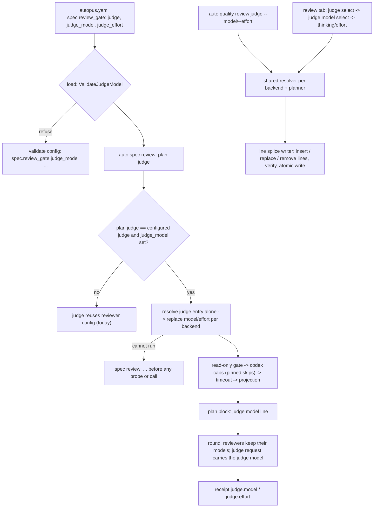

# SPEC-JUDGEMODEL-001 Implementation Plan

Status: draft

## Tasks

- T1: `pkg/config/schema_spec.go` fields `JudgeModel`/`JudgeEffort` (`omitempty`) after `Judge`; `[NEW] pkg/config/schema_review_judge_model.go` `ReviewGateConf.ValidateJudgeModel`; one call in `HarnessConfig.Validate`; `[NEW] schema_review_judge_model_test.go` for load, refusal, round trip, and a default config without the keys.
- T2: `[NEW] internal/cli/spec_review_judge_model.go` — `configuredSpecReviewJudgeModel` (the applies rule), `applySpecReviewJudgeModel` (OMP selector, `planReviewArgsEdit` for the claude, codex, and agy rows, codex pinned, family recompute, every refusal of REQ-JM-RUN-02), the effective judge model (an OMP base selector and its thinking level once) for the plan line and the receipt fields; hooks: `assembleSpecReviewJudge` resolves an overridden judge apart from the reviewers and applies the model before the gate, `specReviewProviderPlan.JudgeModel`, one call in `printSpecReviewPlan`, `specReviewRuntimeEvidence.JudgeModel` set in `runSpecReviewAttempt`, one call in `syncReviewedSpecStatusWithReceipt`.
- T3: `[NEW] internal/cli/quality_compose_review_judgemodel.go` — `reviewJudgeModel` in `reviewComposition`, baseline and raw values, attestation against the provider's lists, targets (set, insert, remove), change lines, the note, the after-table judge cell, the summary suffix, init's memory path and the live check candidate; the line removal in the splice and its verification.
- T4: `[NEW] internal/cli/quality_review_judge.go` — `--model`/`--effort` on `auto quality review judge`, `default`, clearing on a judge change, refusals; `quality_review_model.go` split so the model and judge paths share one resolver per backend; show text and JSON fields.
- T5: `[NEW] internal/cli/quality_compose_review_judge.go` — the `<judge> — judge model 고르기` option, the judge model select per backend, thinking and effort, the placeholder refusal; the reset when a judge provider switches to the OMP backend.
- T6: help texts, READMEs, CHANGELOG, the three skill sources; re-record the TUIUX goldens and log recapture section 96; harneval and content tests.
- T7: the test files listed under Generated And Changed Surfaces (new tests and the two changed regression tests); `go test ./pkg/config ./pkg/spec ./internal/cli`, golangci-lint on changed packages, the source-lines gate, `auto spec validate --strict`; scope check: every path of `git diff --name-only origin/main` is in Module ownership and none is under a generated root.

## Implementation Strategy

The judge model is a property of the configured judge, not a new provider: the runtime keeps one `orchestra.providers` entry per provider and edits a copy of the judge's entry with the very planner the review tab writes args with, so the judge argv differs from the reviewer argv only in the model and effort values. Applying it inside `assembleSpecReviewJudge` makes every reader of the judge config — the readiness preflight, the plan block, the loop, the receipt rows, and any fingerprint of the judge config — see the same judge. Validation splits in three: shape at load (pkg/config), backend fit at review time (no catalog read, no model call), and attestation against the provider's lists when the command or the tab writes it.

The tab and the command share one composition value. Clearing removes the lines, so a file returns to the key set older releases read.

## Visual Planning Brief



## Feature Completion Scope

This single Primary SPEC closes the Outcome Lock: T1 gives the keys, T2 the runtime with its refusals, plan line, and receipt, T3–T5 the command and the tab on one composition value and writer, T6 the documentation, and T7 the evidence. There is no sibling SPEC and no Completion Debt; a live check of the judge model and judge models for orchestra commands are Evolution Ideas.

## Risk-First Integration Probe

| assumption_id | class | risk | boundary | input | oracle | isolation | status | reason | evidence |
|---------------|-------|------|----------|-------|--------|-----------|--------|--------|----------|
| B1 | implementation_assumption | high | judge argv after the read-only projection | RL providers (claude CLI, codex CLI with `model_policy: quality`, agy) and an OMP provider; judge_model set per backend; `assembleSpecReviewJudge` and a recording backend over one review round | judge argv equals the reviewer argv with only the model and effort values replaced, the projection still last (`--tools=Read,Grep,Glob` last for claude); codex judge keeps the pinned values after the capability resolution; OMP judge `Config.Model` is the judge selector | temporary project, recording backend, no provider binary runs | PASS | the override runs before the gate, so the projection stays the final argv mutation and the Codex resolution skips a pinned entry | `TestSpecReviewJudgeModel_JudgeRequestCarriesItsModel`, `TestSpecReviewJudgeModel_AssemblyPerBackend` |
| B2 | implementation_assumption | high | removing a key line through the line splice writer | R3 file with `judge_model` and `judge_effort` lines, an inline comment on `judge`, and a comment line above `review_gate` | after `--model default` the file is byte-identical to the file before the keys were added; the comments stay | temporary project | PASS | the removal deletes exactly the key's single line after the same shape checks as a value splice, and `verifyReviewLineEdit` checks the result loads to the plan | `TestQualityReviewJudge_SetsAndClearsTheJudgeModel` |
| B3 | verified_fact | medium | strict loader and older releases | a file holding `judge_model` loaded by this branch and by the strict decoder without the field | this branch loads it; a decoder without the field rejects `judge_model` as an unknown key | in-process decode | PASS | the strict decoder rejects unknown keys, so REQ-JM-COMPAT-01 writes the keys only when a judge model is set and removes them on clear | `TestReviewGateJudgeModel_LoadsValidatesAndRoundTrips`, `TestReviewGateJudgeModel_UnknownToAStrictDecoderWithoutTheField` |

## Verification

```sh
go test ./pkg/config ./pkg/spec -count=1
go test ./internal/cli -count=1 -timeout 90m -p 2
golangci-lint run ./pkg/config/... ./internal/cli/...
go run ./cmd/source-lines --max 300 --ext .go <changed .go files>
go run ./cmd/auto spec validate --strict .autopus/specs/SPEC-JUDGEMODEL-001
```
