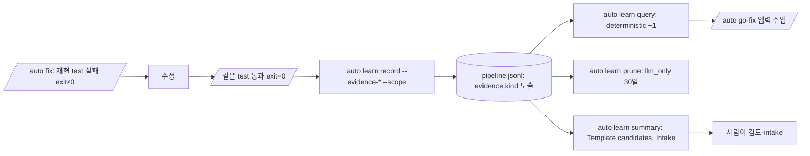

# SPEC-LEARN-003 구현 계획

## Tasks

기준은 `fix/learn-store-defects`(350ce05c)이고 branch는 `feat/learn-evidence-scope`다. 순서: T1 → (T2, T3, T4) → (T5, T6, T7) → T8 → T9. `pkg/learn/store.go`가 300줄에 가까워 새 판단은 `[NEW] pkg/learn/evidence.go`와 `[NEW] pkg/learn/summary_evidence.go`에 둔다.

- [x] T1: 근거·범위 기록. 소유: `pkg/learn/types.go`(`LearningEntry.Scope`·`Evidence`, `RecordOpts` 입력 넷), `[NEW] pkg/learn/evidence.go`(`Evidence`, `EvidenceKind`, `evidenceFromOpts`, `EffectiveScope`, `EvidenceKindOf`), `pkg/learn/store.go`(`newEntry`, `redactEntry`의 근거 명령 검사, `checkVerbatim`의 scope 검사), `pkg/learn/record.go`(`FieldEvidenceCommand` cap 512, `FieldScope`), `internal/cli/learn_record.go`(flag 넷, `Changed`로 exit code 입력 판정)
- [x] T2: 조회. 소유: `pkg/learn/query.go`(`evidenceBonus`, `evidenceScore`, scope 필터), `pkg/learn/types.go`(`RelevanceQuery.Scope`), `internal/cli/learn_query.go`(`--scope`, 잘못된 값 거부)
- [x] T3: 정리. 소유: `pkg/learn/prune.go`(`PrunePolicy`, `PruneResult`, `PrunePolicyExcept`; `PruneExcept`는 그 래퍼로 남는다), `internal/cli/learn_prune.go`(`--llm-only-days` 기본 30, 첫 줄 불변, 조건부 둘째 줄)
- [x] T4: 요약. 소유: `[NEW] pkg/learn/summary_evidence.go`(`addEvidenceSummary`), `pkg/learn/summary.go`(호출 한 줄), `pkg/learn/types.go`(`Summary` 필드 넷), `internal/cli/learn_summary.go`(조건부 줄 넷)
- [x] T5: Claude 템플릿. 소유: `templates/claude/commands/auto-workflows.md.tmpl`(fix Step 5 record에 근거·범위, sync Target 4.5에 후보·intake 제안)
- [x] T6: Codex 템플릿(Codex·OpenCode·OMP 공용). 소유: `templates/codex/skills/auto-go.md.tmpl`(Context Load의 learnings 줄을 query 출력 주입으로), `auto-fix.md.tmpl`(`## 학습 참조와 기록`), `auto-sync.md.tmpl`(`## 학습 요약과 정리`)
- [x] T7: Gemini 템플릿. 소유: `templates/gemini/skills/auto-go|auto-fix|auto-sync/SKILL.md.tmpl`(같은 세 절)
- [x] T8: test와 CHANGELOG. 소유: `[NEW] pkg/learn/evidence_test.go`, `[NEW] internal/cli/learn_evidence_test.go`, `CHANGELOG.md`
- [x] T9: 생성 결과 확인. 새 프로젝트를 `auto init --yes`로 만들고 다섯 플랫폼 표면에서 명령을 grep한다(S8). template·parity test(`./templates/...`, `./pkg/adapter/...`)가 통과한다

## Implementation Strategy

- 판단은 저장소가 한다. 템플릿은 명령과 관찰한 exit code를 넘기고, 종류 도출·검사·가림은 `pkg/learn`이 한다. 그래서 다섯 플랫폼이 같은 규칙을 쓴다.
- 기존 형식을 넓히기만 한다. 새 필드는 `omitempty`, 새 flag의 기본값은 기존 동작이다. 단, `--llm-only-days` 기본 30은 `llm_only` 항목에만 닿고 그런 항목은 이 SPEC 전에는 없다.
- 기존 출력 줄은 바꾸지 않는다. 새 줄은 값이 있을 때만 붙인다. 그래서 기존 출력 고정 test(intake S5, prune S7)가 그대로 통과한다.
- 새 의존성과 새 YAML key는 없다.

## Visual Planning Brief

UI 변경은 없다(`wireframe intent: not applicable`). 데이터 흐름:

## Feature Completion Scope

- 이 SPEC 하나가 Outcome Lock을 닫는다. T1–T4는 저장소와 CLI, T5–T7은 다섯 플랫폼 템플릿, T8–T9는 검증이다.
- 승인된 sibling 의존성은 없다. 선행 PR #214가 같은 branch 계보에 있다. 규모는 task 9개, 소스 파일 test 포함 약 20개다.

## Risk-First Integration Probe

| assumption_id | class | risk | boundary | input | oracle | isolation | status | reason | evidence |
|---------------|-------|------|----------|-------|--------|-----------|--------|--------|----------|
| A1 | verified_fact | medium | 저장소 decoder가 모르는 필드를 받아들이는가 | 새 필드가 든 JSONL 줄 | `store.Read`가 오류 없이 읽고 새 필드를 채운다 | temp dir | PASS | `pkg/learn/store.go:98`이 `json.Unmarshal`(엄격 모드 아님)이다 | `pkg/learn/evidence_test.go` |
| A2 | verified_fact | medium | intake fingerprint가 새 필드에 영향받는가 | 같은 pattern·files의 근거 유무 두 항목 | fingerprint 입력은 {v, type, pattern, files, packages}뿐 | 코드 읽기 | PASS | `pkg/harneval/intake/fingerprint.go:18-48` | Read |
| A3 | verified_fact | low | OpenCode·OMP가 Codex 템플릿을 쓰는가 | 생성 프로젝트 | `.agents/skills/auto-fix`, `.omp/skills/auto-fix`에 근거 flag가 있다 | scratch 프로젝트 | PASS | `pkg/adapter/opencode/opencode_specs.go` SkillPath, `pkg/adapter/omp/omp_skills.go` | S8 기록 |
