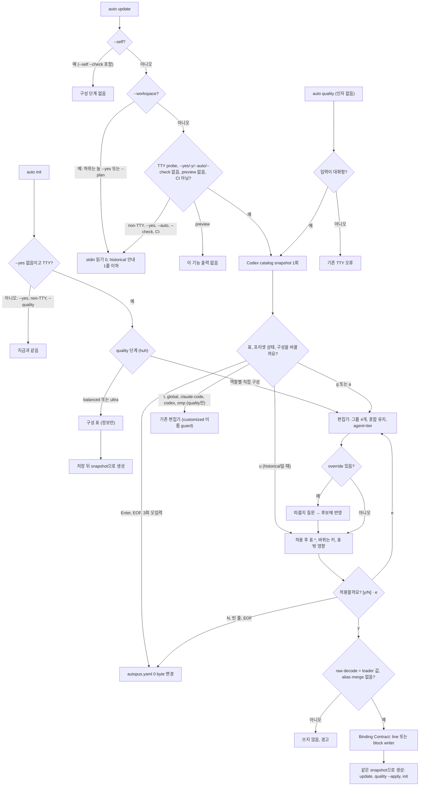

# SPEC-MODELUX-001 구현 계획

## Tasks

선행 조건은 없다. T1–T4는 서로 독립이다. T5–T9는 T1–T4 뒤에, T10–T12는 T9 뒤에 한다. 기존 파일에는 호출 몇 줄만 더한다(`update.go` 291줄, `quality.go` 278줄, `init.go` 253줄).

- [ ] T1: `[NEW] pkg/config/quality_preset_history.go`. registry 6행과 runtime standard 표시, `[NEW] ClassifyBuiltinQualityPreset`를 만든다. `isHistoricalBalancedDefault`는 runtime standard 행만 본다. 행별 고정 test, HB1·HB4에서 `NativeBalancedAgentCandidate` 결과 불변 test (REQ-MUX-10, REQ-MUX-11, REQ-MUX-12).
- [ ] T2: `[NEW] pkg/config/quality_effective.go`. `EffectiveAgentTier`, `ClaudeAgentProfile`, `ClaudeAgentEffort`. Claude adapter의 두 함수는 위임만 한다 (REQ-MUX-02, REQ-MUX-05).
- [ ] T3: `[NEW] pkg/adapter/codex/codex_resolve.go`의 `ResolveAgentProfile`, `ResolveSupervisorProfile`(render context가 이것을 부른다)와 `[NEW] internal/cli/quality_compose_snapshot.go`. 후자에는 `composeCodexCatalogProbe` 변수, `captureDriftGenerationSnapshot`·`driftAdapterFor` 재사용, `updateHarnessPlatformWith`, `generatePlatformFilesWith`, `applyQualityHarnessWith`가 들어간다. 기존 Codex template test는 그대로 통과해야 한다 (REQ-MUX-05, REQ-MUX-13, REQ-MUX-15, REQ-MUX-16, REQ-MUX-19).
- [ ] T4: `[NEW] internal/cli/quality_compose_sources.go`. `contentfs.FS` agent source에서 fallback tier와 `MapEffort(effort, "codex")`를 읽는다. `templates/codex/agents/*.toml.tmpl` literal 인자와의 drift test (REQ-MUX-02, REQ-MUX-05).
- [ ] T5: `[NEW] internal/cli/quality_compose_groups.go`. 그룹 4개, 구성 상태, 혼합 표시, 그룹 선택, 고급 편집(`parseQualityToolTierAssignment` 재사용), 커버리지 test (REQ-MUX-01, REQ-MUX-02, REQ-MUX-03, REQ-MUX-04).
- [ ] T6: `[NEW] internal/cli/quality_compose_table.go`. Table Cell Contract의 raw 값과 표기(Fallback 표시, OMP 요청 route, footer), override 머리말, `*` 비교, 제어 문자 escape, catalog fixture CAT-A–D로 golden (REQ-MUX-05, REQ-MUX-18, REQ-MUX-19).
- [ ] T7: `[NEW] internal/cli/quality_compose_bind.go`. Binding Contract, `u` 갱신 계획, 바뀌는 키와 표 밖 영향 목록(block 재작성 안내 포함), 분리 후보 config, 결정 표 test (REQ-MUX-06, REQ-MUX-07, REQ-MUX-09, REQ-MUX-11, REQ-MUX-12).
- [ ] T8: `[NEW] internal/cli/quality_config_block.go`. raw decode, 불일치·참조 거부(구성 단계의 line 쓰기에도), root key 경계 splice, `verifyQualityLineEdit`·`validateQualityYAML`, atomic을 만든다. F-001 fixture, 1열 주석 fixture, CRLF, 블록 없음, legacy schema strict decode test (REQ-MUX-08, REQ-MUX-09).
- [ ] T9: `[NEW] internal/cli/quality_compose_driver.go`, `quality_compose_text.go`. 공유 reader, 글자 키, 3회 오입력, EOF 유지, `[y/N] · e`, TTY·CI·catalog·wizard seam, ko/en 문구 (REQ-MUX-04, REQ-MUX-06, REQ-MUX-17, REQ-MUX-22).
- [ ] T10: `[NEW] internal/cli/update_compose.go`와 `update.go` 호출. 대화형 판정(`--check` 포함), supervisor migration 앞 위치, `cfg.Quality` 동기화, 생성 루프의 snapshot 전달, 비대화형 안내, 쓰기 거부 시 경고 후 계속 (REQ-MUX-13, REQ-MUX-14, REQ-MUX-19).
- [ ] T11: `tui/wizard_steps.go` 세 번째 option과 `[NEW] tui.QualityRoleGroups`. `[NEW] internal/cli/init_compose.go`, `[NEW] runInitWizard` seam, init TTY 판정의 공유 probe, snapshot 생성. `init.go`에는 3줄 이하만 더한다 (REQ-MUX-15).
- [ ] T12: `[NEW] internal/cli/quality_compose_entry.go`와 `quality.go` 호출. 구성 단계 우선, 기존 대상 이름 라우팅, `t`, `applyQualityHarnessWith`. `quality_tool_persist.go`의 `saveQualitySection`은 `saveQualityBlock`에 위임하고, `quality_tool_interactive.go`에 customized built-in 이름 guard를 둔다 (REQ-MUX-12, REQ-MUX-16, REQ-MUX-19).
- [ ] T13: Should. override 질문(미리보기 전), `auto quality show --agents`, locale (REQ-MUX-20, REQ-MUX-21, REQ-MUX-22).
- [ ] T14: 문서. help, README, v0.50.125 CHANGELOG. 생성 표면 문구는 `content/`·`templates/`를 고친 뒤 `make generate-templates`로 만든다 (REQ-MUX-23).
- [ ] T15: 회귀와 smoke. `go test ./pkg/config/... ./pkg/adapter/... ./pkg/content/... ./internal/cli/...`를 필터 없이 돌린다. `auto eval harness run`, coverage 85% 이상, 신규·변경 소스 파일 300줄 이하, `GOOS=windows GOARCH=amd64 go build ./...`, 기존 test 변경 0건을 확인한다. macOS 터미널에서 S21을 실행하고 `evidence/manual-smoke.txt`에 기록한다.

## Implementation Strategy

- 판단은 생성기와 같은 함수 한 곳에서 한다. 등급과 Claude projection은 `pkg/config`, Codex catalog 해석은 `pkg/adapter/codex`의 순수 함수다. 표와 생성기가 같은 함수를 부르고, Codex는 run마다 catalog snapshot 하나를 같이 쓴다. 이 snapshot 공유는 doctor drift가 이미 쓰는 방식이다.
- 쓰기 원천은 env 확장 없이 decode한 raw quality다. loader가 펼친 config는 표와 binding 판단에만 쓴다. raw와 loader 값이 다르거나 참조가 있으면 쓰지 않는다.
- 쓰기는 두 종류다. `quality.default` 한 줄은 기존 line writer, 나머지는 quality 블록 splice다. 둘 다 같은 사전 검사를 거치고, 확인 전에는 아무것도 쓰지 않는다.
- 종단 검증은 실제 명령과 실제 adapter `Generate`로 한다. 대신하는 것은 TTY·CI probe, catalog probe(고정 fixture), huh wizard 결과뿐이다. huh와 driver 사이의 실제 터미널 경계는 수동 smoke로 닫는다.
- 주 접점은 update다. T10을 T11·T12보다 먼저 붙이고 probe A2를 바로 실행한다.

## Visual Planning Brief

UI는 터미널 프롬프트와 표다. 아래 wireframe은 의도를 확인하기 위한 low-fi 초안이다(`wireframe intent: assumed`). Gate 1이나 spec review에서 confirm 또는 adjust를 받는다. REQ에 연결되지 않은 배치와 문구는 요구사항이 아니다. 역할 그룹과 고급 화면은 `research.md`에 있다.



Wireframe A: update 질문 (fixture R, CAT-A, 일부 행만)

```text
에이전트 모델 구성 ─────────────────────────────────────────────────────
quality.default = ultra   ultra: 이전 버전 기본값 (갱신 가능)   balanced: 이전 버전 기본값 (갱신 가능)
그룹       에이전트      등급            Claude Code     Codex            OMP            OpenCode       Antigravity
설계·판단  planner       opus            opus · max      6.1-sol · xhigh  플랫폼 기본값  플랫폼 기본값  플랫폼 기본값
구현       deep-worker   기본값(opus)    opus · max      6.1-sol · xhigh  플랫폼 기본값  플랫폼 기본값  플랫폼 기본값
탐색·보조  annotator     기본값(sonnet)  sonnet · high   6.1-sol · xhigh  플랫폼 기본값  플랫폼 기본값  플랫폼 기본값
Codex catalog: 읽음 · 대체 0칸   Codex 기본 세션: 6-astra · ultra
구성을 바꿀까요? [Enter] 유지 · u) 최신 기본값으로 갱신 · g) 역할 그룹 · a) 고급
>
```

Wireframe B: override와 OMP 열 머리말 (fixture P와 O1을 합친 예)

```text
그룹  에이전트  등급    Claude Code       Codex (개별 설정: codex-custom)  OMP (요청 route · catalog 확인 전)
구현  executor  sonnet  sonnet-5-5 · max  6-luna · medium                 task · fable-5-1:max
```

Wireframe C: 적용 전 미리보기 (fixture D에서 `g`, Enter, `3`, Enter, `4`)

```text
미리보기 (아직 바뀌지 않음)   * = 바뀌는 칸
설계·판단  planner   fable    fable · max*      6-astra · max
구현       debugger  sonnet*  sonnet · medium*  6-luna · max*
바뀌는 설정: quality.presets.custom 새로 씀 (16개 에이전트) / quality.default balanced → custom
             custom은 balanced 표준 배치를 받지 않음
             quality 블록을 다시 씁니다: 블록 안 주석 0줄과 서식은 유지되지 않습니다(값은 그대로)
적용할까요? [y/N] · e) 계속 편집 >
```

## Feature Completion Scope

- 이 SPEC 하나가 Outcome Lock을 닫는다. T1–T9는 core(판별, projection, catalog 해석과 snapshot, 상태, 표, binding, writer, driver)이고, T10–T12는 진입점 세 개, T13–T14는 Should, T15는 회귀와 smoke다.
- sibling과 승인된 sibling 의존성은 없다. Completion Debt는 작성 시점에 없다(`research.md`).
- 규모: task 15개, 소스 파일 약 28개(test 포함)다. sibling 기준(25개 초과 task이면서 40개 초과 파일)에 해당하지 않는다.

## Risk-First Integration Probe

| assumption_id | class | risk | boundary | input | oracle | isolation | status | reason | evidence |
|---------------|-------|------|----------|-------|--------|-----------|--------|--------|----------|
| A1 | verified_fact | high | 기존 section writer(`saveQualitySection` → `replaceAutopusConfigSection`)와 quality 밖 bytes | 이 저장소 `autopus.yaml` 사본, 손으로 쓴 2칸 fixture(빈 줄, 정렬 주석, `&bin` anchor), quality가 마지막인 혼합 들여쓰기 fixture에 16개 custom을 쓴다 | quality 블록 밖 줄이 byte 단위로 같은가 | `go test -overlay` scratch test, repo 파일은 고치지 않음 | PASS | 저장소 사본은 115줄이 그대로였다. 2칸 fixture는 빈 줄 3개가 사라지고 2칸이 4칸이 됐으며 주석 앞 공백이 줄었다. 그래서 REQ-MUX-08이 블록 splice를 요구한다. splice와 raw decode는 T8 뒤 같은 fixture와 F-001 fixture로 다시 실행한다 | 2026-10-10 `go test -overlay <session-scratchpad>/probes/modelux/overlay_section.json ./internal/cli -run TestProbeModelUXSectionWriter -count=1 -v`, 로그 `<session-scratchpad>/probes/modelux/probe-section.log` |
| A2 | implementation_assumption | high | 실제 update 흐름 안의 구성 단계 위치, snapshot 전달, 비대화형 판정 | fixture D와 R, catalog fixture CAT-A. TTY probe true와 scripted `g\n\n3\n\n4\ny\n`, probe false, `--yes`, `--check`, `CI=true`, 2개 리포 `--workspace --yes` | 같은 run의 생성 파일이 표와 같고, catalog probe는 run당 1회이며, 비대화형은 Read 0회이고 기존 update test가 그대로 통과한다 | temp project, 주입 probe, Read하면 실패하는 reader | PASS | 실제 `auto update` 명령(`NewRootCmd`)으로 돌렸다. 대신한 것은 TTY·CI seam, run의 catalog probe(CAT-A), 호출을 기록하는 `codex` stand-in(`debug models`에 CAT-B)뿐이다. R에서 TTY true로 Enter, EOF, `x\nx\nx\n`, `CI=false`, `CI=0`은 모두 표와 질문을 한 번 보였고 SHA-256이 같았다. catalog probe는 run당 1회, adapter의 `codex debug models`는 0회였다. 표 16행의 Claude·Codex 칸은 같은 run의 생성 파일과 같았고, 디스크에서 고친 planner 생성 파일(`model: sonnet`, `gpt-5.5`)은 표에 나오지 않고 표 값으로 다시 생성됐다(S20). D에서 `g\n\n3\n\n4\ny\n`은 custom을 썼고, 같은 run의 생성 값이 승인한 미리보기 16행과 같았다(`*` Claude 16칸, Codex 4칸, debugger `sonnet`·`medium`과 `gpt-6-luna`·`max`). TTY false, `--yes`, `-y`, `--auto`, `--check`, `CI=true`, `CI=1`은 실패 reader를 읽지 않았고 SHA-256이 같았으며 안내를 정확히 1줄 썼다. `--check`도 플랫폼 파일을 다시 생성했다. `--plan`은 이 기능의 출력이 없고, `--self --check`의 구성 단계 진입은 0회다. R 사본 2개의 `--workspace --yes`는 Read 0회, 리포마다 안내 1줄이었다. 쓰기 거부는 경고 1줄을 남기고 update가 끝까지 돌았다. 확인한 구성은 뒤의 supervisor migration `config.Save` 뒤에도 남았다(`cfg.Quality` 동기화를 끊는 mutation에서 FAIL). CAT-D에서는 표의 `생성 거부` 7칸이 같은 run의 `플랫폼 업데이트 실패: codex`로 이어졌다. 기존 update test는 고치지 않고 통과했다. `go test`는 pty 아래에서도 test binary에 TTY가 아닌 stdin을 준다 | 2026-10-11 `go test ./internal/cli/ -run 'TestNewComposeSession|TestUpdateCompose|Update|Compose' -count=1 -race` (top-level 237 PASS, 0 FAIL), test `TestUpdateCompose_*` 8건과 `TestNewComposeSession_*` 5건, 로그 `<session-scratchpad>/mux-u7-scratch/a2-race.log`·`t10-race.log`, pty 확인 `<session-scratchpad>/mux-u7-scratch/ttyprobe/ttyprobe.log` |
| A3 | implementation_assumption | high | 표 칸과 실제 adapter `Generate` 결과(Claude frontmatter, Codex TOML) | fixture 8종과 catalog fixture CAT-A(전부 있음), CAT-B(6.1-sol 없음), CAT-C(probe 실패), CAT-D(6-astra 없음) | 16행 × Claude·Codex raw 값이 같은 snapshot으로 돈 `Generate` 결과와 같고, CAT-D의 거부 칸은 Codex 생성 오류와 같다 | temp dir, `codex.WithModelCatalog` 고정 | not-run | `ResolveAgentProfile`와 Claude projection export(T2, T3)가 아직 없다. T6 뒤에 실행한다 | - |

## Plan Statement Classification

| Statement | Class | Evidence |
|-----------|-------|----------|
| 유지 경로는 autopus.yaml을 0 byte 바꾼다. 비대화형은 stdin을 읽지 않는다 | requirement_invariant | REQ-MUX-13, REQ-MUX-14, S10 |
| loader가 펼친 값은 파일에 써지지 않는다. customized 프리셋 값은 바뀌지 않는다 | requirement_invariant | REQ-MUX-08, REQ-MUX-12, S13, S9 |
| Claude·Codex 칸은 같은 snapshot으로 돈 생성 결과와 같다 | requirement_invariant | REQ-MUX-05, REQ-MUX-19, S5, S19 |
| 기존 section writer는 손으로 쓴 파일의 quality 밖 서식을 바꾼다 | verified_fact | probe A1 (2026-10-10) |
| loader는 decode 전에 문서 전체의 `${NAME}`만 펼치고, 없는 변수는 그대로 둔다 | verified_fact | `pkg/config/loader.go:151-161` Read |
| Codex 생성은 catalog를 매번 probe한다. 실패하면 표준 배치가 아닌 칸은 `gpt-5.6-sol`, 표준 배치 칸은 요청 값이다 | verified_fact | `codex_catalog.go:20-31`, `codex_profile_resolve.go:52-62`, `codex_native_placement.go:29-47` Read |
| 고정 catalog로 생성하는 seam(`codex.WithModelCatalog`, `platformAdapterOptions`, drift snapshot)이 이미 있다 | verified_fact | `platform_catalog.go:15-18,51-56`, `doctor_drift_content.go:60-80` Read |
| OMP 생성은 `omp`로 catalog를 읽고 쓴 config를 되읽는다 | verified_fact | `omp_model_integration_probe.go:26`, `omp_model_integration_activation.go:56` Read |
| `--check`는 `--self` 분기에서만 쓰인다 | verified_fact | `internal/cli/update.go:44-50` Read |
| `saveQualitySection`의 호출처는 도구별 편집기 하나다 | verified_fact | grep (2026-10-10) |
| 출하 balanced 배치는 4종, ultra는 2종이고, strict decode는 v0.50.113, `quality.providers`는 v0.50.88부터다 | verified_fact | `git log -p`, `git tag --contains` (2026-10-10) |
| `Validate`는 `quality.default`가 presets에 있어야 통과한다. workspace update는 `--yes`나 `--auto`를 요구한다 | verified_fact | `schema.go:235-239`, `update_workspace.go:28-30` Read |
| raw decode 비교와 alias·merge 거부가 F-001 경로를 모두 막는다 | implementation_assumption | T8 test(F-001 fixture, 무작위 anchor fixture) |
| block splice와 `verifyQualityLineEdit`가 블록 밖 bytes를 지킨다 | implementation_assumption | probe A1 fixture로 T8에서 확인 |
| `codex.ResolveAgentProfile` 추출이 템플릿 출력과 진단을 바꾸지 않는다 | implementation_assumption | 기존 `pkg/adapter/codex` test, T3 |
| CI의 `go test` stdin은 TTY가 아니라서 기존 update test는 비대화형이다 | verified_fact | probe A2 (2026-10-11): pty 아래 `go test`도 test binary에 TTY가 아닌 stdin을 준다. test binary를 터미널에서 직접 실행할 때만 TTY다 |
| freshness re-exec 자식이 같은 터미널 stdin을 받아 질문이 한 번만 나온다 | implementation_assumption | `update_freshness.go:227` Read, T10 test |

## Gate Applicability

- `{SPEC_DIR}/gate-applicability.json`은 아직 없다. 구현 handoff에서는 `auto spec gates`가 쓴 값만 쓴다. 사용자 설정 파일 쓰기, 환경 변수 값 노출 경계, 새 exported API, 생성 표면 변화를 다루므로 classifier가 `security_or_data`로 볼 것으로 예상한다. 이것은 예상일 뿐 판정이 아니다.
- security, validation, data_loss, deterministic_oracle gate는 `not_applicable`이 될 수 없다. 터미널 UI 경로가 있으므로 accessibility(색 없이 `*`)와 ux_verification도 classifier 판단에 맡긴다.
- 요구사항보다 넓은 제약(예: quality 블록 안 주석 보존, OMP 칸의 catalog 반영, 추가 승인 단계)은 요구사항으로 올리지 않는다. scope expansion으로 표시하고, fan-out 전에 probe 행으로 확인한다.
