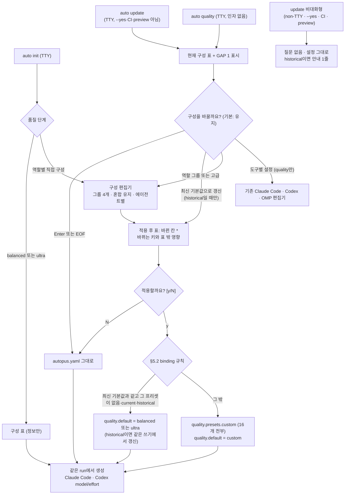
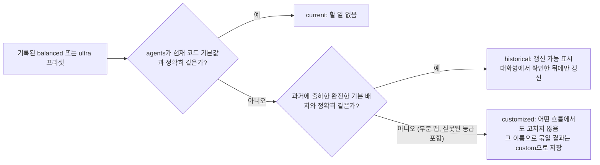

# PRD: 에이전트별 모델 구성 UX (역할 그룹 · 플랫폼별 실제 모델 표 · 오래된 프리셋 안전 갱신)

> Product Requirements Document — Standard mode. Plan Intent Ledger(answered 8행, assumed 3행)와 worktree `a930e5ff` 코드 확인을 근거로 작성했다.
> Outcome Lock, Feature Coverage Map, Visual Brief, Completion Debt, Evolution Ideas, Sibling SPEC Decision을 함께 담는다.

- **SPEC-ID**: SPEC-MODELUX-001
- **Mode**: Standard
- **Source**: `/auto plan` Plan Intent Ledger (2026-10-10), 브라운필드 코드 확인 (origin/main `a930e5ff`)
- **Author**: Autopus planning workflow (planner)
- **Status**: Draft
- **Date**: 2026-10-10
- **Target module**: `autopus-adk`
- **Release**: v0.50.125 (`release-prep.sh --apply` 전에 merge)

**Overview**: `auto init`, `auto update`, `auto quality`에서 16개 에이전트를 UI 전용 역할 그룹 4개로 묶어 상대 등급(fable/opus/sonnet/haiku)을 고르고 '고급'에서 에이전트 하나씩 조정하며, 적용 전에 에이전트×플랫폼 실제 모델·effort 표를 확인하고 명시적으로 승인할 때만 기존 스키마(`quality.presets` + `quality.default`)에 저장한다. 대화형 `auto update`는 매번 현재 구성을 보여 주고 기본값 '유지'로 한 번 묻고, `--yes`·CI·non-TTY·preview에서는 묻지도 바꾸지도 않는다. 예전 버전이 기록한 기본 프리셋(GAP 1)은 정확 일치로 판별해 확인한 뒤에만 갱신하고, 사용자가 고친 프리셋은 어떤 흐름에서도 고치지 않는다.

---

## Discovery Q&A Checklist

- [x] **Problem** (answered — ledger `goal`, 코드 근거): 사용자가 고를 수 있는 것은 전역 모드 balanced/ultra 두 개뿐이다. 에이전트별 조정은 `auto quality` 안의 도구별 16행 `agent=tier` 편집기에서만 할 수 있고, init·update에서는 닿지 않는다. 플랫폼마다 실제로 어떤 모델이 도는지 한 화면에서 볼 수 없다. 기록된 프리셋은 코드 기본값과 병합되지 않아서 새 등급과 새 에이전트가 반영되지 않는다(GAP 1).
- [x] **Target Users** (answered — ledger `goal`): `auto update`를 자주 돌리는 기존 사용자(주 사용자), `auto init` 하는 신규 사용자, 에이전트별로 조정하는 파워 유저, `--yes`·CI 자동화.
- [x] **Success Metrics** (assumed — ledger `done_evidence`, medium): 유지 경로 입력 1회와 변경 0 byte, 비대화형 5조건에서 stdin 읽기 0회, 표와 생성 결과 100% 일치, customized 프리셋 수정 0건, 동결 legacy schema strict decode 100% 통과.
- [x] **Constraints** (answered — ledger `constraints`, `release`, high): 1인 메인테이너 OSS다. 새 secret, 승인 단계, CI의 유료 API 의존은 없다. 생성 루트(`.claude`, `.codex`, `.gemini`, `.opencode`, `.agents`, `.omp`, `.autopus/plugins`)는 손으로 고치지 않는다. Lore commit은 한국어로 쓴다. 새 YAML 키는 없고 구버전 바이너리가 파일을 읽을 수 있어야 한다. 소스 파일은 300줄 이하(`architecture.max_file_lines: 300`), coverage는 85% 이상(`workflow.coverage_threshold`)이다. v0.50.125에 출하한다.
- [x] **Prior Art** (answered — 코드): SPEC-PROVIDER-QUALITY-001(provider별 quality), `auto quality` 도구별 편집기(`internal/cli/quality_tool_*.go`), OMP custom pin 편집기(`quality_omp_custom.go`), balanced historical 배치 해석(`pkg/config/native_balanced.go`), quality section writer(`replaceAutopusConfigSection`, ff5db742).
- [x] **Scope Boundary** (assumed — ledger `scope_boundary`, medium): OMP `role_model_policy`는 이번에 통합하지 않는다(Evolution Idea). 에이전트별 provider 모델 ID 고정은 non-goal이다.

### Ledger Reuse

| Field | Status | Confidence | PRD 반영 위치 |
|---|---|---|---|
| goal | answered | high | Outcome Lock, §1, §2 |
| selection unit (역할 그룹 4개, 고급) | answered | high | FR-01 ~ FR-04, §5.1 |
| stored value (상대 등급) | answered | high | FR-07, FR-09 |
| update behavior | answered | high | FR-13, FR-14, §5.3 |
| storage (`quality.presets.custom` + binding) | answered | high | FR-07 ~ FR-09, §5.2 |
| table (Claude, Codex, OMP, OpenCode, Gemini) | answered | high | FR-05, FR-06, §5.4 |
| release (v0.50.125) | answered | high | §2, FR-23 |
| constraints | answered | high | §6, §7 |
| scope_boundary | assumed | medium | §8, Evolution Ideas, Open Question Q1 |
| done_evidence | assumed | medium | §2, Outcome Lock Completion evidence |
| brownfield_impact | assumed → 코드로 검증 | high | §1, 아래 "컨텍스트 사실 보정" |

Question Audit 재사용: 이 단계에서 추가 질문은 0개다. answered 행은 다시 묻지 않았다. assumed 3행은 Outcome Lock이나 Must acceptance를 막지 않으므로 가정으로 진행하고, 가정이 틀렸을 때 바뀌는 점은 Open Questions에 적는다.

### 컨텍스트 사실 보정 (코드로 확인)

계획 컨텍스트의 브라운필드 메모 중 코드와 다르거나 더 구체적인 부분이다. 요구사항은 아래 사실을 따른다.

| # | 메모 | 코드로 확인한 사실 | 근거 | 설계 영향 |
|---|---|---|---|---|
| C1 | OpenCode 에이전트가 tier를 소비한다 | OpenCode와 Antigravity 에이전트 파일에는 `model`이 없다. 둘 다 세션 모델을 상속한다 | `internal/cli/quality_tool_targets.go:33-36` (`qualityInheritOnlyTools`), 생성된 `.opencode/agents/executor.md`에 `model` 키 없음 | OpenCode 열도 `플랫폼 기본값` |
| C2 | OMP role routing이 tier를 소비한다 | `role_model_policy.profile`이 비면 ADK가 OMP 모델을 묶지 않는다. builtin `balanced`는 프리셋을 무시한다. builtin `ultra`만 `quality.presets.ultra`를 읽는다. 16개 역할이 OMP native agent 5개로 접히고, 그중 13개가 `task`(대표 planner)로 간다 | `pkg/adapter/omp/omp_model_integration.go:38-40`, `pkg/config/role_model_policy_builtin.go:96-111,214-226`, `pkg/config/omp_native_agents.go:12-46` | OMP 열은 "native agent · 모델"로 보여 준다. custom은 OMP에 반영되지 않는다 |
| C3 | GAP 1에는 대응이 없다 | balanced에는 일부 대응이 있다. 과거 기본 배치 2종(이 저장소의 11개 opus/sonnet 배치 포함)과 정확히 같으면 Claude·Codex 생성 시 표준 배치로 해석한다. ultra에는 이런 처리가 없다 | `pkg/config/native_balanced.go:9-31,52-76` | 같은 registry를 ultra로 넓혀 판별에만 쓴다. 런타임 해석은 바꾸지 않는다 |
| C4 | binding은 `quality.providers.<p>`도 된다 | `quality.providers`는 claude와 codex만 받는다. 이 키는 a0355acf(2026-07-25)에서 생겼다. loader는 strict decode라 그 이전 바이너리는 이 키를 거부한다 | `pkg/config/quality_provider.go:15-24`, `pkg/config/loader.go:71-77` | 역할 그룹 결과는 `quality.default`로만 묶는다 |
| C5 | (메모 없음) | 기존 `auto quality` 표는 fallback tier로 `""`를 넘긴다. 생성기는 템플릿의 tier를 넘긴다. 그래서 부분 프리셋에서는 표와 생성 결과가 다를 수 있다 | `internal/cli/quality_tool_targets.go:82-94`, `templates/codex/agents/*.toml.tmpl` 3행, `pkg/adapter/claude/claude_agent_content.go:93-94` | 표는 생성기와 같은 fallback을 쓴다(FR-05) |
| C6 | (메모 없음) | custom 프리셋은 ultra의 effort 상향을 받지 않는다. Claude effort는 mode가 `ultra`일 때만 오른다(opus max, sonnet high). Codex는 ultra에서만 최소 opus로 올리고 supervisor를 `ultra` effort로 둔다. balanced 표준 배치의 Claude sonnet은 max/high이지만 custom의 sonnet은 medium이다 | `pkg/adapter/claude/claude_agent_content.go:131-148`, `pkg/config/codex_profile.go:78-83,110-112,156-161`, `pkg/config/role_model_policy_balanced.go:46-69` | 최신 기본값과 같은 결과는 built-in 이름으로 묶는다(FR-07). 표에 effort를 넣는다 |
| C7 | 기록된 프리셋이 코드 기본값보다 우선한다 | 병합 자체가 없다. loader는 파일을 그대로 decode한다. `quality.default`는 `quality.presets`에 있어야 한다. init은 기본 프리셋 전체를 파일에 쓴다 | `pkg/config/loader.go:75-79,100-121`, `pkg/config/schema.go:235-238`, `pkg/config/defaults.go:132-153`, `internal/cli/platform_lifecycle.go:141` | 파일에서 프리셋을 빼는 방식은 구버전 Validate를 깨므로 기각한다 |

---

## Outcome Lock

- **User-visible outcome**: 대화형 터미널에서 `auto init`, `auto update`, `auto quality`가 에이전트×플랫폼 실제 모델·effort 표를 보여 준다. 사용자는 역할 그룹 4개에 등급을 하나씩 고르거나 '고급'에서 에이전트 하나씩 바꿀 수 있다. 바뀐 칸이 표시된 적용 후 표를 확인하고 명시적으로 승인하면, 결과가 기존 스키마에 저장되고 Claude Code·Codex 생성 에이전트의 `model`/`effort`가 표와 똑같이 바뀐다. `auto update`는 대화형일 때 매번 묻고, Enter 한 번이면 아무것도 바꾸지 않는다. 비대화형일 때는 묻지도 바꾸지도 않는다. 예전 버전이 기록한 기본 프리셋은 "갱신 가능"으로 표시되고 확인해야만 갱신된다. 사용자가 고친 프리셋은 어떤 흐름에서도 바뀌지 않는다.
- **Mandatory requirements**: FR-01 ~ FR-19 (P0) 전부.
- **Accepted assumptions** (plan 단계로 검증과 함께 넘긴다):
  - A1. 표에는 설치된 플랫폼 열만 고정 순서로 보인다(Claude Code, Codex, OMP, OpenCode, Antigravity).
  - A2. Codex 셀은 catalog probe 전의 요청 모델·effort다. 생성 시점의 catalog 대체는 기존 `reportCodexFallback` 경고가 알린다.
  - A3. ultra의 과거 기본 배치는 `pkg/config/defaults.go` git 이력에서 복원한다. 최소한 이 저장소 `autopus.yaml`의 11개 all-opus 배치를 포함한다.
  - A4. CI 판정은 `CI` 환경 변수가 비어 있지 않고 `0`/`false`가 아닌 경우다.
  - A5. init에서 balanced/ultra를 고르면 표를 정보로만 보여 주고 질문을 더하지 않는다. custom 경로만 확인 질문을 거친다.
  - A6. `--workspace` update는 리포마다 한 번 묻고, 머리말에 리포 경로를 쓴다.
  - A7. 화면 문구는 기존 `tui` locale 감지를 따른다. ko는 이 PRD의 한국어 표기를, 그 밖은 영어를 쓴다.
- **Deferred decisions**: 표의 축약 표기 규칙(100열 안), 그룹 메뉴의 정확한 키 배치, custom 프리셋 description 문구. 모두 spec 단계에서 정한다.
- **Explicit non-goals**: OMP `role_model_policy` 통합, 에이전트별 provider 모델 ID 고정, 새 YAML 키(그룹, base mode, provider별 구성), balanced/ultra 코드 기본값 변경, 런타임 해석 의미 변경(balanced historical 배치 해석 포함), 기존 도구별 편집기 제거.
- **Completion evidence**: §5.1 커버리지 테스트, §5.2 binding 결정 표 테스트, GAP 1 판별 fixture(이 저장소의 실제 `autopus.yaml` 포함), 이질적 config 8종 이상에서 표 golden과 "표 = 생성 결과" 비교, update TTY 계약 행렬(§5.3) scripted-input 테스트, quality 섹션 밖 byte 불변과 anchor·placeholder 보존 테스트, 동결 legacy schema strict decode 테스트, `auto eval harness run` 통과, 신규·변경 패키지 coverage 85% 이상, 소스 파일 300줄 이하.

---

## Feature Coverage Map

| 영역 | 이번 SPEC이 닫는 범위 | 요구사항 | 완료 증거 (acceptance seed) |
|---|---|---|---|
| 선택 UX (happy path) | 역할 그룹 4개, 혼합 표시, 고급 에이전트별 편집, 시작 구성 = 실제 생성 등급 | FR-01 ~ FR-04 | 그룹 커버리지 테스트, 혼합 유지·덮어쓰기 테스트, 손대지 않고 저장하면 쓰기 0 |
| 표 | 16행 × 설치 플랫폼, effort, provider override 표시, Codex supervisor footer, 변경 칸 `*` | FR-05, FR-06, FR-18 | golden 8종 이상, 표 = 생성 `model`/`effort`, OMP route 일치 |
| 저장 | binding 규칙, line/section writer, 쓰는 키 제한 | FR-07 ~ FR-09 | §5.2 결정 표 테스트, quality 밖 byte 불변, legacy decode |
| GAP 1 | current/historical/customized 판별, historical 갱신, customized 보호 | FR-10 ~ FR-12 | 이 저장소 config fixture, partial·invalid tier fixture 수정 0건 |
| 진입점 | init 3번째 선택, update 단계, quality 메뉴 통합 | FR-13, FR-15, FR-16 | 진입점별 scripted 흐름 테스트, 같은 run의 생성 반영 |
| 비대화형 계약 | non-TTY, `--yes`, CI, preview, EOF | FR-14, §5.3 | stdin 읽기 0, 설정 byte 불변, 안내 1줄 이하 |
| 공유 구현 | UI 비의존 core + 줄 기반 driver 하나 | FR-17 | 세 진입점이 같은 core를 호출하는지 확인하는 테스트 |
| 생성 결과 | 바뀐 에이전트만 `model`/`effort` 변경 | FR-19 | 재생성 전후 diff = 표 diff |
| 오류·복구 | 잘못된 입력 재질문, EOF 유지, Ctrl+C 중단, 검증·쓰기 실패 시 원본 유지 | FR-06, FR-08, §5.3 | 오류 경로별 테스트 |
| 문서·릴리스 | help, README, CHANGELOG, `auto quality show --agents` | FR-21, FR-23 | help golden, 문서 diff |

---

## Visual Brief

UI 표면은 터미널 프롬프트와 표다. 아래 wireframe은 최종 디자인이 아니라 의도를 확인하기 위한 low-fi 초안이다. `wireframe intent: assumed` — planner 단계에서는 사용자에게 confirm/adjust를 받지 않았으므로 Gate 1 또는 spec review에서 확인한다. Outcome Lock이나 FR에 연결되지 않은 배치·문구는 요구사항이 아니다.





**Wireframe 1 — update 구성 단계 (대화형, 이 저장소 기준 예시)**

```text
에이전트 모델 구성 ───────────────────────────────────────────────
quality.default = ultra   ultra: 이전 버전 기본값 (갱신 가능, 11개 에이전트 다름)

그룹       에이전트             등급        Claude Code       Codex            OMP          OpenCode    Antigravity
설계·판단  planner              opus        opus 5.5 · max    6.1-sol · xhigh  플랫폼 기본값  플랫폼 기본값 플랫폼 기본값
           architect            opus        opus 5.5 · max    6.1-sol · xhigh  ...
구현       deep-worker          기본값(opus) opus 5.5 · max    6.1-sol · xhigh  ...
탐색·보조  annotator            기본값(sonnet) sonnet 5.5 · high 6.1-sol · xhigh ...
...
Codex 기본 세션: 6-astra · ultra (supervisor_model_policy = quality)

구성을 바꿀까요?
  [Enter] 유지   1) 최신 ultra 기본값으로 갱신   2) 역할 그룹으로 고르기   3) 고급 (에이전트별)
>
```

**Wireframe 2 — 역할 그룹 편집 (최신 ultra 기본값에서 시작한 예)**

```text
역할 그룹마다 등급을 고르세요 (Enter = 그대로)
설계·판단  planner, architect, spec-writer, security-auditor                현재: fable
  1) fable  2) opus  3) sonnet  4) haiku   [Enter] 그대로        >
구현       executor, debugger, deep-worker, devops, frontend-specialist, perf-engineer
                                                                            현재: 혼합 (fable 2 · opus 4)
  1) fable  2) opus  3) sonnet  4) haiku   [Enter] 혼합 그대로    >
검증·리뷰  reviewer, validator, tester, ux-validator                         현재: 혼합 (fable 1 · opus 3)
탐색·보조  explorer, annotator                                               현재: opus
```

**Wireframe 3 — 고급 (에이전트별)**

```text
고급: 에이전트별 등급 (agent=tier, 빈 줄로 끝)
> debugger=opus
  debugger = opus      구현: 혼합 (fable 1 · opus 5)
> tester=gpt
  알 수 없는 등급 "gpt" (fable, opus, sonnet, haiku 중 선택)
>
```

**Wireframe 4 — 적용 전 미리보기**

```text
미리보기 (아직 바뀌지 않음)   * = 바뀌는 칸
설계·판단  planner     fable*   fable 5.1 · max*   6-astra · max*   플랫폼 기본값 ...
...
바뀌는 설정
  quality.presets.custom   새로 씀 (16개 에이전트)
  quality.default          ultra → custom
  Codex 기본 세션          6-astra · ultra → 6-astra · xhigh   (custom은 ultra effort를 받지 않음)
  Codex 열                 개별 설정 codex-custom 유지
적용할까요? [y/N] >
```

**Data flow — 표 셀은 생성기와 같은 함수에서 나온다**

```text
detached candidate HarnessConfig
 ├─ 등급         ← 실제 생성 등급 (표준 배치면 rung 등급, 아니면 AgentTier + 템플릿 fallback)
 ├─ Claude Code  ← Claude 에이전트 projection (model, effort) — adapter와 공유하는 export 함수
 ├─ Codex        ← QualityConf.CodexAgentProfile(agent, 템플릿 fallback, 템플릿 effort)
 ├─ OMP          ← role_model_policy.profile == "" ? 플랫폼 기본값
 │                 : SelectedRoleModelProfileForQuality → OMPNativeAgentForRole → OMPNativeAgentRoute
 ├─ OpenCode     ← 플랫폼 기본값 (에이전트 파일에 model 없음)
 ├─ Antigravity  ← 플랫폼 기본값
 └─ footer       ← CodexSupervisorProfile (codex 설치 + supervisor_model_policy = quality일 때)
```

---

## 1. Problem & Context

### Current Situation

| 영역 | 현재 동작 | 근거 |
|---|---|---|
| 선택 단위 | 전역 모드 balanced/ultra만 고를 수 있다. init wizard의 quality 단계도 이 두 개뿐이다 | `internal/cli/tui/wizard_steps.go:154-169`, `internal/cli/init.go:120` |
| 에이전트별 조정 | `auto quality`의 도구별 편집기에서만 된다. 16행 `agent=tier` 줄 입력이고, 그룹 개념도 플랫폼 간 비교 화면도 없다. init·update에서는 닿지 않는다 | `internal/cli/quality_tool_interactive.go:19-77`, `quality.go:136-155` |
| update | quality에 관한 상호작용이 없다. 기존 프로젝트 설정 프롬프트는 미설정 항목만 묻고 `--yes`이면 건너뛴다 | `internal/cli/update.go:191-195,276-287` |
| 프리셋 수명 | init이 그 시점의 기본 프리셋 전체를 파일에 쓴다. loader는 코드 기본값과 병합하지 않는다. 그래서 프리셋이 init 시점 값에 고정된다 | `pkg/config/defaults.go:132-153`, `internal/cli/platform_lifecycle.go:141`, `pkg/config/loader.go:75-79,100-121` |
| GAP 1 대응 | balanced 과거 배치 2종만 Claude·Codex 생성 시 표준 배치로 해석한다. `AgentTier`, 기존 표의 Tier 열, ultra에는 대응이 없다 | `pkg/config/native_balanced.go:9-31,52-76`, `pkg/config/quality_tier.go:76-91` |
| 플랫폼별 의미 | Claude는 tier alias와 effort, Codex는 GPT-6 rung과 effort, OMP는 `role_model_policy`, OpenCode·Antigravity는 세션 모델 상속이다. 이를 한꺼번에 보여 주는 화면이 없다 | C1, C2, C6 |

이 저장소의 실제 상태(`autopus.yaml:107-138`, main checkout의 생성물):

- `quality.default: ultra`인데 ultra 프리셋은 11개 에이전트 all-opus인 옛 기본값이다. 최신 ultra 기본값은 16개 에이전트이고 7개가 fable이다.
- Claude 기준으로 16개 중 11개 에이전트가 최신 ultra 기본값과 다른 모델로 돈다. 6개는 fable 대신 opus이고, 프리셋에 없는 5개는 템플릿 fallback으로 간다(deep-worker opus, annotator·frontend-specialist·perf-engineer·ux-validator는 sonnet).
- 같은 에이전트가 플랫폼마다 다르게 돈다. annotator는 Claude에서 `sonnet`/`high`이고, Codex에서는 ultra 최소 opus 상향 때문에 `gpt-6.1-sol`/`xhigh`이다.

### Problem Statement

ADK 사용자는 에이전트마다 알맞은 모델 등급을 쉽게 정할 수 없고, 정해진 구성이 플랫폼마다 실제로 어떤 모델이 되는지 확인할 수도 없다. 그리고 예전 버전이 기록한 기본 프리셋은 조용히 낡아서, 사용자는 자기가 최신 구성을 쓰고 있다고 잘못 알게 된다.

### Impact

- 2모드만으로는 비용과 품질의 중간 지점을 고를 수 없다. 예를 들어 "설계·리뷰만 fable, 나머지는 sonnet" 같은 구성이 그렇다. 그러려면 YAML을 손으로 고치거나 도구마다 16행을 입력해야 한다.
- GAP 1 때문에 오래된 프로젝트는 새 등급(fable)과 새 에이전트(16개 체계)를 영영 받지 못한다. 이 저장소가 그 예다.
- 표가 생성 결과와 다르게 보이면(C5) 사용자는 화면을 믿지 않게 된다.

### Change Motivation

사용자 요청: "balanced/ultra 두 모드만으로는 이제 최적화가 안 된다. auto init / auto update 때 에이전트별로 모델을 지정할 수 있게, 사용자 경험을 좋게." 등급 체계가 4단계(fable 추가)로 늘고 에이전트가 16개가 되면서, 전역 2모드와 도구별 16행 편집기 사이의 빈칸이 커졌다. OKR은 정의되어 있지 않아 정렬 항목은 생략한다.

---

## 2. Goals & Success Metrics

| Goal | Success Metric | Target | Timeline |
|---|---|---|---|
| 유지 경로 마찰 최소화 | 대화형 update에서 바꾸지 않고 넘어갈 때의 입력 수와 autopus.yaml 변경 | 입력 1회(Enter), 0 byte | v0.50.125 |
| 비대화형 안전 | non-TTY, `--yes`, CI, preview, EOF 5조건에서 구성 단계의 stdin 읽기 수와 설정 변경 | 각각 0 | v0.50.125 |
| 표의 진실성 | 이질적 fixture 8종 이상에서 표 셀과 생성 `model`/`effort`, OMP route의 일치율 | 100% | v0.50.125 |
| 역할 그룹 경로 길이 | 그룹만 바꿀 때 질문부터 적용까지의 입력 수 | 6회 이하 (메뉴 1 + 그룹 4 + 확인 1) | v0.50.125 |
| GAP 1 안전 | historical fixture 판별 정확도, customized fixture 수정 건수 | 100%, 0건 | v0.50.125 |
| 구버전 호환 | 이 기능이 쓴 파일이 동결 legacy schema strict decode를 통과하는 비율 | 100% | v0.50.125 |
| 쓰기 범위 | quality 섹션 밖의 byte 변화 | 0 | v0.50.125 |
| 회귀 없음 | `auto eval harness run`, 기존 quality·init·update 테스트 | 모두 통과 | v0.50.125 |
| 코드 품질 | 신규·변경 패키지 coverage, 소스 파일 줄 수 | 85% 이상, 300줄 이하 | v0.50.125 |

**Anti-Goals**

- 사용자가 GAP 1을 실제로 갱신했는지를 성공 조건으로 삼지 않는다. 갱신은 사용자 선택이다.
- 비대화형 경로에서 GAP 1을 고치려고 설정을 자동으로 바꾸지 않는다.
- 플랫폼 모델 ID를 직접 고르게 해서 정밀도를 높이지 않는다. 상대 등급이 저장 단위다.
- 표를 짧게 만들려고 effort나 플랫폼 열을 숨기지 않는다.

---

## 3. Target Users

| User Group | Role | Usage Frequency | Key Expectation |
|---|---|---|---|
| 기존 ADK 사용자 | 개발자, `auto update` 실행 | 릴리스마다 또는 주 1회 이상 | Enter 한 번이면 그대로이고, 낡은 프리셋은 알려 주되 멋대로 바꾸지 않는다 |
| 신규 사용자 | `auto init` | 프로젝트당 1회 | 기본값으로 바로 시작하거나, 역할별로 한 번에 고른다 |
| 파워 유저 | `auto quality` | 필요할 때 | 그룹 단위로 빠르게 고르고 에이전트 하나만 따로 바꾼다. 플랫폼별 실제 모델을 본다 |
| 자동화·CI | `auto update --yes`, non-TTY | 파이프라인마다 | 프롬프트로 멈추지 않고 설정이 바뀌지 않는다 |
| 메인테이너 | 릴리스와 회귀 관리 | 릴리스마다 | 결정적 테스트, secret·승인 단계 없음 |

**Primary User**: 기존 ADK 사용자다. 매번 보는 update 단계가 이 기능의 주 접점이다.

---

## 4. User Stories / Job Stories

### Story 1: update 때마다 확인하되 Enter 한 번이면 그대로

**When** `auto update`를 터미널에서 실행하면, **I want to** 지금 에이전트들이 어떤 모델로 도는지 보고 그대로 둘지 고르기를, **so I can** 업데이트 흐름을 방해받지 않으면서 구성을 의식한다.

- Given TTY이고 `--yes`가 없을 때, when update가 구성 단계에 이르면, then 16행 표와 질문 1개가 나오고 Enter를 누르면 autopus.yaml이 byte 단위로 그대로다.
- Given stdin이 EOF일 때, when 질문을 읽으면, then 유지로 처리하고 update를 계속한다.
- Given 잘못된 입력일 때, when 답하면, then 선택지를 다시 보여 주고, 3번 연속 잘못되면 안내와 함께 유지한다.
- Given 구성을 바꾸고 확인했을 때, when update가 계속되면, then 같은 run의 생성에서 바뀐 모델이 반영된다.

### Story 2: 역할 그룹으로 빠르게 고르기

**When** 비용을 줄이면서 판단 품질은 지키고 싶을 때, **I want to** 그룹 4개에 등급을 하나씩 고르기를, **so I can** 16번 입력하지 않는다.

- Given 시작 구성이 최신 balanced 기본값일 때, when 편집기를 열면, then 구현은 `혼합 (fable 2 · sonnet 4)`, 검증·리뷰는 `혼합 (fable 1 · sonnet 3)`으로 보인다.
- Given 구현 그룹에서 Enter를 누를 때, when 저장하면, then 구현 그룹 에이전트들의 등급은 바뀌지 않는다.
- Given 구현 그룹에 sonnet을 고를 때, when 미리보기를 보면, then debugger와 deep-worker 칸이 `*`로 표시된다.
- Given 고급에서 `debugger=opus`를 입력할 때, when 그룹 표시를 보면, then 구현 그룹 표시가 즉시 다시 계산된다.

### Story 3: 플랫폼별로 실제로 무엇이 도는지 보기

**When** Claude Code, Codex, OMP를 함께 쓸 때, **I want to** 같은 구성이 플랫폼마다 무엇이 되는지 한 표에서 보기를, **so I can** 플랫폼 간 차이에 놀라지 않는다.

- Given OpenCode나 Antigravity가 설치되어 있을 때, when 표를 보면, then 그 열은 `플랫폼 기본값`이다.
- Given `role_model_policy.profile`이 비어 있을 때, when 표를 보면, then OMP 열은 `플랫폼 기본값`이다.
- Given OMP profile이 builtin `balanced`일 때, when executor 행을 보면, then OMP 칸은 `task`와 그 route의 모델이고, custom으로 바꿔도 이 칸은 바뀌지 않는다.
- Given `quality.providers.codex: codex-custom`일 때, when 표를 보면, then Codex 열 머리말이 `개별 설정: codex-custom`이고 값은 그 프리셋을 따른다.
- Given 적용 후 재생성했을 때, when 생성 파일을 보면, then Claude Code·Codex의 `model`/`effort`가 표와 같다.

### Story 4: 낡은 기본 프리셋을 안전하게 갱신하기

**When** 예전 버전이 init한 프로젝트를 업데이트하면, **I want to** 내 ultra가 옛 기본값이라는 것과 무엇이 달라지는지 알기를, **so I can** 비용 변화를 보고 갱신 여부를 정한다.

- Given 이 저장소의 `autopus.yaml`을 fixture로 쓸 때, when 판별하면, then balanced와 ultra 모두 `historical`이다.
- Given historical ultra에서 "최신 기본값으로 갱신"을 골랐을 때, when 미리보기를 보면, then 에이전트별 차이(opus→fable 6개, 없던 5개 추가)와 적용 후 표가 보이고, `y`일 때만 ultra 프리셋이 바뀐다.
- Given ultra 맵에서 한 에이전트만 고친 프로젝트일 때, when update를 돌리면, then `사용자 수정` 표시만 나오고 어떤 선택으로도 ultra 프리셋은 바뀌지 않는다.
- Given historical balanced를 갱신할 때, when 미리보기를 보면, then 모델 변화가 없고 YAML만 최신 기본값으로 정리된다는 안내가 나온다.

### Story 5: 자동화에서는 절대 묻지 않기

**When** CI나 스크립트에서 `auto update`를 돌리면, **I want to** 프롬프트로 멈추지 않기를, **so I can** 파이프라인이 그대로 돈다.

- Given non-TTY, `--yes`, `CI=true`, `--dry-run` 각각일 때, when update가 돌면, then 구성 단계는 stdin을 읽지 않고 설정을 바꾸지 않는다.
- Given historical 프리셋이 있을 때, when 비대화형 update가 돌면, then 안내는 1줄 이하다.

### Story 6: init에서 처음부터 역할별로 고르기

**When** 새 프로젝트를 init할 때, **I want to** 기본값 대신 역할별 구성을 고르기를, **so I can** 처음부터 원하는 비용·품질로 시작한다.

- Given 대화형 init의 quality 단계일 때, when 선택지를 보면, then balanced, ultra, 역할별 직접 구성 3개가 있다.
- Given 역할별 직접 구성을 골랐을 때, when 편집기가 열리면, then 시작 구성은 최신 balanced 기본값이고, 확인 뒤 저장된 구성으로 플랫폼 파일이 생성된다.
- Given `--yes`, non-TTY, `--quality ultra`일 때, when init하면, then 지금과 똑같이 동작한다.

---

## 5. Functional Requirements

### P0 — Must Have

| ID | Requirement | Notes |
|---|---|---|
| FR-01 | THE SYSTEM SHALL define exactly four UI-only role groups in the §5.1 order covering every name returned by `config.CanonicalAgentNames()` exactly once, and SHALL never write a group name or a group-derived key to autopus.yaml. | 정의 위치는 `internal/cli` 계층이다. 정규 에이전트가 늘거나 줄면 커버리지 테스트가 실패한다 |
| FR-02 | WHEN a composition session starts, THE SYSTEM SHALL take each canonical agent's starting tier from the generator's effective resolution under the global quality view (provider overrides cleared): the rung tier where the native balanced placement applies, otherwise `AgentTier` with the agent template's declared fallback tier. | 기록된 값이 아니라 실제 생성 등급에서 시작해야 손대지 않고 저장해도 결과가 같다. 예: historical balanced의 debugger는 기록이 opus이지만 실제로는 fable이다. 이 해석 함수는 `pkg/config`에 하나만 둔다 |
| FR-03 | WHEN the agents of one group have different tiers, THE SYSTEM SHALL display the group as `혼합` with per-tier counts in tier order, keep every member's tier unchanged unless the operator selects a tier for that group, and set every member to the selected tier when one is selected. | 최신 기본값 기준으로 balanced와 ultra 모두 구현, 검증·리뷰 두 그룹이 혼합이다 |
| FR-04 | WHEN the operator opens 고급, THE SYSTEM SHALL accept per-agent `agent=tier` edits validated against the canonical agent and tier vocabularies, report a rejected line without discarding earlier edits, and recompute every group display after each accepted edit. | 기존 `parseQualityToolTierAssignment` 규칙과 오류 문구를 재사용한다 |
| FR-05 | THE SYSTEM SHALL render the composition table with one row per canonical agent in group order, a tier column, and one column per installed platform in the fixed order Claude Code, Codex, OMP, OpenCode, Antigravity, computing every cell through the same exported projection the platform's generator uses (§5.4), and SHALL NOT keep a second tier-to-model mapping table. | Claude projection(`claudeAgentProfile`, `claudeAgentEffort`)은 지금 `pkg/adapter/claude`에 unexported로 있다. 한 곳으로 export해 adapter와 표가 같이 부른다. 템플릿 fallback tier와 Codex declared effort도 하나의 원천에서 읽거나, 템플릿 literal과의 drift 테스트로 고정한다 |
| FR-06 | WHEN a change is pending, THE SYSTEM SHALL render the after-table from a detached candidate config, mark every changed cell with `*`, list every autopus.yaml key the write will change and every effect outside the table (the Codex supervisor profile WHERE `supervisor_model_policy` is `quality`), and write only after an explicit `y` or `yes` answer to a prompt whose default is no. | 후보 config는 `withQualityToolPreset`처럼 분리 사본으로 만든다. 취소하면 아무것도 쓰지 않는다. 색만으로 변경을 표시하지 않는다 |
| FR-07 | WHEN a confirmed composition is persisted, THE SYSTEM SHALL apply the §5.2 binding rules, writing nothing when the result equals the starting composition. | 최신 기본값과 같은 결과를 custom으로 저장하면 balanced 표준 배치의 정확한 모델 ID·effort와 ultra의 effort 상향을 잃는다(C6) |
| FR-08 | THE SYSTEM SHALL write `quality.default` alone through the existing line writer (`saveQualityDefault`) and any preset change through the existing section writer (`saveQualitySection`: `replaceAutopusConfigSection`, `validateQualityYAML`, `atomicWriteQualityConfig`), never re-marshal an existing autopus.yaml as a whole, keep every byte outside the `quality` section identical, and validate the resulting config before the atomic replace. | init은 새 파일을 `config.Save`로 만드는 기존 경로를 유지한다. 검증이나 쓰기가 실패하면 원본은 그대로다 |
| FR-09 | THE SYSTEM SHALL write only `quality.default` and `quality.presets.<name>.description`/`agents` from these flows, and SHALL NOT write `quality.providers`, `quality.supervisor_model_policy`, `role_model_policy`, or any key the current schema lacks. | `custom`은 평범한 프리셋 이름이라 `quality.providers`가 없던 바이너리도 읽는다(C4) |
| FR-10 | THE SYSTEM SHALL classify each written `balanced` and `ultra` preset as `current` when its agents map exactly equals the current code default, `historical` when it exactly equals a complete layout once shipped as that preset's default, and `customized` otherwise (including partial maps and invalid tiers), ignoring descriptions, using one registry that also backs `isHistoricalBalancedDefault`. | balanced 항목은 현행 2종을 옮긴다. ultra 항목은 가정 A3. 등록 항목마다 "완전한 16개 이하 맵이고 현재 기본값과 다름"을 테스트로 고정한다. 기존 balanced 런타임 해석은 그대로다 |
| FR-11 | WHEN a written built-in preset is `historical`, THE SYSTEM SHALL offer 최신 기본값으로 갱신 in interactive `auto update` and `auto quality`, show the per-agent diff and the after-table, and rewrite that preset's agents and description to the current code default only after explicit confirmation. | balanced historical은 Claude·Codex 런타임이 이미 표준 배치이므로, 미리보기가 "모델 변화 없음, YAML만 정리"를 보여 준다 |
| FR-12 | IF a written built-in preset is `customized`, THEN THE SYSTEM SHALL NOT modify it in any flow, SHALL label it `사용자 수정` with the number of agents that differ from the current default, and SHALL persist any composition that would otherwise bind that name as `custom`. | 사용자 의도를 조용히 바꾸지 않는다 |
| FR-13 | WHEN the project update path of `auto update` runs with a TTY stdin, without `--yes`, `--plan`, `--preview`, `--dry-run`, or a truthy `CI` environment variable, and autopus.yaml exists, THE SYSTEM SHALL, after the existing project settings prompt and before platform file generation, show the current composition table with GAP 1 labels and ask one question whose default (Enter or EOF) keeps the configuration byte-identical, and a confirmed change SHALL take effect in the same run's generation. | §5.3. `--workspace`는 리포마다 한 번 묻는다(A6) |
| FR-14 | IF stdin is not a TTY, `--yes` is set, a preview flag is set, or `CI` is truthy, THEN THE SYSTEM SHALL NOT read stdin for the composition step, SHALL leave autopus.yaml byte-identical with respect to this feature, and SHALL print at most one notice line naming each `historical` preset. | §5.3. 안내 예: `참고: ultra 프리셋이 이전 버전 기본값입니다. 대화형 auto update 또는 auto quality에서 갱신할 수 있습니다.` |
| FR-15 | WHEN `auto init` runs interactively, THE SYSTEM SHALL offer balanced, ultra, and 역할별 직접 구성 in the quality step, start the shared composition editor from the current balanced default for the third choice, and show the composition table of the chosen result before platform files are written, while `--yes`, non-TTY, and `--quality` behavior SHALL stay unchanged. | balanced·ultra는 표를 정보로만 보여 준다(A5). custom 경로는 FR-06 확인을 거친다. `init.go`는 이미 253줄이므로 새 로직은 새 파일에 둔다 |
| FR-16 | WHEN `auto quality` runs without arguments on a TTY, THE SYSTEM SHALL open the composition step first (table, keep as default, 역할 그룹, 고급, conditional 갱신) and keep the existing Claude Code, Codex, and OMP editors reachable from the same menu; WHERE `--apply` is set, THE SYSTEM SHALL regenerate harness files after a confirmed change. | 기존 non-TTY 오류와 인자가 있는 하위 명령(`auto quality <preset>`, `provider`, `supervisor`, `show`)은 그대로다 |
| FR-17 | THE SYSTEM SHALL implement composition state, group logic, classification, binding decision, and table rendering once and UI-agnostically, with one line-based prompt driver shared by init, update, and quality that reads from an injectable reader and uses injectable TTY and CI probes. | init 기존 단계의 huh 폼은 유지한다. 줄 기반 driver는 Windows 터미널의 huh hang 우회(`wizard_steps.go:52-60`)가 필요 없고 scripted input으로 테스트된다. TTY 판정은 `isStdinTTY`(`internal/cli/prompts.go:18`)를 기본값으로 쓴다 |
| FR-18 | WHILE `quality.providers.claude` or `quality.providers.codex` names a preset, THE SYSTEM SHALL compute that platform's column from the override, label the column header `개별 설정: <preset>`, and leave the override unchanged. | override를 지울지 묻는 것은 FR-20(P1)이다 |
| FR-19 | WHEN a confirmed composition is applied and harness files are regenerated, THE SYSTEM SHALL change generated agent `model` and `effort` fields only for agents whose Claude Code or Codex cell changed, and every generated value SHALL equal its after-table cell. | Claude alias(`opus`)는 `ClaudeModelForTier`로 slug와 비교한다. Codex는 catalog probe가 없는 상태에서 비교한다(A2) |

### 5.1 Role Group Contract

| 순서 | 그룹 (ko / en) | 에이전트 (표시 순서) |
|---|---|---|
| 1 | 설계·판단 / Design·Judgment | planner, architect, spec-writer, security-auditor |
| 2 | 구현 / Implementation | executor, debugger, deep-worker, devops, frontend-specialist, perf-engineer |
| 3 | 검증·리뷰 / Verification·Review | reviewer, validator, tester, ux-validator |
| 4 | 탐색·보조 / Exploration·Support | explorer, annotator |

- 그룹은 UI 전용이다. YAML에는 에이전트별 등급만 남는다.
- 등급 선택지는 강한 순서인 `config.QualityTiers()`를 따른다. 화면에는 짧은 설명을 붙일 수 있지만(예: fable 최상위, haiku 경량) 저장 값은 등급 이름이다.
- 그룹 표시값: 멤버 등급이 모두 같으면 그 등급, 아니면 `혼합 (fable n · opus m …)`.

### 5.2 Binding Contract

| 결과 구성 | 같은 이름의 기록된 프리셋 | 쓰기 | writer |
|---|---|---|---|
| 시작 구성과 같음 | — | 쓰지 않음 ("변경 없음") | — |
| 최신 `balanced` 기본값과 같음 | 없음 또는 current | `quality.default: balanced` | line |
| 최신 `balanced` 기본값과 같음 | historical | balanced 프리셋을 최신 기본값으로 갱신하고 `quality.default: balanced` (미리보기에 갱신 표시) | section |
| 최신 `balanced` 기본값과 같음 | customized | `quality.presets.custom` + `quality.default: custom` | section |
| 최신 `ultra` 기본값과 같음 | balanced와 같은 규칙 | ultra | line 또는 section |
| 그 밖 | — | `quality.presets.custom`에 정규 에이전트 16개 전부를 쓰고 `quality.default: custom` | section |

- `custom`이 이미 있고 현재 binding이 아니면, 미리보기의 바뀌는 설정에 `quality.presets.custom 덮어씀`을 명시한다.
- 쓰지 않는 것: `quality.providers`, `supervisor_model_policy`, `role_model_policy`, 다른 프리셋. 쓰이지 않게 된 프리셋(예: 예전 `custom`)도 지우지 않는다.

### 5.3 Update Prompt Contract

| 조건 | 질문 | stdin 읽기 | autopus.yaml (이 기능 기준) |
|---|---|---|---|
| TTY, `--yes` 없음, preview 없음, CI 아님, autopus.yaml 있음 | 1회, 기본값 유지 | 예 | Enter·EOF: 그대로. 확인한 변경만 쓴다 |
| non-TTY | 없음 | 아니오 | 그대로 |
| `--yes` / `-y` | 없음 | 아니오 | 그대로 |
| `CI`가 truthy (비어 있지 않고 `0`/`false`가 아님) | 없음 | 아니오 | 그대로 |
| `--plan` / `--preview` / `--dry-run` | 없음 | 아니오 | 그대로 |
| `--self`, `--check` (프로젝트 갱신 경로 아님) | 없음 | 아니오 | 그대로 |
| `--workspace` | 리포마다 1회, 머리말에 리포 경로 | 예 | 리포별 |
| autopus.yaml 없음 | 없음 | 아니오 | 해당 없음 |

- 잘못된 입력은 선택지를 다시 보여 주고 다시 묻는다. 3번 연속 잘못되면 안내와 함께 유지한다.
- Ctrl+C는 이 단계에서 아무것도 쓰지 않고 update를 중단한다.
- 편집 경로에서는 그룹 질문과 최종 확인이 더해진다. 최종 확인의 기본값은 아니오다.

### 5.4 Table Cell Contract

| 열 | 표시 조건 | 셀 값의 원천 | 비고 |
|---|---|---|---|
| 등급 | 항상 | FR-02의 실제 생성 등급. 프리셋에 없으면 `기본값(<tier>)`, 잘못된 값이면 `잘못된 값→<tier>` | 생성기와 같은 fallback |
| Claude Code | platforms에 `claude-code` | Claude 에이전트 projection의 model과 effort | alias는 slug로 표시한다 |
| Codex | `codex` | `QualityConf.CodexAgentProfile(agent, 템플릿 fallback, 템플릿 effort)` | 요청 모델이다(A2) |
| OMP | `omp` | profile이 비면 `플랫폼 기본값`. 아니면 `SelectedRoleModelProfileForQuality` → `OMPNativeAgentForRole` → `OMPNativeAgentRoute`의 첫 후보 `selector:thinking`과 native agent 이름 | 머리말에 "role_model_policy를 따름, custom은 반영 안 됨"을 쓴다. builtin ultra는 ultra 프리셋 갱신 시 바뀐다 |
| OpenCode | `opencode` | `플랫폼 기본값` | 에이전트 파일에 model 없음(C1) |
| Antigravity | `antigravity-cli` | `플랫폼 기본값` | 같은 이유 |
| footer | `codex` 설치 + `supervisor_model_policy: quality` | `CodexSupervisorProfile` | ultra와 다른 모드 사이를 오가면 바뀐다(C6) |

- 표 계산은 네트워크와 subprocess를 쓰지 않는다. OMP·Codex catalog probe도 하지 않는다.
- 설치된 플랫폼 중 에이전트별 모델을 쓰는 곳이 없으면 footer에 그 사실을 적는다. 구성은 그대로 저장할 수 있다.

### P1 — Should Have

| ID | Requirement | Notes |
|---|---|---|
| FR-20 | WHERE a provider override exists, THE SYSTEM SHALL ask one additional question, defaulting to no, whether that provider should follow the new composition, and on yes remove only that `quality.providers.<p>` entry through the existing provider writer. | 항목을 지우는 쓰기라서 구버전 호환 문제가 생기지 않는다 |
| FR-21 | WHEN `auto quality show --agents` runs, THE SYSTEM SHALL print the composition table read-only on any stdin, including non-TTY. | CI와 지원 문의에서 현재 구성을 확인하는 수단. 기존 `show` 출력 줄은 바꾸지 않는다 |
| FR-22 | THE SYSTEM SHALL render group labels, prompts, and `플랫폼 기본값` in Korean when the detected UI language is ko and in English otherwise, using the existing `tui` locale detection. | A7. ko 문구는 이 PRD 표기를 따른다 |
| FR-23 | THE SYSTEM SHALL document the role groups, table columns, binding rules, update prompt contract, GAP 1 classes, and OMP independence in CLI help, README, and the v0.50.125 CHANGELOG. | 생성 표면 문서는 `content/`와 `templates/`를 고치고 재생성한다 |

### P2 — Could Have

| ID | Requirement | Notes |
|---|---|---|
| FR-30 | WHERE `--format json` is given to `auto quality show --agents`, THE SYSTEM SHALL emit the table through the existing JSON envelope. | acceptance를 막지 않는다 |
| FR-31 | WHERE pricing data is available in `pkg/cost`, THE SYSTEM SHALL show a relative cost hint per group in the editor. | 비용 감각을 돕는 보조 정보 |

### 5.5 Edge Cases

- 프리셋에 없는 에이전트: 템플릿 fallback으로 보여 주고, 저장할 때는 16개 전부를 쓴다. 미래에 정규 에이전트가 늘어도 custom 프리셋은 다음 편집 때 채워진다.
- 프리셋의 잘못된 등급 값(예: `gpt`): `AgentTier` fallback으로 보여 주고 표시를 붙인다. 그 프리셋은 customized로 분류한다.
- `quality.default`가 사용자 프리셋(예: `fast`)일 때: 그 프리셋에서 시작하고, 결과는 §5.2 규칙으로 저장한다. `fast`는 고치지 않는다.
- `quality.default`가 비어 있을 때: `EffectiveMode`대로 balanced로 본다.
- env placeholder(`${VAR}`), anchor·alias가 있는 파일: 기존 writer의 semantic YAML 검사(ff5db742)를 그대로 거친다.
- quality 섹션 안의 주석: section writer는 quality 노드를 교체하므로 그 안의 주석은 보장하지 않는다. `quality.default`만 바뀌면 line writer라 주석이 남는다(R2).
- 로드와 쓰기 사이에 다른 프로세스가 파일을 고친 경우: 기존 atomic replace를 따르고, 마지막 쓰기가 이긴다(R7).
- 좁은 터미널: 표는 줄바꿈될 수 있다. 정보는 잃지 않는다.

---

## 6. Non-Functional Requirements

| Category | Requirement | Target |
|---|---|---|
| Determinism | 표는 config와 플랫폼 목록만의 순수 함수다. 행·열 순서가 고정이다 | golden 테스트에서 byte 단위로 같다 |
| Performance | 표 계산에 네트워크, subprocess, catalog probe가 없다 | 16행 × 5열에 50 ms 미만. 유지 경로가 update에 더하는 프롬프트는 1개 |
| Safety | 명시 확인 없이 쓰지 않는다. 기본값은 유지·아니오다. 쓰기 전 검증과 atomic replace | 확인 없는 쓰기 0건, quality 밖 byte 변화 0 |
| Compatibility | 쓰는 키는 `quality.default`와 `quality.presets.*`뿐이다 | 동결 legacy schema strict decode 100% 통과 |
| UX | 유지 1입력, 그룹 경로 6입력 이하, 5개 플랫폼 표가 100열 안 | scripted 테스트로 입력 수 확인 |
| Accessibility | 색 없이도 읽을 수 있다. 변경 표시는 `*`다 | `NO_COLOR` golden |
| Portability | 줄 기반 driver라 macOS, Linux, Windows 터미널에서 같게 동작한다 | 기존 OS 매트릭스 CI |
| Testability | reader, TTY probe, CI probe를 주입한다. 실제 TTY가 필요 없다 | coverage 85% 이상, 소스 파일 300줄 이하 |
| Security | 새 secret, 네트워크, 유료 API가 없다 | CI 추가 요구사항 0 |

---

## 7. Technical Constraints

### Technology Stack Constraints

- brownfield Go 모듈이다. `go.mod` major 버전을 유지하고 의존성을 추가하지 않는다(`charmbracelet/huh` v1.0.0은 init 기존 단계에만 쓴다).
- 재사용할 것: `config.CanonicalAgentNames`, `QualityTiers`, `NormalizeQualityTier`, `NormalizeAgentName`, `AgentTier`, `EffectiveMode`, `ForProvider`, `WithGlobalOverride`, `NativeBalancedAgentCandidate`, `CodexAgentProfile`, `CodexSupervisorProfile`, `SelectedRoleModelProfileForQuality`, `OMPNativeAgentForRole`, `OMPNativeAgentRoute`, `saveQualityDefault`, `saveQualitySection`, `isStdinTTY`, `parseQualityToolTierAssignment`.
- 새로 export할 것(위치는 spec-writer가 정함): Claude 에이전트 projection, FR-02의 실제 생성 등급 함수, 프리셋 판별 registry.
- 생성 표면은 손으로 고치지 않는다. 문서가 생성물에 반영되어야 하면 `content/`와 `templates/`를 고치고 재생성한다.

### Technology Stack Decision

| Mode | Selected stack | Resolved versions | Source refs | Checked at | Rejected alternatives |
|---|---|---|---|---|---|
| brownfield | 기존 Go 모듈, `bufio` 줄 기반 prompt, `text/tabwriter` 표, 기존 quality writer | 현재 `go.mod` (huh v1.0.0, bubbletea v1.3.6, lipgloss v1.1.0) | `go.mod`, `internal/cli/quality_tool_interactive.go`, `internal/cli/quality_tool_persist.go` | 2026-10-10 | 새 huh 폼 편집기(Windows hang 우회가 필요하고 scripted 테스트가 어렵다), 전체 파일 re-marshal(사용자 파일 손상), 새 YAML 키(구버전 strict decode 거부) |

### External Dependencies

| Dependency | Version / SLA | Risk if Unavailable |
|---|---|---|
| 없음 (로컬 config와 embedded content만 읽음) | — | 표 계산에 OMP·Codex 바이너리가 필요 없다. 실제 가용성은 기존 생성·doctor 경로가 확인한다 |

### Compatibility Requirements

- 이 기능이 쓴 파일은 `quality.providers` 도입(a0355acf) 이전 schema로도 strict decode와 Validate를 통과해야 한다.
- 런타임 해석 의미를 바꾸지 않는다: `EffectiveMode` 우선순위(SPEC-PROVIDER-QUALITY-001 `@AX:ANCHOR`), balanced historical 배치 해석, Codex ultra 상향, Claude effort 사다리.
- 기존 명령의 동작을 유지한다: `auto quality <preset>`, `auto quality provider …`, `auto quality supervisor …`, `auto quality show`, 도구별 편집기, `auto platform omp profile apply`, init의 `--yes`/non-TTY/`--quality` 단계 생략(SPEC-INITUX-001).

### Infrastructure Constraints

- 새 서비스, 원격 호출, CI secret, 수동 승인 단계를 만들지 않는다.

---

## 8. Out of Scope

- OMP `role_model_policy`를 quality 프리셋이나 custom 구성과 통합하는 것.
- 에이전트별 provider 모델 ID 고정.
- 새 YAML 키(그룹, base mode, provider별 역할 구성).
- balanced/ultra 코드 기본값 변경, 런타임 해석 변경(balanced historical 배치 해석 제거 포함).
- 기존 도구별 편집기와 OMP pin 편집기 제거.
- OpenCode·Antigravity 에이전트별 모델(플랫폼에 에이전트별 모델이 없다).
- 기존 autopus.yaml이 있을 때 `auto init` 재실행이 파일을 덮어쓰는 기존 정책.
- 비대화형 GAP 1 갱신 명령.

### Deferred to Future Iterations

- 위 항목 중 개선 가치가 있는 것은 Evolution Ideas에 둔다. 이 SPEC의 acceptance나 후속 SPEC 대상이 아니다.

---

## 9. Risks & Open Questions

### Risks

| Risk | Severity | Probability | Mitigation Strategy |
|---|---|---|---|
| R1. 표와 생성 결과가 어긋나 사용자가 표를 믿지 않는다 | High | Medium | 생성기와 같은 export 함수, 템플릿 fallback·effort drift 테스트, 8종 이상 fixture에서 표 = 생성 비교 |
| R2. section writer가 quality 블록 안 주석을 잃는다 | Medium | Medium | default만 바뀌면 line writer. 문서에 명시. quality 밖은 byte 불변 테스트 |
| R3. historical registry가 불완전해 낡은 프리셋이 customized로 보이고 갱신이 제안되지 않는다 | Medium | Medium | `defaults.go` git 이력에서 복원(A3), 이 저장소 config fixture, 결과는 "고치지 않음" 쪽이라 안전하다 |
| R4. custom이 OMP에 반영된다고 오해한다 | Medium | High | OMP 열 머리말 안내, `auto platform omp profile apply` 안내, 문서 |
| R5. 매번 묻는 update 질문에 피로를 느껴 늘 `--yes`를 쓴다 | Medium | Medium | Enter 1회 유지, 짧은 머리말, historical일 때만 추가 안내 |
| R6. ultra에서 한 에이전트만 바꿔 custom이 되면 많은 칸의 effort가 바뀐다 | Medium | Medium | 미리보기가 바뀌는 칸과 supervisor 변화를 모두 보여 준다. 결과가 최신 ultra와 같으면 ultra로 묶는다. base mode는 Evolution Idea |
| R7. 로드와 쓰기 사이의 동시 수정 | Low | Low | 기존 atomic replace, 마지막 쓰기 우선 |
| R8. TTY를 할당하는 CI가 질문에서 멈춘다 | Medium | Low | `CI` 환경 변수 검사(A4), EOF는 유지 |
| R9. `init.go`(253줄)와 기존 파일이 300줄을 넘는다 | Low | High | 새 로직은 새 파일, 줄 수 검사 |
| R10. Codex catalog가 생성 시 모델을 대체해 표와 다르다 | Low | Medium | 표는 요청 모델이라고 표시(A2), 기존 fallback 경고 |

### Open Questions

| # | Question | Owner | Due Date | Status |
|---|---|---|---|---|
| Q1 | OMP를 이번 범위에서 빼는가? (ledger `scope_boundary`) | 사용자 | spec review 전 | Open — assumed: 예. 틀리면 custom을 `role_model_policy.agents`로 옮기는 설계가 필요하고, OMP는 13개 역할이 `task` 하나로 접히므로 그룹 단위 반영만 가능하다 |
| Q2 | 표에 설치된 플랫폼만 보이는가? | 사용자 | spec review 전 | Open — assumed: 예(A1). 틀리면 5열을 늘 보여 주고 미설치 열은 `미설치`로 쓴다 |
| Q3 | init에서 balanced/ultra를 고르면 확인 질문 없이 표만 보여 주는가? | 사용자 | spec review 전 | Open — assumed: 예(A5). 틀리면 init의 모든 대화형 경로에 확인 질문이 하나 늘어난다 |
| Q4 | `--workspace` update는 리포마다 묻는가? | 사용자 | spec review 전 | Open — assumed: 예(A6). 틀리면 첫 리포 결정을 나머지에 적용하는 규칙이 필요하다 |
| Q5 | 표에 effort를 보여 주는가? | planner | — | Resolved — 예. custom과 balanced·ultra의 실제 차이가 effort에 있다(C6) |
| Q6 | 역할 그룹 결과를 provider별로 묶는가? | planner | — | Resolved — 아니오. `quality.default`만 쓴다(C4, FR-09). override 정리는 FR-20 |
| Q7 | historical 프리셋을 비대화형에서 자동 갱신하는가? | planner | — | Resolved — 아니오. 비대화형은 설정을 바꾸지 않는다는 answered 결정을 따른다. 안내만 한다 |
| Q8 | 기존 balanced historical 런타임 해석을 없애는가? | planner | — | Resolved — 아니오. 없애면 지금 사용자의 실제 모델이 바뀐다 |

### Risk-First Integration Probe 후보 (plan 단계에서 확정)

- P1: 이 저장소 `autopus.yaml` 사본과 anchor·alias·주석·env placeholder fixture에 section writer로 `custom`을 쓴다. 현재 loader로 다시 읽고, 동결 legacy schema로 strict decode하고, quality 밖 diff가 0인지 확인한다.
- P2: 이 저장소의 낡은 config와 fixture 3종으로 표를 계산하고, 임시 디렉터리에서 Claude·Codex 에이전트를 재생성해 셀과 `model`/`effort`를 비교한다(Claude projection export가 선행).

변경 등급은 plan 단계의 `gate-applicability.json`이 정한다. PRD 판단으로는 사용자 설정 파일 쓰기와 생성 표면 변화가 있어 high tier 후보다.

---

## 10. Pre-mortem

| # | Failure Scenario | Probability | Impact | Preventive Action |
|---|---|---|---|---|
| 1 | 표가 생성 결과와 달라 사용자가 표를 믿지 않는다 | Medium | High | 같은 함수 사용, 표 = 생성 비교 테스트, drift 테스트 |
| 2 | 매번 묻는 질문이 귀찮아 다들 `--yes`를 써서 GAP 1이 계속 남는다 | Medium | Medium | Enter 1회 유지, 짧은 화면, historical 안내 1줄 |
| 3 | writer가 사용자의 autopus.yaml을 망가뜨린다 | Low | High | 기존 writer, semantic 검사, atomic replace, P1 probe |
| 4 | custom으로 저장하면 effort가 떨어져 품질이 나빠졌다고 느낀다 | Medium | Medium | built-in 이름 binding, 미리보기의 effort 표시 |
| 5 | 구버전 바이너리를 쓰는 팀원이 파일을 읽지 못한다 | Low | High | 쓰는 키 제한, legacy schema strict decode 테스트 |
| 6 | historical ultra 갱신 뒤 비용이 늘어 놀란다 (opus→fable) | Medium | Medium | 확인 전 에이전트별 diff와 적용 후 표, 비대화형 자동 갱신 없음 |

**Connection to Risks (Section 9)**: 1은 R1·R10, 2는 R5, 3은 R2·R7, 4는 R6, 5는 FR-09 호환 계약, 6은 R3와 FR-11에 연결된다. 새로 드러난 위험은 없다.

---

## 11. Practitioner Q&A

**Q1: 왜 그룹을 YAML에 저장하지 않는가?**
A: 사용자 결정이다. 그리고 새 키는 strict decode를 하는 구버전 바이너리가 거부한다. 에이전트별 등급만 저장하면 그룹 정의가 바뀌어도 기존 파일의 의미가 그대로다.

**Q2: 왜 늘 `custom`에 쓰지 않고 `balanced`나 `ultra`로 묶기도 하는가?**
A: custom은 ultra의 effort 상향(Claude opus max, Codex 최소 opus, supervisor ultra effort)과 balanced 표준 배치(정확한 모델 ID, sonnet max/high)를 받지 않는다. 결과가 최신 기본값과 같은데 custom으로 저장하면 사용자는 같은 등급을 골랐는데 실제 모델이 바뀐다.

**Q3: historical ultra도 balanced처럼 런타임에서 최신 배치로 해석하면 되지 않는가?**
A: 그러면 YAML이 opus라고 말하는데 fable이 돌게 된다. 사용자 모르게 비용이 오른다. 이번에는 판별과 확인 후 갱신만 하고, balanced의 기존 런타임 해석은 호환을 위해 그대로 둔다.

**Q4: OMP 열은 어떻게 계산하고, 왜 custom을 따르지 않는가?**
A: `role_model_policy.profile`이 비면 ADK가 OMP 모델을 묶지 않으므로 `플랫폼 기본값`이다. profile이 있으면 선택된 profile에서 에이전트가 접히는 native agent의 route를 읽는다. OMP는 builtin ultra일 때만 `quality.presets.ultra`를 읽고, custom은 읽지 않는다. 통합은 범위 밖이다(Q1).

**Q5: 시작 구성은 어디서 오는가?**
A: 기록된 값이 아니라 실제 생성 등급이다(FR-02). 그래서 historical balanced 프로젝트에서 편집기를 열고 그대로 저장해도 아무것도 바뀌지 않는다.

**Q6: 비대화형은 어떻게 판정하는가?**
A: stdin이 TTY가 아니거나 `--yes`, preview 플래그, truthy `CI` 중 하나라도 있으면 비대화형이다. 이때 구성 단계는 stdin을 읽지 않는다(§5.3).

**Q7: 롤백은?**
A: 쓰기는 quality 섹션에 국한된다. `auto quality balanced --apply`나 `auto quality ultra --apply`로 되돌릴 수 있고, git으로 `autopus.yaml`을 되돌린 뒤 `auto update`를 실행해도 된다. 스키마 migration은 없다.

**Q8: 관찰성은?**
A: 구성 표 자체가 관찰 수단이다. P1의 `auto quality show --agents`가 non-TTY에서도 같은 표를 보여 준다. 생성 시 Codex catalog 대체는 기존 경고가 알린다.

**Q9: 기존 도구별 편집기는 어떻게 되는가?**
A: 그대로 두고 `auto quality` 메뉴에서 계속 고를 수 있다. 그 편집기가 쓰는 `quality.providers.<p>`는 새 표에서 `개별 설정`으로 보인다.

**Q10: sibling SPEC이 필요한가?**
A: 아니다. 아래 Sibling SPEC Decision을 참고한다.

---

## Completion Debt

PRD 시점에 알려진 Completion Debt는 없다. 다음 항목은 Primary SPEC 안에서 닫혀야 하고, 하나라도 빠지면 Completion Debt가 되어 sync 완료를 막는다.

- FR-01 ~ FR-19 전부. 특히 세 진입점(init, update, quality) 모두와 `--workspace` update 규칙.
- Claude projection export와 표·생성기 공유(FR-05). 이것이 빠지면 "표 = 생성 결과" 증거를 만들 수 없다.
- historical registry의 ultra 항목 복원과 이 저장소 config fixture(FR-10).
- §5.3 TTY 계약 행렬 전 조건 테스트, legacy schema decode 테스트, quality 밖 byte 불변 테스트.

다음은 Completion Debt가 아니다: 이 저장소의 `autopus.yaml`을 실제로 갱신하는 것(사용자 선택), OMP 통합(범위 밖), P1·P2 항목.

---

## Evolution Ideas

다음은 개선 기회이며 필수 후속 작업이 아니다. Outcome Lock을 막지 않으며, 사용자가 명시적으로 요청할 때만 승격한다.

| Idea | Why not required now | Promotion trigger |
|---|---|---|
| OMP 통합 (custom → `role_model_policy.agents`, 그룹 단위) | scope_boundary 밖이다. OMP는 13개 역할이 `task` 하나로 접힌다 | 사용자가 OMP도 같은 구성을 따르기를 요청할 때 |
| custom의 base mode (ultra effort 사다리 상속) | 새 YAML 키가 필요하다 | effort 하락(R6)이 실제 불만이 될 때 |
| provider별 역할 그룹 구성 | `quality.default` 하나로 Outcome Lock을 충족한다 | Claude와 Codex를 다르게 쓰려는 요청이 늘 때 |
| 비대화형 `auto quality refresh-defaults` | 비대화형은 바꾸지 않는다는 결정이다 | CI만 쓰는 사용자의 GAP 1 갱신 요청 |
| 런타임 balanced historical 해석 제거 | 지금 제거하면 실제 모델이 바뀐다 | 갱신 채택이 충분해졌을 때 |
| 표의 비용 열, JSON 출력 고도화 | P2로 충분하다 | 비용 비교 요청 |

---

## Sibling SPEC Decision

- **Decision**: sibling SPEC 없음. Primary SPEC `SPEC-MODELUX-001` 하나로 Outcome Lock을 닫는다.
- **검토한 후보**:
  1. GAP 1 판별·갱신 분리: 기각. 갱신은 같은 구성 단계와 미리보기, 같은 writer를 공유한다. 분리하면 update 화면 계약이 두 SPEC에 걸친다.
  2. OMP 통합: 사용자 결과는 다르지만 scope_boundary가 범위 밖으로 정했다. sibling이 아니라 Evolution Idea다.
- **재검토 조건**: Q1에서 OMP를 이번에 포함하기로 하면, OMP route 쓰기는 다른 config 경계(`role_model_policy`, catalog attestation)이므로 sibling 1개로 분리한다.
- **규모 추정**: 태스크 약 12-14개, 소스 파일 약 22-28개(테스트 포함)다. sibling 기준(25개 초과 태스크와 40개 초과 파일을 동시에 충족)에 해당하지 않는다.

---

## Cross-SPEC Consistency

- **SPEC-PROVIDER-QUALITY-001** (Provider별 Quality Mode): `NormalizeQualityProvider`, `EffectiveMode` 우선순위, 도구별 편집기를 바꾸지 않고 재사용한다. 이 SPEC은 `quality.providers`를 쓰지 않는다.
- **SPEC-INITUX-001** (completed, Init Quality Gate Wizard): quality 단계에 세 번째 선택지를 더한다. 플래그로 단계를 건너뛰는 규칙(R13)과 accessible 기본값은 그대로다.
- **SPEC-OSSUX-001** (completed, Init Profile 분기): profile 단계는 바꾸지 않는다.
- **OMP 계열 SPEC** (SPEC-OMP-005 Policy Contract 등): `capabilityBySourceAgent`와 native agent 접힘을 읽기만 한다.
- **SPEC-EDITGUARD-001**: 이 기능은 CLI 프로세스가 autopus.yaml을 쓴다. 에이전트 Edit/Write 가드와 충돌하지 않는다.
- 다른 submodule(`autopus`, `autopus-desktop`)의 SPEC은 키워드 검사를 하지 않았다. 별도 제품이라 충돌 가능성은 낮다.

---

## PRD Quality Checklist

### Structure (Standard mode)
- [x] 11개 섹션이 모두 있고 비어 있지 않다 (Problem & Context ~ Practitioner Q&A)
- [x] Overview가 3문장 이하다

### Goals
- [x] 측정 가능한 성공 지표가 1개 이상 있다 (유지 입력 1회·0 byte, stdin 읽기 0회, 표 일치 100%, customized 수정 0건)

### Requirements
- [x] P0 요구사항이 1개 이상 있다 (FR-01 ~ FR-19)
- [x] 요구사항이 EARS 형식이다 (THE SYSTEM SHALL / WHEN / WHILE / WHERE / IF-THEN)

### Scope
- [x] Out of Scope 항목이 1개 이상 명시되어 있다

### Consistency
- [x] 기존 SPEC과 충돌하지 않는다: `autopus-adk/.autopus/specs/`에서 quality·init·OMP 관련 SPEC을 확인했고, SPEC-ID 중복은 workspace 루트와 submodule 전체에서 없음을 확인했다. 다른 submodule의 내용 검사는 하지 않았다
- [x] 용어가 코드베이스 관례와 맞는다 (`quality.presets`, `quality.default`, `quality.providers`, tier, preset, `role_model_policy`, native agent, generated surface, Outcome Lock)
