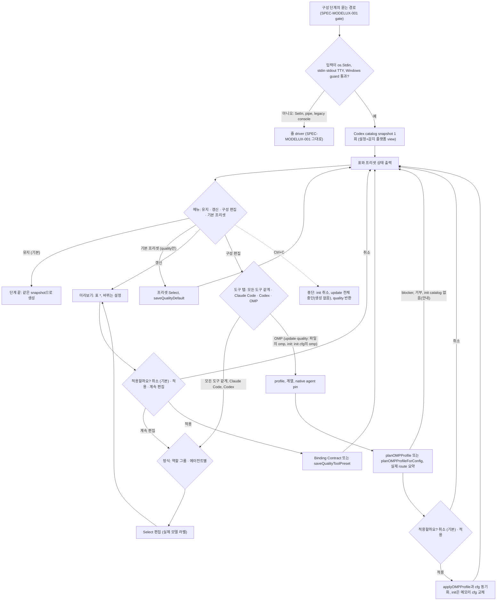

# SPEC-MODELUX-002 구현 계획

## Tasks

순서: T1, T2, T4는 서로 독립이다. T3는 T4의 도구별 후보를 쓴다. T5는 T1, T3, T4 뒤, T6은 T1 뒤, T7은 T5와 T6 뒤다. T8–T10은 T7 뒤, T12는 T6과 T7 뒤, T11은 마지막이다. 기존 파일에는 호출 몇 줄만 더한다(`update.go` 299줄, `init.go` 260줄, `quality.go` 280줄).

- [ ] T1: `[NEW] internal/cli/quality_compose_form.go`(+test). `composeFormsProbe`(Input Mode Contract, wizard의 Windows guard 재사용), `composeRunForm`(기본 `form.WithInput(cmd.InOrStdin()).WithOutput(cmd.OutOrStdout()).Run()`. huh `NewForm`의 기본 출력이 `os.Stderr`라서 명시한다), Select·Confirm builder(`tui.AutopusTheme()`, 폭 미지정, 라벨 terminalSafe), `huh.ErrUserAborted` 판정. 먼저 probe A2를 실행한다: accessible runner와 `iotest.OneByteReader`로 form 5개를 이어 돌려 입력이 빠지지 않는지 (REQ-MUX2-01, REQ-MUX2-02, REQ-MUX2-17).
- [ ] T2: 플랫폼 view와 snapshot 전달. `quality_compose_driver_gate.go`(`[NEW] composeGate.Detected`), `quality_compose_session.go`(view 사본, 쓰기 대상은 읽어 온 cfg), `quality_compose_snapshot.go`(view로 캡처), `update_compose.go`(Detected를 세션에), `platform_update.go`(`[NEW] updateDetectedHarnessPlatformsWith`), `platform_catalog.go`(snapshot을 묶은 descriptor), `update.go`(L217 literal에 `Detected: addedPlatforms`, L255-257 호출 교체. 줄 수 불변). `[NEW] quality_compose_view_test.go`. 이 기계에서 기존 update test를 먼저 돌려 R1을 확인한다 (REQ-MUX2-12, REQ-MUX2-13, REQ-MUX2-16).
- [ ] T3: `[NEW] internal/cli/quality_compose_form_labels.go`(+test). Label Contract: 모든 도구 같게 라벨(`planComposeBinding` 후보), 도구별 라벨(T4 후보), `<cells>` 합치기, Claude slug·effort, Codex 표기 재사용(`composeTableCodexText`) (REQ-MUX2-05, REQ-MUX2-06).
- [ ] T4: `[NEW] internal/cli/quality_compose_tool.go`(+test). Per-Tool Binding Contract: 시작(`ForProvider(p).EffectiveAgentTier`), 분리 후보(`withQualityToolPreset`), 바뀌는 설정 줄, 파일 쓰기 `saveQualityToolPreset`, init 메모리 쓰기, 변경 없음 (REQ-MUX2-07, REQ-MUX2-16).
- [ ] T5: `[NEW] internal/cli/quality_compose_form_driver.go`, `[NEW] internal/cli/quality_compose_form_edit.go`, `[NEW] internal/cli/quality_compose_form_text.go`(각 +test). Form Flow Contract: 메뉴 반복(snapshot 1회, 표 다시 그리기), 도구 탭, 방식, 그룹 Select 4개, 에이전트 목록 → 값, 미리보기(기존 `Preview`와 바뀌는 줄), 확인 Select, `u` 갱신, `auto quality`의 기본 프리셋 Select(`precheckQualityWriteFile`과 cfg 분리 사본으로 `saveQualityDefault`, 성공 뒤에만 동기화), 기준 상태 규칙(마지막 성공 쓰기 뒤 상태 보존), 쓰기 거부·실패 시 경고 1줄(Write Safety Contract) (REQ-MUX2-03, REQ-MUX2-04, REQ-MUX2-08, REQ-MUX2-09, REQ-MUX2-13).
- [ ] T6: `[NEW] internal/cli/quality_compose_omp.go`(+test). OMP Tab Contract: 기존 OMP 편집기 판단을 폼으로, `installedOMPCustomModelChoices`·`requireOMPCustomCapability`로 모델 목록, `planOMPProfile`·`renderOMPQualitySummary` 미리보기, blocker·거부 시 쓰기 0, `applyOMPProfile`, `[NEW] composeReloadConfig`(기본 `config.LoadPreview`)로 `cfg.RoleModelPolicy` 동기화(되읽기가 실패하면 update는 `composeGate.Abort`로 중단, quality는 `--apply` 없이 오류), update·quality 노출 조건과 update 감지 안내, `[NEW] updateComposeOMPDeps`. 이 task 안에서 probe A3를 실행한다 (REQ-MUX2-04, REQ-MUX2-10, REQ-MUX2-11).
- [ ] T7: 진입점 연결. `update_compose.go`·`init_compose.go`·`quality_compose_entry.go`가 `composeFormsProbe`로 폼 driver와 줄 driver를 고른다. Ctrl+C: init은 `[NEW] runInitComposeStepCancellable`과 init.go 4줄 이하로 `init cancelled.`, update는 `[NEW] composeGate.Abort`로 받은 `[NEW] errComposeInterrupted`를 supervisor migration과 생성 전에 돌려준다(update.go +4줄, `updateComposeStep` 시그니처 불변, 통합 결정), quality는 오류 없이 반환. update `Long`을 `[NEW] internal/cli/update_help.go`로 옮긴다(update.go −13줄) (REQ-MUX2-01, REQ-MUX2-14).
- [ ] T8: Must(review R11). `quality_compose_entry_override.go`에 질문 함수를 주입해 폼에서는 huh Confirm(기본 아니오)으로 묻고, 확인한 제거는 구성 쓰기와 같은 `saveQualityBlock` 편집 하나로 한다(실패하면 둘 다 안 남는다). 줄 입력은 기존 `askOverrides`와 두 번 쓰기 그대로 (REQ-MUX2-18).
- [ ] T9: Should. Form Text의 ko/en, locale test (REQ-MUX2-20).
- [ ] T10: Should. 문서: init·update·quality 도움말(기존 문장 유지, 덧붙이기), README, CHANGELOG v0.50.125(도구 탭, `<p>-custom` binding, OMP 탭, 라벨 표기, OSC 11 알려진 동작). 생성 표면은 `content/`·`templates/`를 고친 뒤 `make generate-templates` (REQ-MUX2-19, REQ-MUX2-21).
- [ ] T12: init OMP 메모리 경로(2026-10-12 사용자 결정). `platform_omp_profile_apply.go`에서 `[NEW] planOMPProfileForConfig`를 꺼내고 `planOMPProfile`은 파일을 읽은 뒤 그것을 부른다(출력 불변, 기존 OMP test 통과). `quality_compose_omp.go`의 init 분기: init cfg의 분리 사본으로 plan, `yamlNodeContainsOMPProfilePlaceholder`로 후보 검사, 확인하면 init cfg의 `RoleModelPolicy`만 교체, catalog를 못 읽으면 안내와 원인 줄 뒤 메뉴. `init_compose.go`에 OMP 탭 노출과 `[NEW] initComposeOMPDeps`, `platform_catalog.go`의 OMP descriptor에 test 전용 `[NEW] platformOMPModelRunner`(nil이면 지금과 같음). init 종단 test의 생성 runner는 기존 `ompModelDoctorE2ERunner`(`doctor_omp_model_routing_e2e_test.go:110-146`)를 재사용해 실제 OMP 생성과 되읽기, 생성 실패 시 init rollback까지 확인한다 (REQ-MUX2-04, REQ-MUX2-22, REQ-MUX2-23).
- [ ] T11: 회귀와 smoke. `go test ./pkg/config/... ./pkg/adapter/... ./internal/cli/...`를 필터 없이 돌린다. 기존 `_test.go` 수정 0건(`git diff --stat` 확인), `auto eval harness run`, coverage 85% 이상, 신규·변경 소스 파일 300줄 이하, `GOOS=windows GOARCH=amd64 go build ./...`, golangci-lint. macOS 실제 터미널에서 S20을 실행하고, transcript에서 OSC와 CSI를 지우고 `$HOME`, scratch 경로, 사용자 이름을 placeholder로 바꾼 뒤 `evidence/manual-smoke-002.txt`에 남긴다. `auto update 2>err.log`로 폼이 stdout에 나오는지도 본다 (REQ-MUX2-15, REQ-MUX2-19, 전체).

## Implementation Strategy

- 판단은 새로 만들지 않는다. 표, binding, 등급 투영, Codex 해석, raw quality writer는 SPEC-MODELUX-001의 함수다. 도구별 저장은 기존 도구별 편집기의 `withQualityToolPreset`과 `saveQualityToolPreset`, OMP는 기존 OMP 편집기와 profile apply 함수다. 새 코드는 폼 흐름, 라벨 조립, 플랫폼 view, OMP 쓰기 뒤 동기화다.
- 라벨은 선택지마다 후보 config를 만들고 `buildComposeTable`로 그 칸을 읽는다. 선택지 수는 그룹 하나에 5개, 에이전트 하나에 5개라 비용이 작다. 같은 snapshot을 쓰므로 라벨, 미리보기, 생성이 어긋나지 않는다.
- 줄 driver는 고치지 않는다. 폼 driver는 같은 `composeDriverSession` 부품(Table, Groups, Planner, Text)을 쓰는 별도 흐름이다. 메뉴를 반복할 때마다 planner를 새로 만들어 `u` 갱신 상태가 다음 반복으로 넘어가지 않게 한다. snapshot은 run에서 한 번만 잡는다.
- 플랫폼 view는 표시용 얕은 사본이다. `composeSessionRun`은 쓰기·동기화 대상인 cfg와 감지 목록을 따로 갖고, 표시할 때마다 사본을 만든다. 사본은 쓰기 함수로 가지 않는다.
- test는 실제 명령(`NewRootCmd`)으로 돈다. 대신하는 것은 TTY·CI probe, 폼 판정(`composeFormsProbe`), 폼 실행(`composeRunForm`의 accessible runner), Codex catalog probe, OMP runner·activate, init wizard 결과뿐이다. huh의 실제 렌더링과 화살표 입력은 S20이 닫는다.

## Visual Planning Brief

UI는 터미널 표와 huh Select다. 아래 wireframe은 의도 확인용 low-fi 초안이다(`wireframe intent: assumed`). Gate 1이나 spec review에서 confirm 또는 adjust를 받는다. 요구사항으로 묶는 것은 Label Contract와 Form Flow Contract의 순서·기본값뿐이다.



Wireframe A: update 메뉴(fixture DP: D에 opencode, omp 감지, CAT-A, 일부 행)

```text
에이전트 모델 구성 ────────────────────────────────────────
quality.default = balanced   ultra: 현재 기본값   balanced: 현재 기본값
그룹       에이전트  등급    Claude Code       Codex          OMP            OpenCode
설계·판단  planner   fable   fable-5-1 · max   6-astra · max  플랫폼 기본값  플랫폼 기본값
구현       executor  sonnet  sonnet-5-5 · max  6-luna · max   플랫폼 기본값  플랫폼 기본값
Codex catalog: 읽음 · 대체 0칸
┃ 구성을 바꿀까요?
┃ > 유지
┃   구성 편집
↑ up • ↓ down • enter submit
```

Wireframe B: 도구 탭과 Codex 그룹 Select(fixture D)

```text
┃ 어느 도구를 바꿀까요?
┃ > 모든 도구 같게
┃   Claude Code
┃   Codex

┃ 설계·판단 — planner, architect, spec-writer, security-auditor
┃ > 그대로 — 6-astra · max
┃   6-astra · max  [fable]
┃   6.1-sol · xhigh  [opus]
┃   6-luna · max  [sonnet]
┃   6-luna · max  [haiku]
```

Wireframe C: 모든 도구 같게 그룹 Select(fixture D)

```text
┃ 설계·판단 — planner, architect, spec-writer, security-auditor
┃ > 그대로 — fable
┃   fable — Claude Code: fable-5-1 · max | Codex: 6-astra · max
┃   opus — Claude Code: opus-5-5 · high | Codex: 6.1-sol · xhigh
┃   sonnet — Claude Code: sonnet-5-5 · medium | Codex: 6-luna · max
┃   haiku — Claude Code: haiku-4-5 · - | Codex: 6-luna · max
```

Wireframe D: Claude 탭 에이전트 목록과 확인(fixture D, executor를 opus로 고른 뒤)

```text
┃ 에이전트를 고르세요
┃ > 완료
┃   planner — fable-5-1 · max
┃   executor — opus-5-5 · high
┃   validator — sonnet-5-5 · medium
...
미리보기 (아직 바뀌지 않음)   * = 바뀌는 칸
구현  executor  sonnet  opus · high*  6-luna · max
바뀌는 설정:
  quality.presets.claude-custom 새로 씀 (16개 에이전트)
  quality.providers.claude 없음 → claude-custom
  claude-custom은 balanced 표준 배치를 받지 않음
┃ 적용할까요?
┃ > 취소
┃   적용
┃   계속 편집
```

Wireframe E: OMP 탭(fixture O3, init도 같은 화면)

```text
┃ OMP 구성
┃ 현재: 플랫폼 기본값
┃ > 돌아가기
┃   balanced
┃   ultra
┃   에이전트별 지정 (balanced 위에)

┃ 에이전트를 고르세요
┃ > 완료
┃   scout — 프로필 기본값
┃   task — 프로필 기본값
```

## Feature Completion Scope

- 이 SPEC 하나가 Outcome Lock을 닫는다. T1–T4는 부품(폼 seam, view, 라벨, 도구별 저장), T5–T7은 흐름과 진입점, T8은 override 폼(Must), T9–T10은 Should, T11은 회귀와 smoke, T12는 init OMP 메모리 경로다.
- 승인된 sibling 의존성은 없다. SPEC-MODELUX-001은 같은 branch에 구현된 선행 SPEC이고 같은 PR #196로 출하한다. Completion Debt는 작성 시점에 없다(`research.md`).
- 규모: task 12개, 소스 파일 약 26개(test 포함)다. sibling 기준(25개 초과 task이면서 40개 초과 파일)에 해당하지 않는다.

## Risk-First Integration Probe

| assumption_id | class | risk | boundary | input | oracle | isolation | status | reason | evidence |
|---------------|-------|------|----------|-------|--------|-----------|--------|--------|----------|
| A1 | verified_fact | high | update의 감지 플랫폼 저장(`updateDetectedHarnessPlatforms` → `config.Save`)과 quality 블록 bytes | `auto init --yes --platforms claude-code,codex`로 만든 project에 `auto update --yes`, 이 기계에 antigravity-cli·opencode·omp 설치 | top-level `quality:` 블록 bytes가 같고, 파일 diff가 `platforms` 추가뿐인가 | scratch temp project, `CODEX_HOME`을 scratch로 | PASS | 감지 3개가 더해졌다. 파일 SHA는 바뀌었고 quality 블록 SHA-256은 같았다(`a8ff97ba…`). diff는 `platforms`의 3줄 추가뿐이다. 그래서 REQ-MUX2-13과 S11, S20의 oracle을 블록 bytes로 정한다 | `evidence/probe-a1.md`(run.sh, SHA-256, diff, update 출력, 경로 치환). 실행 2026-10-12, 바이너리 HEAD 44773355 |
| A2 | implementation_assumption | high | `composeRunForm`의 huh accessible mode가 여러 form을 이어 돌릴 때의 입력 소비 | Select 4개와 Confirm 1개를 `iotest.OneByteReader(strings.NewReader("2\n\n3\n\ny\n"))`로 | 각 form이 정확히 자기 줄만 읽고, 묶인 값이 입력대로이며, EOF는 기본값이다 | unit test, 실제 터미널 없음 | not-run | seam이 아직 없다. accessible `PromptString`이 질문마다 Scanner를 새로 만든다는 것은 소스로만 확인했다. T1의 첫 작업으로 실행한다 | - |
| A3 | implementation_assumption | high | OMP 선택이 같은 run의 저장·생성까지 남는가: update 구성 단계 안의 `applyOMPProfile`과 뒤 `config.Save`·생성 루프, init 메모리 경로와 init의 `config.Save`·OMP 생성 | update: OMP가 설정되고 감지 플랫폼이 하나 있는 project, OMP 가짜 runner(`ompCLIBalancedCatalogJSON`), activate stub / init: `--platforms claude-code,codex,omp`, `initComposeOMPDeps`와 `platformOMPModelRunner`에 가짜 runner | update는 감지 플랫폼 저장 뒤에도 파일에 `role_model_policy.agents.task`가 남고 루프의 OMP 갱신이 받은 cfg에 같은 pin이 있다. init은 끝난 autopus.yaml의 `role_model_policy`가 승인한 pin과 같고 OMP 생성이 가짜 runner로 돈다 | temp project, 주입 deps와 runner | not-run | OMP 다리, init 경로, `platformOMPModelRunner`가 아직 없다. init 생성 runner는 `ompModelDoctorE2ERunner`를 재사용한다. 생성 실패 주입으로 rollback도 본다. T6과 T12에서 실행한다 | - |

## Plan Statement Classification

| Statement | Class | Evidence |
|-----------|-------|----------|
| 유지, 취소, 중단, 변경 없음은 quality 블록과 role_model_policy bytes를 바꾸지 않는다 | requirement_invariant | REQ-MUX2-13, S11, S12 |
| 라벨, 미리보기, 생성은 같은 snapshot의 같은 해석 함수 값이다 | requirement_invariant | REQ-MUX2-05, 06, 16, S4–S6, S14 |
| 줄 입력의 출력은 HEAD 44773355와 bytes가 같다 | requirement_invariant | REQ-MUX2-15, S1, S13 |
| 감지 플랫폼 저장은 init이 만든 파일의 quality 블록 bytes를 바꾸지 않는다 | verified_fact | probe A1 (2026-10-12) |
| 시작 시 OSC 11 query는 bubbletea v1.3.6 package init이 보낸다 | verified_fact | module cache `tea_init.go:7-22` Read, `GODEBUG=inittrace=1` 순서(termenv → lipgloss → bubbletea) |
| 표는 `cfg.Platforms`로 열을 고르고 감지 플랫폼은 구성 단계 뒤에 더해진다 | verified_fact | `quality_compose_table.go:91-95`, `update.go:179,217,255-257` Read, S21 transcript L219-241 |
| 감지 플랫폼 생성은 snapshot 없이 adapter가 스스로 probe한다 | verified_fact | `platform_update.go:64`, `platform_lifecycle.go:72`, `platform_catalog.go:125-135` Read |
| `applyOMPProfile`은 자기가 읽은 cfg로 쓰고 활성화하며 호출자의 cfg는 그대로다 | verified_fact | `platform_omp_profile_apply.go:160-194` Read |
| huh accessible mode는 숫자 입력과 EOF 기본값으로 진짜 field를 돌린다 | verified_fact | huh v1.0.0 `form.go:662-718`, `field_select.go:712-744`, `accessibility.go:131-163` Read |
| accessible runner와 1byte reader로 이어진 form들이 입력을 잃지 않는다 | implementation_assumption | probe A2 |
| OMP 쓰기 뒤 cfg 동기화가 update와 `--apply`의 뒤 저장·생성을 모두 덮는다 | implementation_assumption | probe A3 |
| 기존 update test는 감지 플랫폼 열 추가에 영향받지 않는다 | implementation_assumption | update test 다수가 PATH를 설정한다(값은 미확인), R1, T2에서 이 기계로 실행 |
| OMP adapter에는 `WithModelIntegrationRunner` seam이 있고 CLI의 OMP descriptor는 exec runner를 그대로 쓴다 | verified_fact | `pkg/adapter/omp/omp_model_integration.go:21-25`, `omp.go:45-51`, `internal/cli/platform_catalog.go:86-89` Read와 grep(2026-10-12) |
| init 메모리 경로의 OMP 검사는 파일 경로와 같은 함수다 | requirement_invariant | REQ-MUX2-22, S21 |
| `planOMPProfileForConfig` 추출은 `planOMPProfile`의 출력을 바꾸지 않는다 | implementation_assumption | 기존 OMP profile·편집기 test, T12 |
| huh `NewForm`의 기본 출력은 `os.Stderr`다 | verified_fact | huh v1.0.0 `form.go:112` Read |
| `ompModelDoctorE2ERunner`는 catalog와 `--config` 파일 되읽기에 답하고 실제 `Generate`에 쓰인다 | verified_fact | `doctor_omp_model_routing_e2e_test.go:36,77,110-146` Read |
| update 구성 단계 wrapper의 시그니처는 `func(cmd, dir, cfg, composeGate) driftGenerationSnapshot`이다 | verified_fact | `update_compose_helpers_test.go:143-146` Read |

## Gate Applicability

- `{SPEC_DIR}/gate-applicability.json`은 아직 없다. 구현 handoff에서는 `auto spec gates`가 쓴 값만 쓴다. 사용자 설정 파일 쓰기(quality 블록, role_model_policy), subprocess(`omp`, `codex`), 터미널 UI 변화를 다루므로 classifier가 `security_or_data`로 볼 것으로 예상한다. 이것은 예상일 뿐 판정이 아니다.
- security, validation, data_loss, deterministic_oracle gate는 `not_applicable`이 될 수 없다. 터미널 UI 경로가 있으므로 accessibility와 ux_verification은 classifier 판단에 맡긴다.
- 요구사항보다 넓은 제약(예: 줄 driver에도 실제 모델 라벨, OMP 쓰기의 서식 보존, update 감지 직후의 OMP 지정)은 요구사항으로 올리지 않는다. scope expansion으로 표시하고, fan-out 전에 probe 행으로 확인한다.
