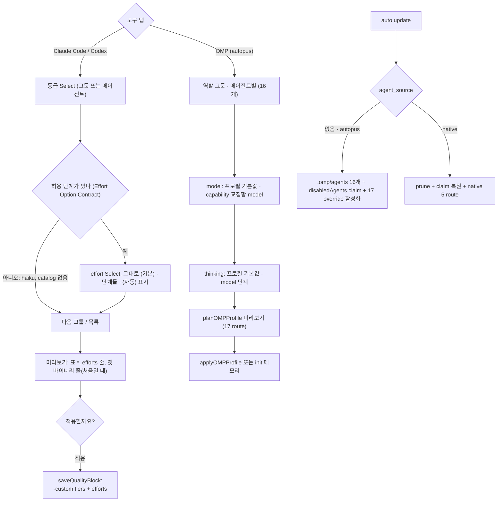

# SPEC-MODELUX-003 구현 계획

## Tasks

순서: T1 → (T2, T3 독립) → T4·T5·T6(T3 뒤, 서로 독립) → T7·T8(T6 뒤) → T9(T2 뒤) → T10(T6, T9 뒤) → T11(T4, T5 뒤) → T12 → T13. 300줄 근처 파일(`quality_compose_omp.go` 292, `quality_compose_form_driver.go` 290, `schema.go` 290)에는 호출 몇 줄만 더한다.

- [ ] T1: 기존 test 목록. `rg 'OMPNativeAgentNames|OMPNativeAgentForRole|shadowsOMPNativeAgent|native_agent_shadowed|\.omp/agents' --glob '*_test.go'` 결과를 `research.md`에 붙이고 Existing Test Changes 규칙(fixture 한 줄 또는 기본값 전환 단언)을 파일마다 정한다. 소스 변경 없음 (REQ-MUX3-16).
- [ ] T2: effort 설정. 소유: `pkg/config/schema.go`(+1줄), `[NEW] pkg/config/quality_effort.go`(+test), `schema_model_selection.go`, `quality_effective.go`, `native_balanced.go`, `codex_profile.go`. `QualityPreset.Efforts`, 값 집합, load 검증 오류 문구, `AgentEffort`, 명시 effort는 표준 배치를 떠남, Claude haiku 제외, Codex 사다리 자리 교체 (REQ-MUX3-01, REQ-MUX3-02).
- [ ] T3: agent source. 소유: `pkg/config/role_model_policy.go`(+1줄), `[NEW] pkg/config/omp_agent_source.go`(+test), `role_model_policy_validate.go`. 값 검증(`agent_source_invalid`), 정책 존재 판정 제외, 모드 helper와 모드별 agent 집합(16 + task / native 5) (REQ-MUX3-06).
- [ ] T4: OMP agent 파일. 소유: `[NEW] pkg/content/agent_transformer_omp_render.go`(+test), `[NEW] pkg/adapter/omp/omp_agents.go`(+test), `pkg/adapter/omp/omp.go`, `omp_rooted_lifecycle.go`. `61f72bb0^` 생성기를 model 없이 되살리고 `thinkingLevel`·reviewer `output`을 더한다. 은퇴 정리는 native에서만. manifest 밖 사용자 파일은 건너뛰고, manifest 파일을 사용자가 고쳤으면 `.autopus/backup/<ts>/`에 복사 후 덮는다(Generate와 Update 둘 다) (REQ-MUX3-07, 08, 09).
- [ ] T5: disabledAgents claim. 소유: `[NEW] pkg/adapter/omp/omp_agent_surface_claim.go`(+test). `MergeOMPProjectManagedConfig`(FullArrayOwnership, prior 지문)와 ownership ledger로 Disabled Agents Contract 5행, native 모드 preimage 복원. 먼저 probe A3을 돌린다 (REQ-MUX3-10, REQ-MUX3-15).
- [ ] T6: Autopus 이름 route. 소유: `[NEW] pkg/config/role_model_policy_autopus_agents.go`(+test), `pkg/adapter/omp/omp_model_integration_bridge.go`, `omp_model_projection.go`, `omp_model_routing_compile.go`. Route Contract(① 자기 pin ② 옛 native pin 펼침 ③ 프로필 route, task는 대표 규칙), 모드별 순위, family 기준 executor, autopus 모드의 conflict 비활성 (REQ-MUX3-11).
- [ ] T7: CLI 소비처. 소유: `internal/cli/platform_omp_agent_catalog.go`, `platform_omp_projection_build.go`, `platform_omp_profile_preview.go`, `pipeline_backend_omp_models.go`, `pipeline_backend_orca_models.go`, `doctor_omp_model_routing_probe.go`, `quality_compose_table.go`. Agent Set Contract의 catalog 17행, `autopus_agent_missing`, shadow 판정 반전, receipt phase 이름, 표 OMP 칸 (REQ-MUX3-12).
- [ ] T8: skill dispatch. 소유: `pkg/content/skill_transformer_replace_omp.go`, `skill_transformer_replace_omp_render.go`, `pkg/adapter/omp/omp_skills.go`. `[NEW] NormalizeOMPSemanticReferencesFor(body, source)`, 옛 함수는 native 동작 유지 (REQ-MUX3-12).
- [ ] T9: effort 폼(Claude·Codex). 소유: `[NEW] internal/cli/quality_compose_effort.go`(+test), `[NEW] quality_compose_form_effort.go`(+test), `quality_compose_form_edit.go`, `quality_compose_tool.go`, `quality_tool_persist.go`, `quality_compose_form_text.go`. Effort Option Contract, 등급 Select 뒤 effort Select, `(자동)` 표시, 자동과 같으면 저장 안 함, `setQualityToolPreset`의 effort 보존, 바뀌는 설정 줄과 옛 바이너리 줄, init 메모리 경로 (REQ-MUX3-03, 04, 05).
- [ ] T10: OMP 탭(autopus). 소유: `[NEW] internal/cli/quality_compose_omp_autopus.go`(+test), `quality_compose_omp.go`(모드 분기). 역할 그룹·에이전트별, capability 교집합 model 목록, thinking 교집합, thinking만 바꾸면 plan의 effective selector로 pin, 기존 적용·동기화·init 경로 (REQ-MUX3-13).
- [ ] T11: migration과 되돌리기. 소유: `[NEW] internal/cli/platform_omp_agent_migration.go`(+test). update 미리보기 줄(Migration Contract), 사용자 파일 줄, `sonic` pin 경고, native 전환 줄. autopus.yaml을 쓰지 않음을 test로 고정한다 (REQ-MUX3-14, REQ-MUX3-15).
- [ ] T12: Should. Form Text ko/en, help·README·CHANGELOG v0.50.125(`efforts` 한계, Autopus 기본, `agent_source: native`와 다음 릴리스 제거). 생성 표면은 `content/`·`templates/` 수정 뒤 `make generate-templates` (REQ-MUX3-18, REQ-MUX3-19).
- [ ] T13: 회귀와 smoke. `go test ./pkg/... ./internal/cli/...` 필터 없이, T1 규칙 밖의 기존 test 변경 0(`git diff --stat 93dbb564 -- '*_test.go'` 검토), `auto eval harness run`, coverage 85% 이상, 300줄, `GOOS=windows GOARCH=amd64 go build ./...`, golangci-lint. macOS 실제 터미널에서 S17을 실행하고 `evidence/manual-smoke-003.txt`에 경로를 치환해 남긴다 (REQ-MUX3-16, REQ-MUX3-17).

## Implementation Strategy

- 판단을 새로 만들지 않는다. effort 해석은 `AgentTier`와 같은 프리셋 조회, Codex는 `ResolveCodexProfile`, 폼은 SPEC-MODELUX-002 driver·라벨·planner, OMP 쓰기는 기존 apply·activation·claim·ledger다.
- 작업 구성은 에이전트마다 (등급, effort)다. effort가 없는 에이전트는 자동이라, 이 SPEC 전의 fixture와 줄 driver 출력은 같다.
- agent source는 config 한 곳(`omp_agent_source.go`)이 정하고 모든 OMP 소비처가 그 집합을 받는다. native 경로 코드는 지우지 않는다(한 릴리스 유예).
- OMP 쓰기는 adapter의 한 transaction에 모은다(agent 파일, claim, ledger, 활성화). 실패하면 기존 snapshot 복원이 전부 되돌린다.

## Visual Planning Brief

UI는 SPEC-MODELUX-002의 huh Select에 effort Select가 더해진 것이다. wireframe은 의도 확인용 초안이다(`wireframe intent: assumed`). 요구사항으로 묶는 것은 Effort Option Contract와 순서·기본값뿐이다.



Wireframe A: Codex 탭 설계·판단 그룹(fixture D, CAT-E)

```text
┃ 설계·판단 — planner, architect, spec-writer, security-auditor
┃ > 그대로 — 6-astra · max
┃   6.1-sol · xhigh  [opus]
┃ 설계·판단 effort
┃ > 그대로 — 6.1-sol · xhigh
┃   6.1-sol · low
┃   6.1-sol · medium
┃   6.1-sol · high
┃   6.1-sol · xhigh (자동)
```

Wireframe B: OMP 탭 에이전트별 thinking(fixture O3, 프로필 balanced)

```text
┃ 에이전트를 고르세요
┃ > 완료
┃   planner — 프로필 기본값
┃   explorer — 프로필 기본값
┃ planner thinking
┃ > 프로필 기본값 (<plan thinking>)
┃   low · medium · high · xhigh · max   (model이 보고한 단계)
```

## Feature Completion Scope

- 이 SPEC 하나가 Outcome Lock을 닫는다. T2·T9는 effort, T3–T8·T10·T11은 OMP agent source, T1·T13은 회귀와 smoke, T12는 Should다.
- 승인된 sibling 의존성은 없다. SPEC-MODELUX-001·002와 같은 PR #196로 출하한다. Completion Debt는 작성 시점에 없다(S17이 빠지면 debt).
- 규모: task 13개, 소스 파일 약 38개(test 포함). sibling 기준(25개 초과 task이면서 40개 초과 파일)에 못 미친다.

## Risk-First Integration Probe

| assumption_id | class | risk | boundary | input | oracle | isolation | status | reason | evidence |
|---------------|-------|------|----------|-------|--------|-----------|--------|--------|----------|
| A1 | verified_fact | high | OMP 18.6.1 설정 layer가 bundled가 아닌 이름의 `task.agentModelOverrides` key와 `task.disabledAgents`를 받는가 | overlay `{planner, reviewer, task}` override와 `[scout, security-reviewer, sonic]`, `PI_CONFIG_FILES` | `omp config get … --json`이 같은 record와 array를 돌려주고 overlay 없으면 기본값이다 | scratch HOME·XDG·`PI_CODING_AGENT_DIR`, 모델 호출 없음 | PASS | record에 `planner`가 그대로 있고 array 3개가 되읽혔다. `--config`는 `config get`에서 무시된다(18.6.1). 세션 dispatch 적용은 A2로 남긴다 | `evidence/probe-omp-18.6.1.md` P3a–P3d(2026-10-12) |
| A2 | implementation_assumption | high | plain `omp` 세션이 project `.omp/agents` 16개를 발견하고 reviewer가 bundled를 대신하며 disabledAgents가 셋을 숨기고 override가 이름대로 적용되는가 | S17의 init 결과 project에서 `omp` TUI를 열고 `/agents`만 본다(메시지 없음) | `/agents`에 16개 + task, scout·security-reviewer·sonic은 disabled, model 열이 override 값 | 실제 터미널, provider 호출 없음 | not-run | 18.6.1에 읽기 전용 목록 명령이 없고(`omp agents`는 unpack뿐) TUI는 자동화하지 않는다. 정적 근거 S:524490·S:564994·S:526773은 research에 있다. T13 S17에서 실행한다 | - |
| A3 | implementation_assumption | high | 기존 managed-claim merge와 ownership ledger가 프로필 없는 `task.disabledAgents` claim을 쓰고 native에서 preimage로 복원하는가 | `.omp/config.yml` 없음·key 없음·ADK 소유·사용자 소유 fixture 4개 | Disabled Agents Contract 표의 bytes와 ledger, 복원 뒤 원본 SHA | temp dir, adapter unit test | not-run | 지금 claim 집합은 프로필 `ManagedKeys`와 수가 같아야 한다(`omp_model_integration_project.go:19-21`). 프로필 밖 claim은 새 경로다. T5 첫 작업이다 | - |

## Plan Statement Classification

| Statement | Class | Evidence |
|-----------|-------|----------|
| `efforts`가 없는 파일의 생성 결과는 HEAD 93dbb564와 같다 | requirement_invariant | REQ-MUX3-01, S1, S2 |
| 선택지는 그 도구·model이 지원하는 단계뿐이다 | requirement_invariant | REQ-MUX3-03, 13, S3, S4, S10 |
| `.omp/agents`에는 model이 없고 route는 override로만 간다 | requirement_invariant | REQ-MUX3-07, 11, S7, S9 |
| OMP 설정은 사용자 이름 override key와 disabledAgents를 되읽는다 | verified_fact | probe P3(A1) |
| `omp config get`은 `--config` overlay를 무시한다(18.6.1) | verified_fact | probe P3d |
| bundled reviewer는 `@slow`와 verdict `output`을 갖는다 | verified_fact | probe P0 |
| 지금 OMP update는 manifest 밖 기존 파일을 백업 없이 쓴다 | verified_fact | `omp_rooted_lifecycle.go:98-175` Read |
| plain 세션의 발견·대체·숨김·이름별 override 적용 | implementation_assumption | A2, S17 |
| 프로필 밖 disabledAgents claim과 복원 | implementation_assumption | A3, S7, S13 |
| override `:thinking`이 frontmatter `thinkingLevel`보다 먼저다 | implementation_assumption | 정적 S:543407 일부, S17 |
| task를 끄면 이름 없는 dispatch가 실패한다 | verified_fact | 정적 S:526773(`defaultAgent` 뒤 disabled 검사) Read |

## Gate Applicability

- `{SPEC_DIR}/gate-applicability.json`은 아직 없다. 구현 handoff에서는 `auto spec gates`가 쓴 값만 쓴다. 사용자 설정·사용자 파일 쓰기(`.omp/config.yml`, `.omp/agents`, quality 블록)와 subprocess(`omp`)를 다루므로 classifier가 `security_or_data`로 볼 것으로 예상한다. 예상일 뿐 판정이 아니다.
- security, validation, data_loss, deterministic_oracle gate는 `not_applicable`이 될 수 없다. 터미널 UI 경로가 있으므로 accessibility와 ux_verification은 classifier가 정한다.
- 요구사항보다 넓은 제약(예: 프로필 없는 자동 route, OMP 버전별 `/review` schema 추적)은 scope expansion으로 표시하고 fan-out 전에 probe 행으로 확인한다.
