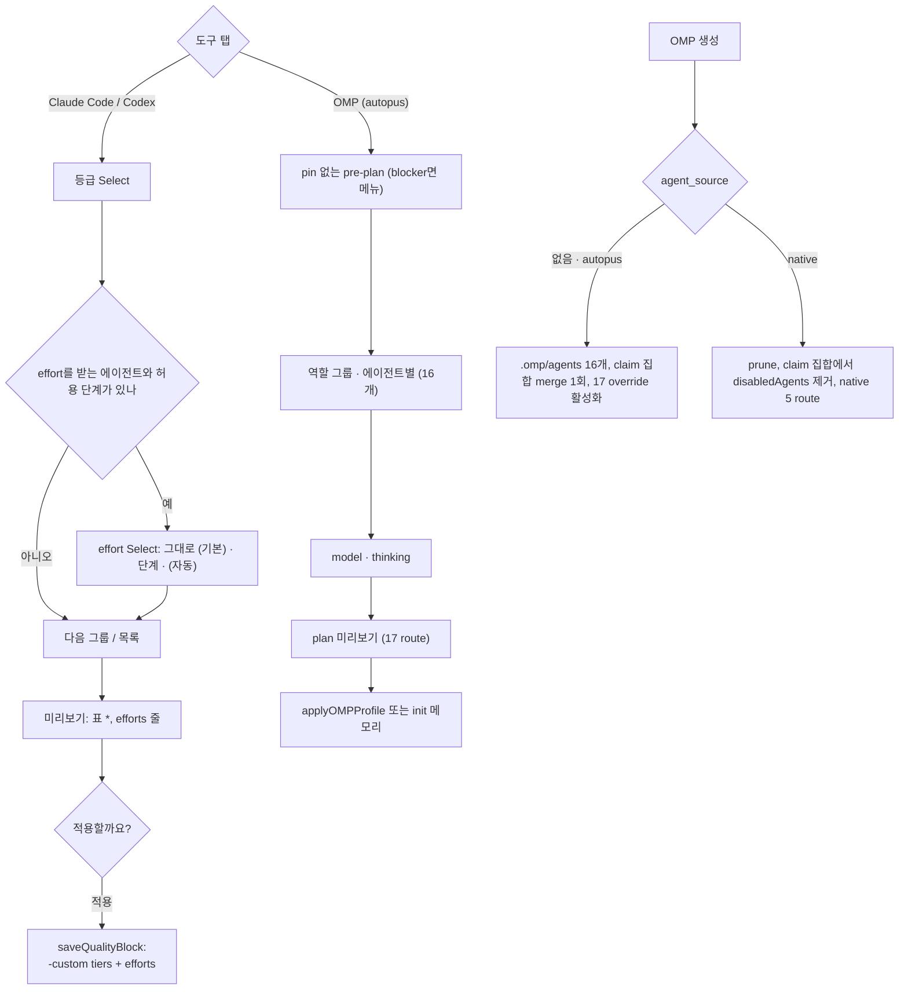

# SPEC-MODELUX-003 구현 계획

## Tasks

기준은 `v0.50.125`(dd6d6ea2)이고 branch는 `feat/modelux-003`이다. 순서: T1 → (T2, T3) → T5의 probe A3 → T4·T5·T6(T3 뒤) → T7·T8(T6 뒤) → T9·T10(T2 뒤) → T11(T6, T9 뒤) → T12(T4, T5 뒤) → T13 → T14. 292·290줄 파일(`quality_compose_omp.go`, `quality_compose_form_driver.go`, `schema.go`)에는 호출 몇 줄만 더한다.

- [ ] T1: 기존 test 분류. `research.md` `### 기존 test`의 27개 파일마다 기본값 전환 단언·native fixture·native option·폼 입력 Enter·무변경 중 하나를 정해 research에 붙인다. 소스 변경 없음 (REQ-MUX3-16).
- [ ] T2: effort 설정. 소유: `pkg/config/schema.go`(+1줄), `[NEW] pkg/config/quality_effort.go`(+test), `schema_model_selection.go`, `quality_effective.go`, `native_balanced.go`, `codex_profile.go`. `QualityPreset.Efforts`, load 검증 오류 문구, `AgentEffort`, 명시 effort는 표준 배치를 떠남, Claude haiku 제외, Codex 사다리 자리 교체 (REQ-MUX3-01, 02).
- [ ] T3: agent source와 load 검증. 소유: `pkg/config/role_model_policy.go`(+1줄), `[NEW] pkg/config/omp_agent_source.go`(+test), `role_model_policy_validate.go`. 값 검증, 정책 존재 판정 제외, 모드별 agent 집합, `validateOMPNativeAgentCollapse`(L52-54, L72-80)는 native 모드만, autopus는 `[NEW] validateOMPAutopusAgentRoutes` (REQ-MUX3-06, 11).
- [ ] T4: OMP agent 파일. 소유: `[NEW] pkg/content/agent_transformer_omp_render.go`(+test), `[NEW] pkg/adapter/omp/omp_agents.go`(+test), `[NEW] pkg/adapter/omp/testdata/omp-18.6.1-reviewer-output.yaml`, `pkg/adapter/omp/omp.go`, `omp_rooted_lifecycle.go`. 생성기 복원(model 없음), `thinkingLevel`은 override에 없는 에이전트만, reviewer `output` = golden. 사용자 파일 보호는 Generate 쓰기 loop(`omp.go:89-100`)와 Update resolver(`omp_rooted_lifecycle.go:98-134`) 두 자리에 넣고, 고친 manifest 파일은 기존 transaction 백업으로 덮는다. `ompRetiredAgentDir` 주석(`omp.go:20-24`)을 고친다 (REQ-MUX3-07, 08, 09).
- [ ] T5: claim 집합. 먼저 probe A3을 돌린다. 소유: `[NEW] pkg/adapter/omp/omp_agent_surface_claim.go`(+test), `omp_model_integration_project.go`, `omp_rooted_lifecycle_config.go`, `omp_model_integration_ownership_rooted.go`, `omp_model_integration_clean.go`, `omp.go`(L208-216 gate와 주석). Claim Set Contract 전부: 합친 claim 집합 merge 한 번, ledger owner 필드(v0.50.125가 읽는지 먼저 확인, 아니면 새 ledger 이름), release·clean·재기준·사용자 소유·실패 복원 (REQ-MUX3-10, 15).
- [ ] T6: route와 adapter 소비처. 소유: `[NEW] pkg/config/role_model_policy_autopus_agents.go`(+test), `pkg/adapter/omp/omp_model_integration_bridge.go`, `omp_model_projection.go`(`validateOMPProjectionAgents`는 autopus에서 이름 그대로, `CompileOMPModelProjection`은 모드 집합을 돈다), `omp_model_projection_overlay.go`(L19 이름 검사), `omp_model_integration_degraded.go`(L21-37 operator pin 판정), `omp_model_routing_compile.go`(순위, family 기준 executor), `omp_model_doctor_projection.go`. Route Contract의 task 규칙과 degraded 규칙 (REQ-MUX3-11, 12).
- [ ] T7: CLI 소비처. 소유: `internal/cli/platform_omp_agent_catalog.go`, `platform_omp_projection_build.go`, `platform_omp_profile_preview.go`, `pipeline_backend_omp_models.go`, `pipeline_backend_orca_models.go`, `doctor_omp_model_routing_probe.go`, `quality_compose_table.go`. catalog 17행, `autopus_agent_missing`, shadow 반전, receipt phase 이름, 표 칸 (REQ-MUX3-12).
- [ ] T8: 렌더 mode. 소유: `pkg/content/skill_transformer_replace.go`, `skill_transformer_replace_omp.go`, `skill_transformer_replace_omp_render.go`, `skill_resources.go`, `skill_transformer.go`, `agent_transformer_mapping.go`, `generate.go`, `pkg/adapter/omp/omp_skills.go`, `omp_rules.go`, `omp_workflow_render.go`, `templates/shared/omp-agent-pipeline.md.tmpl`. `[NEW] ReplacePlatformReferencesWith`, 기본은 autopus, OMP adapter는 cfg mode를 넘긴다. cfg 없이 만든 OMP 텍스트가 native 생성에 쓰이는지 먼저 확인하고, 쓰이면 adapter가 원천에서 다시 렌더한다 (REQ-MUX3-21).
- [ ] T9: effort 폼(Claude·Codex). 소유: `[NEW] internal/cli/quality_compose_effort.go`(+test), `[NEW] quality_compose_form_effort.go`(+test), `quality_compose_form_edit.go`, `quality_compose_tool.go`, `quality_tool_persist.go`, `quality_compose_form_text.go`. Effort Option Contract, 등급 Select 뒤 effort Select, `(자동)`, 자동과 같으면 저장 안 함, 바뀌는 설정 줄, 옛 바이너리 줄, init 메모리 경로 (REQ-MUX3-03, 04, 05).
- [ ] T10: efforts 보존. 소유: `internal/cli/quality_compose_bind.go`(L173), `quality_compose_bind_write.go`(L29-52), `quality_tool_interactive.go`(L207-222), 갱신 경로 파일(`pkg/config/quality_preset_history.go` 또는 그 호출자). Efforts Preservation Contract 5행 (REQ-MUX3-20).
- [ ] T11: OMP 탭(autopus). 소유: `[NEW] internal/cli/quality_compose_omp_autopus.go`(+test), `quality_compose_omp.go`(분기). pin 없는 pre-plan과 blocker 처리, 역할 그룹·에이전트별, metadata 없는 catalog 규칙, thinking 교집합, thinking만 바꾸면 pre-plan selector로 pin, 기존 적용·동기화·init 경로 (REQ-MUX3-13).
- [ ] T12: migration과 되돌리기 출력. 소유: `[NEW] internal/cli/platform_omp_agent_migration.go`(+test). 미리보기 줄, 사용자 파일 줄, `sonic` pin 경고, native 줄. autopus.yaml을 쓰지 않음을 고정한다 (REQ-MUX3-14, 15).
- [ ] T13: Should. Form Text ko/en, help·README·CHANGELOG v0.50.126(`efforts` 한계, Autopus 기본, `agent_source: native`와 v0.50.127 제거). 생성 표면은 `content/`·`templates/` 수정 뒤 `make generate-templates` (REQ-MUX3-18, 19).
- [ ] T14: 회귀와 smoke. `go test ./pkg/... ./internal/cli/...` 필터 없이, `git diff --stat v0.50.125 -- '*_test.go'`가 T1 분류와 맞는지, `auto eval harness run`, coverage 85%, 300줄, `GOOS=windows GOARCH=amd64 go build ./...`, golangci-lint. S17을 실제 터미널에서, S23을 사용자 동의 뒤 실행하고 `evidence/manual-smoke-003.txt`에 경로를 치환해 남긴다. 둘 중 하나라도 빠지면 CD-1·CD-2가 남는다 (REQ-MUX3-16, 17).

## Implementation Strategy

- 판단을 새로 만들지 않는다. effort는 `AgentTier`와 같은 프리셋 조회와 `ResolveCodexProfile`, 폼은 SPEC-MODELUX-002 driver·라벨·planner, OMP 쓰기는 기존 apply·activation·claim merge·ledger·transaction 백업이다.
- agent source는 `omp_agent_source.go` 한 곳이 정하고 Agent Set Contract의 소비처가 모두 그 집합을 받는다. native 경로 코드는 지우지 않는다(v0.50.126 유예).
- OMP 쓰기는 adapter의 한 transaction에 모은다(agent 파일, `.omp/config.yml`, ledger, manifest, 활성화). 실패하면 기존 snapshot 복원이 모두 되돌린다.
- route가 있는 에이전트는 frontmatter에 thinking이 없으므로 OMP의 우선순위 규칙에 기대지 않는다.

## Visual Planning Brief

UI는 SPEC-MODELUX-002 huh Select에 effort Select가 더해진 것이다(`wireframe intent: assumed`). 요구사항으로 묶는 것은 Effort Option Contract와 순서·기본값뿐이다.



Wireframe A: Codex 탭 설계·판단(fixture D, CAT-E)

```text
┃ 설계·판단 — planner, architect, spec-writer, security-auditor
┃ > 그대로 — 6-astra · max
┃   6.1-sol · xhigh  [opus]
┃ 설계·판단 effort
┃ > 그대로 — 6.1-sol · xhigh
┃   6.1-sol · low   6.1-sol · medium   6.1-sol · high   6.1-sol · xhigh (자동)
```

Wireframe B: OMP 탭 에이전트별 thinking(fixture OP)

```text
┃ planner thinking
┃ > 프로필 기본값 (<pre-plan thinking>)
┃   model이 보고한 단계들
```

## Feature Completion Scope

- 이 SPEC 하나가 Outcome Lock을 닫는다. T2·T9·T10은 effort, T3–T8·T11·T12는 OMP agent source, T1·T14는 회귀와 smoke, T13은 Should다.
- 승인된 sibling 의존성은 없다. 규모는 task 14개(25개 이하), 소스 파일 test 포함 약 60개다. Completion Debt CD-1·CD-2는 T14의 S17·S23 기록으로만 닫힌다.

## Risk-First Integration Probe

| assumption_id | class | risk | boundary | input | oracle | isolation | status | reason | evidence |
|---------------|-------|------|----------|-------|--------|-----------|--------|--------|----------|
| A1 | verified_fact | high | OMP 18.6.1 설정 layer가 bundled가 아닌 이름의 `task.agentModelOverrides` key와 `task.disabledAgents`를 받는가 | overlay `{planner, reviewer, task}` override와 `[scout, security-reviewer, sonic]`, `PI_CONFIG_FILES` | `omp config get … --json`이 같은 record·array를 돌려주고 overlay가 없으면 기본값 | scratch HOME·XDG·`PI_CODING_AGENT_DIR`, 모델 호출 없음 | PASS | `planner` key가 record로 되읽혔고 array 3개가 되읽혔다. `config get`은 `--config`를 무시한다. dispatch 적용은 A2와 S23이다 | `evidence/probe-omp-18.6.1.md` P3a–P3d(2026-10-12) |
| A2 | implementation_assumption | high | plain `omp` 세션이 `.omp/agents` 16개를 발견하고 reviewer가 bundled를 대신하며 disabledAgents가 셋을 숨기는가 | S17 project에서 `omp` TUI를 열고 `/agents`만 본다(메시지 없음) | `/agents`에 16개 + task, 셋은 disabled, reviewer 설명이 content의 description | 실제 터미널, provider 호출 없음 | not-run | 18.6.1에 읽기 전용 목록 명령이 없다(`omp agents`는 unpack뿐). 정적 근거 S:524490·S:564994는 research에 있다. T14가 실행하고 빠지면 CD-1이다 | - |
| A3 | implementation_assumption | high | 합친 claim 집합(프로필 key ∪ `task.disabledAgents`)을 ledger 하나로 merge·release·clean·재기준할 수 있는가 | `.omp/config.yml` 없음·key 없음·ADK 소유·사용자 소유·project-managed 프로필 fixture | Claim Set Contract 표의 bytes와 ledger, 전환 뒤 SHA | temp dir, adapter test | not-run | 지금 merge는 프로필 finalize에서만 불리고 `ManagedKeys` 수 검사가 있다(`omp_model_integration_project.go:19-21`). T5의 첫 작업이다 | - |

## Plan Statement Classification

| Statement | Class | Evidence |
|-----------|-------|----------|
| `efforts`가 없는 파일의 생성 결과와 줄 driver 출력은 v0.50.125와 같다 | requirement_invariant | REQ-MUX3-01, 16, S1, S16 |
| 선택지는 그 도구·model이 지원하는 단계뿐이다 | requirement_invariant | REQ-MUX3-03, 13, S3, S4, S10 |
| route가 있는 에이전트의 frontmatter에는 `thinkingLevel`이 없다 | requirement_invariant | REQ-MUX3-07, S7 |
| OMP 설정은 사용자 이름 override key와 disabledAgents를 되읽는다 | verified_fact | probe P3(A1) |
| bundled reviewer의 `output`은 verdict 필드를 담는다 | verified_fact | probe P0 |
| OMP transaction은 덮기 전 기존 bytes를 `.autopus/backup/<id>/transaction/omp/<path>`에 남긴다 | verified_fact | `omp_rooted_transaction.go:114`, `pkg/adapter/transaction.go:114,262` Read |
| Generate는 manifest 밖 기존 파일도 덮어쓴다 | verified_fact | `omp.go:89-100` Read |
| task를 끄면 이름 없는 dispatch가 실패한다 | verified_fact | 정적 S:526773 Read |
| `config get`은 `--config`를 무시한다(18.6.1) | verified_fact | probe P3d |
| plain 세션의 발견·대체·숨김 | implementation_assumption | A2, S17, CD-1 |
| 이름별 override의 dispatch 적용과 `/review` verdict | implementation_assumption | S23, CD-2 |
| 합친 claim 집합의 merge·release·clean | implementation_assumption | A3, S22 |

## Gate Applicability

- `{SPEC_DIR}/gate-applicability.json`은 아직 없다. 구현 handoff에서는 `auto spec gates`가 쓴 값만 쓴다. 사용자 설정·파일 쓰기(`.omp/config.yml`, `.omp/agents`, quality 블록)와 subprocess(`omp`)를 다루므로 classifier가 `security_or_data`로 볼 것으로 예상한다. 예상일 뿐 판정이 아니다.
- security, validation, data_loss, deterministic_oracle gate는 `not_applicable`이 될 수 없다. 터미널 UI 경로가 있으므로 accessibility와 ux_verification은 classifier가 정한다.
- 요구사항보다 넓은 제약(예: 프로필 claim의 conflict 규칙 완화, OMP 버전별 `/review` schema 추적)은 scope expansion으로 표시하고 fan-out 전에 probe 행으로 확인한다.
