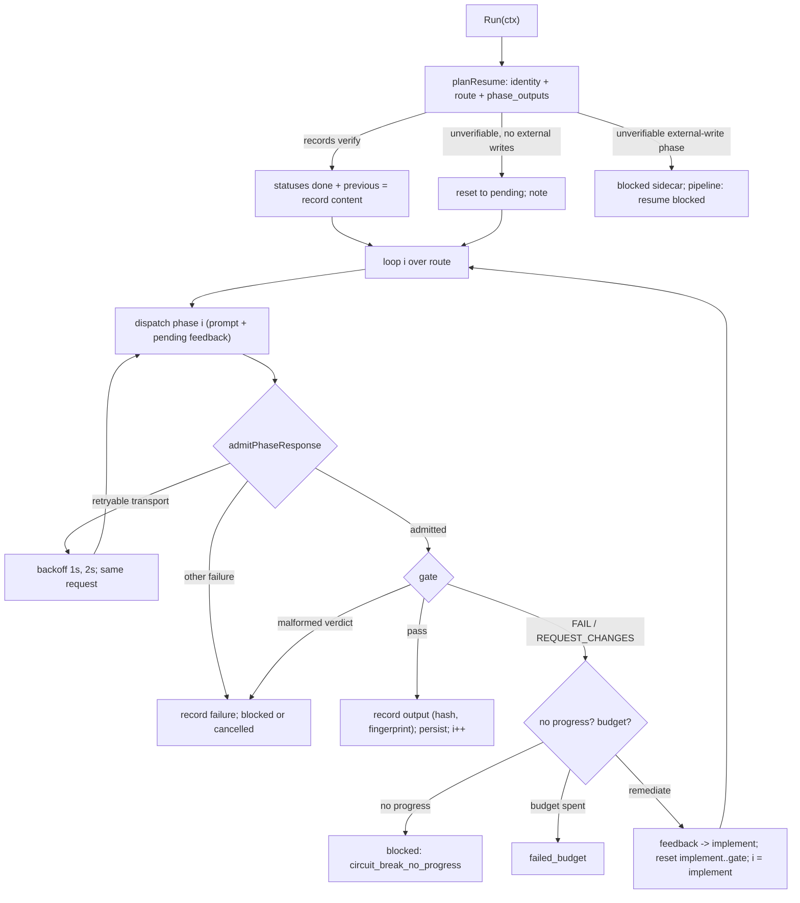

# SPEC-PIPELINE-RESUME-001 Implementation Plan

Status: draft

## Tasks

- T1 (R4): `[NEW] pkg/pipeline/response_contract.go` with `admitPhaseResponse` and the moved `validatePhaseResponse`; `SequentialRunner.runPhaseWithRetry` and the `ParallelRunner` dispatch goroutine admit the response before `EvaluateGate`; the canonical engine calls the same function. One table test over the three runners. Commit `fix(pipeline)` on its own.
- T2 (R3): `[NEW] pkg/pipeline/phase_failure.go` (kinds, decisions, `ErrRetryableTransport`, classification, fingerprint, no-progress rule), `[NEW] phase_failure_report.go` (parse `FAILED_COMMAND`/`EXPECTED`/`ACTUAL` and `FINDING` lines untruncated, signatures from untruncated content with findings identified by normalized evidence and fix text, display bounds that mark every cut), `[NEW] phase_failure_feedback.go` (`## Remediation Feedback` and its `phase:remediation-feedback` manifest layer), and `[NEW] failure_redaction.go` (redaction of every stored, forwarded, and returned failure string; a redacted error keeps its identity).
- T3 (R3): `[NEW] pkg/pipeline/engine_remediation.go`, `[NEW] engine_dispatch.go`, and the `engine_run.go` loop: index-based phase loop, a retryable transport failure recognized before admission and re-sent with an injectable sleep, fix routing to `implement`, invalidation of the fix-to-gate span, circuit breaker, `failed_budget`; gate report request in `engine_prompt.go`; feedback through `PhaseContext.Feedback` into the frozen prompt and the OMP active prompt; redacted receipt reasons and blocker. Tests with fake backends. Commit `fix(pipeline)`.
- T4 (R2): `[NEW] pkg/pipeline/phase_output.go` — record, content hash, input fingerprint, verification; `Phase.ExternalWrites`; checkpoint `phase_outputs` and `pipeline_checkpoint.v2` with v1 read as legacy.
- T5 (R2): `[NEW] pkg/pipeline/checkpoint_restore.go` — resume plan: verify in route order, chain breaks, rerun versus block, notes; restored records feed `previous`, which both prompt paths read through one `priorPhaseInputs` table, so the plain prompt carries every required prior output too.
- T6 (R2): `[NEW] pkg/pipeline/receipt_lineage.go` — task ID, `resumed_from`, `prior_attempts`, cumulative dispatch count, pending remediation feedback, and the recorded reset of each gate's remediation budget and breaker memory on resume.
- T7: `[NEW] internal/cli/pipeline_run_resume.go` prints `Pipeline resume:` notes; existing resume tests whose fixtures assumed an output-less skip are updated to the new contract. Commit `fix(pipeline)`.
- T8: package tests, `go test ./pkg/pipeline/... ./internal/cli/...`, source-lines gate over the changed Go files, scope check of the diff.

## Implementation Strategy

Admission is one function every runner calls, so the order of checks (Go error, nil, timeout, exit code, empty output) and its messages cannot drift between runners again.

The canonical loop becomes index-based. A dispatch failure is classified once; a retryable transport failure re-sends the same request after a bounded, cancellable backoff; every other dispatch failure stops. A gate failure with a typed FAIL or REQUEST_CHANGES becomes a failure record whose evidence is parsed from report lines the gate prompt now asks for, redacted, and rendered into the fix phase's rebuilt prompt; the loop resets the fix-to-gate span and continues from the fix phase, so validation and review always judge the changed code. The breaker compares each gate failure with that gate's previous one; the budget is the gate's `MaxRetries` spent across the run.

Each completed phase stores the exact content later prompts read. The resume plan verifies those records with hashes bound to the SPEC identity, route, policy, source revision, and upstream content, and decides restore, re-dispatch, or block before the run state exists, so a blocked resume writes only the blocked sidecar. Lineage is copied from the prior receipt into the new one.

## Visual Planning Brief



## Feature Completion Scope

This single Primary SPEC closes the Outcome Lock: T1 closes R4 for every runner; T2 and T3 close R3's classification, feedback, re-verification, breaker, budget, and transport retry; T4 to T6 close R2's records, verification, restore, legacy handling, external-write protection, and lineage; T7 surfaces the resume decision; T8 supplies the evidence. No sibling SPEC and no Completion Debt. Status and result-count output (R5) and usage accounting (R10) stay with their own work packages.

## Risk-First Integration Probe

| assumption_id | class | risk | boundary | input | oracle | isolation | status | reason | evidence |
|---------------|-------|------|----------|-------|--------|-----------|--------|--------|----------|
| B1 | implementation_assumption | high | persisted output equals injected output across a resume | `promptlayer.SanitizeContent` applied once and twice to plain text, an injection line with a bearer token, an `OPENAI_API_KEY=sk-proj-…` line, and a PEM private key block | the second pass returns the first pass byte for byte in all four cases | scratch test in a temp package dir, deleted after the run | PASS | persisting the sanitized compacted output and re-sanitizing it at prompt build time yields the same prompt, so resumed prompts can be byte-identical | scratch probe on base `109c7ea4`, 2026-11-02: `idempotent=true` four times; kept as the S7 equality oracle |
| B2 | implementation_assumption | high | OMP sealed view under a remediation dispatch | `NewOMPExecutionView` with phase `implement`, attempt 3, a prompt and active prompt carrying `## Remediation Feedback`, two history rows | the view seals, its binding reports attempt 3, and `Open` with that binding succeeds | scratch test with a temp SPEC dir | PASS | per-phase monotonic attempt numbers and an extended active prompt stay inside the view contract, and the OMP backend compares bindings only for equality | scratch probe on base `109c7ea4`, 2026-11-02: `view err=<nil>`, `binding attempt=3 open err=<nil>` |
| B3 | implementation_assumption | medium | checkpoint version bump across binaries | a YAML checkpoint with `version: pipeline_checkpoint.v2` and a `phase_outputs` list, loaded and validated by the base binary | `LoadFile` succeeds and `ValidateResume` refuses with `checkpoint identity version mismatch: saved pipeline_checkpoint.v2, required pipeline_checkpoint.v1` | scratch test, temp dir | PASS | an older binary fails closed on a newer checkpoint instead of resuming without its outputs; the newer binary reads v1 as legacy (S9) | scratch probe on base `109c7ea4`, 2026-11-02 |

Gate applicability comes from `auto spec gates`; the change persists state and redacts evidence, so `security`, `validation`, `data_loss`, and `deterministic_oracle` stay `required`, and there is no UI path.

## Verification

```sh
go test ./pkg/pipeline/... -timeout 40m -p 2
go test ./internal/cli/... -timeout 40m -p 2
go run ./cmd/source-lines --max 300 --ext .go <changed .go files>
go vet ./pkg/pipeline/ ./internal/cli/
```
