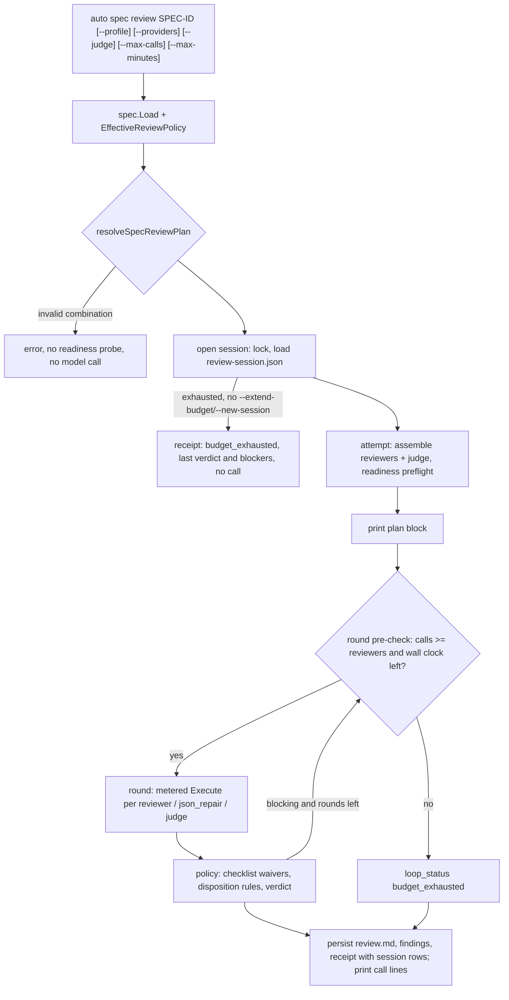

# SPEC-REVIEWPOLICY-001 Implementation Plan

Statement classes used below: `requirement_invariant` (fixed by `spec.md`), `implementation_assumption` (how the code is expected to behave, probed before fan-out), `verified_fact` (confirmed by an execution recorded in `research.md`).

## Tasks

- [ ] T1: Add `[NEW] pkg/spec/review_policy.go` with the profile names `compact`, `lean`, `full`, a `ReviewPolicy` value per profile (required documents and sections, allowed omissions, checklist waivers keyed by item id and section, mandatory gates taken from `pkg/spec/gates`, probe and self-verify flags, reviewer count, default judge, quorum), `ReviewPolicyFor(profile)`, and `EffectiveReviewPolicy(doc)` returning lean only for `LeanEligible()` documents and the full policy plus the escalation reason otherwise. The section maps move out of `profile.go` and `quality_preflight.go` into the policy so there is one table. Tests in `[NEW] pkg/spec/review_policy_test.go`.
- [ ] T2: Make `ValidateSpecSet` take its section set from `EffectiveReviewPolicy`; an ineligible lean SPEC gets the profile error plus every full-profile check (sections, Self-Verify Summary ids, Risk-First Integration Probe). Regression test first: a `feature` SPEC declared lean with only the lean floor reports `Self-Verify Summary` and `Risk-First Integration Probe` errors (fails on 109c7ea4).
- [ ] T3: One disposition rule set. Write the canonical verdict rule lines once in `[NEW] pkg/spec/review_policy_rules.go`; `writeVerdictRules` emits them (plus `pass_criteria` as additional criteria) and a `[NEW]` policy section states the review purpose, the blocking and advisory lists, the heading-versus-evidence rule, and, for an eligible lean SPEC, the allowed omissions and waived checklist items. `IsHardBlockingFinding` becomes the blocking predicate, so `reconcileJudgePassAcceptance` no longer waives a blocking finding, and a reviewer REJECT vote or non-waived checklist FAIL stays a verdict-scoped blocker behind a judge PASS unless the judge rejects that exact item (`scope_ref` `verdict` or the checklist id, recorded as a dismissal). `normalizeStructuredCategory` keeps `contract` and `data_loss`. The loop applies `ApplyChecklistPolicy` to reviewer checklist outcomes and `ApplyLeanOmissionPolicy` to the merged findings before `resolveReviewVerdict`. `templates/shared/spec-review-judge.md.tmpl` carries the same rule lines. Regression tests first: the prompt still says `major <= 2`; a judge PASS with an accepted minor correctness finding converges; a structured suggestion `data_loss` finding is advisory; a lean reviewer FAIL on Q-COMP-08 blocks.
- [ ] T4: Guidance: state the lean floor and the allowed omissions from the policy in `content/agents/spec-writer.md` (Lean Profile and step 5), `content/skills/spec-review.md` (Step 0 and Verdict), `content/rules/spec-quality.md` (a lean applicability section), `templates/claude/commands/auto-workflows.md.tmpl`, `templates/codex/skills/auto-plan.md.tmpl`, `templates/codex/prompts/auto-plan.md.tmpl`, `templates/gemini/skills/auto-plan/SKILL.md.tmpl`; run `go run ./cmd/generate-templates`; extend `templates/lean_profile_surface_test.go` with a parity test that reads the omitted-section list from `pkg/spec`; re-record the TUIUX NPD goldens if they move.
- [ ] T5: Add `[NEW] internal/cli/spec_review_plan.go`: `resolveSpecReviewPlan` (pure) applying REQ-RP-PLAN-02, collecting REQ-RP-PLAN-03 warnings, and rejecting REQ-RP-PLAN-04 combinations; `applySpecReviewPlan` turning it into the gate and options the existing assembly reads. Replace `applyLeanReviewProfile` with it; keep `leanSpecReviewers`. Add the `--profile`, `--judge`, `--max-calls`, `--max-minutes`, `--extend-budget`, `--new-session` flags.
- [ ] T6: Print the plan block per attempt after `planSpecReviewProviders` and before `runSpecReviewLoop`, with the expected and upper-bound call arithmetic (`reviewers x (1 + specReviewJSONRepromptAttempts) + judge` per round, times rounds, times one plus fallbacks per attempt). Table test with the recording fake backend: lean default, single provider override, multiple provider override, explicit judge, high-risk lean, invalid combination; printed reviewers and judge equal the calls, total calls never exceed the printed bound, the invalid row makes zero calls.
- [ ] T7: Add `ReviewBudgetConf` (`max_calls`, `max_minutes`, `max_tokens`, `max_cost_usd`, all `omitempty`) under `ReviewGateConf.Budget` with `Validate()` called from `HarnessConfig.Validate`; not added to `DefaultFullConfig`. Tests in `pkg/config/schema_spec_test.go`.
- [ ] T8: Add `[NEW] internal/cli/spec_review_session.go` and its store: the `spec_review_session.v1` file, an exclusive `.review-session.lock` taken with `pkg/filelock` for the invocation, continue, converged-then-new, exhausted-then-refuse, `--extend-budget`, `--new-session`, a usage error for a differing budget flag on an existing session, corrupt or unknown-schema refusal, in-flight calls rewritten to `interrupted`, the wall-clock axis over invocations that made calls, atomic temp-and-rename writes with mode 0600.
- [ ] T9: Add `[NEW] internal/cli/spec_review_ledger.go`: `reserve` and `settle` under one mutex, persistence after each, usage mapping from `ProviderResponse.Usage` envelopes (`actual`, `cost_only` to actual, `estimated`, else unknown with null values), model and effort from the envelope or `unknown`, end reason classification, and a metered `ExecutionBackend` that `runStructuredSpecReviewOrchestra` installs when the context carries a session. Call reasons ride the context: the loop sets the round and fallback, `repromptStructuredReviewerJSON` sets `json_repair`, the judge role maps to `adjudication`.
- [ ] T10: Loop integration: before each round check the remaining calls against the round's reviewers and the wall-clock deadline; bound the round context by the session deadline; end with `budget_exhausted` (loop status, verdict-scoped blocking reason, degraded reason, never PASS when a call of the round was blocked or cancelled); refuse `--allow-degraded` for `budget_exhausted` in the integrity gate; when no round can run in an invocation, build the result from the last receipt and findings without promoting.
- [ ] T11: Receipt `session` object, the per-call summary printed after each attempt, and `mergeSpecReviewCallRows` deduplicating by `(session_id, call_id)`.
- [ ] T12: Add `[NEW] docs/spec-review-policy.md` and the `docs/README.ko.md` row; run the verification table below.

## Implementation Strategy

The policy is data plus three predicates, kept in `pkg/spec` because every consumer (validator, prompt, runtime, CLI plan) already imports it; the judge template is rendered by `pkg/orchestra`, which this SPEC does not own, so the template carries the canonical lines verbatim and a parity test fails when they drift. The disposition rule set keeps the existing runtime truth table (issue #187) unchanged and aligns the two texts and the judge reconciliation to it, which is the smallest change that makes all three agree without weakening any gate.

Profile and provider selection become two inputs of one pure plan function whose output both configures the existing read-only assembly and is printed; nothing about assembly, readiness, or the read-only policy changes. Budget enforcement sits at the one seam every model call passes through: the backend returned by `specReviewBackendFactory` inside `runStructuredSpecReviewOrchestra`, wrapped by a metered backend that reserves before `Execute` and settles after. The session file is the authoritative ledger; the receipt carries the attempt's rows. Defaults stay unlimited so no existing invocation changes behaviour unless a budget is configured.

## Visual Planning Brief

## Feature Completion Scope

This Primary SPEC closes the Outcome Lock: T1 to T4 deliver R6, T5 and T6 deliver R7, T7 to T11 deliver R10, and T12 supplies the documentation and evidence. No sibling SPEC is created. R8, R9, and R11 are explicit non-goals that a later SPEC builds on the call roles, reasons, judge mode field, and session ledger introduced here; they are not Completion Debt because the Outcome Lock does not require them.

## Risk-First Integration Probe

| assumption_id | class | risk | boundary | input | oracle | isolation | status | reason | evidence |
|---------------|-------|------|----------|-------|--------|-----------|--------|--------|----------|
| A1 | implementation_assumption | high | SPEC review structured runner to `orchestra.ExecutionBackend` | `rg -n '\.Execute\(' internal/cli/spec_review*.go` and `rg -n 'specReviewBackendFactory\(' internal/cli/*.go` excluding tests on 109c7ea4 | exactly three `Execute` call sites (reviewer, JSON repair, judge), all fed the backend that `runStructuredSpecReviewOrchestra` obtains from its single factory call, so one wrapper meters every model call | read-only search in the worktree | PASS | three call sites at `spec_review_structured_runtime.go:182`, `spec_review_reprompt.go:38`, `spec_review_judge.go:67`; one factory call at `spec_review_structured.go:42` | `research.md` `## Probe Evidence (2026-11-02)` A1 |
| A2 | implementation_assumption | medium | context values from the review loop to `Execute` inside the parallel runner | a round context carrying the round number and fallback flag | each reviewer, repair, and judge `Execute` sees the values | fake backend in a unit test | not-run | the parallel runner derives every child context from the round context (`context.WithTimeout(ctx, ...)`), read on 2026-11-02; the T9 ledger test executes it before the loop integration lands | - |
| A3 | implementation_assumption | medium | cross-process exclusion of two `auto spec review` invocations on one SPEC | `pkg/filelock` exclusion and crash-release tests | a second holder is refused while the first holds the lock and admitted after the holder process dies | the package's own temp directories | PASS | `TestAcquire_ExcludesAnotherProcessUntilRelease`, `TestAcquire_CrashedHolderReleasesImmediately`, `TestAcquire_ExcludesSecondHolderInSameProcessAndWaitsForRelease` passed on 2026-11-02 | `research.md` `## Probe Evidence (2026-11-02)` A3 |

Gate applicability for the handoff is read from `{SPEC_DIR}/gate-applicability.json` written by `auto spec gates`, never declared here. The classifier keeps `security`, `validation`, `data_loss`, and `deterministic_oracle` required; no UI path is in the change set.

## Verification

| Step | Command | Gate |
|------|---------|------|
| Policy | `go test ./pkg/spec/... -run 'ReviewPolicy\|ValidateSpecSet\|Blocking\|Prompt\|Structured' -count=1` | S1 to S5 |
| Config | `go test ./pkg/config -run 'ReviewBudget\|ReviewGate' -count=1` | S9 |
| CLI | `go test ./internal/cli -run 'SpecReview' -count=1 -timeout 40m -p 2` | S3, S5, S7, S8, S10 to S15 |
| Race | `go test ./internal/cli -run 'SpecReviewLedger\|SpecReviewSession\|SpecReviewBudget' -race -count=1` | S11 |
| Surfaces | `go run ./cmd/generate-templates` leaves no diff after commit; `go test ./templates ./pkg/content ./pkg/harneval` | S6 |
| Packages | `go test ./pkg/spec/... ./pkg/config ./templates ./pkg/content ./pkg/harneval ./internal/cli -count=1 -timeout 40m -p 2` | S16 |
| Size | `go run ./cmd/source-lines --max 300 --ext .go <changed .go files>` | REQ-RP-VERIFY-01 |
| SPEC | `go run ./cmd/auto spec validate .autopus/specs/SPEC-REVIEWPOLICY-001` | zero errors |
