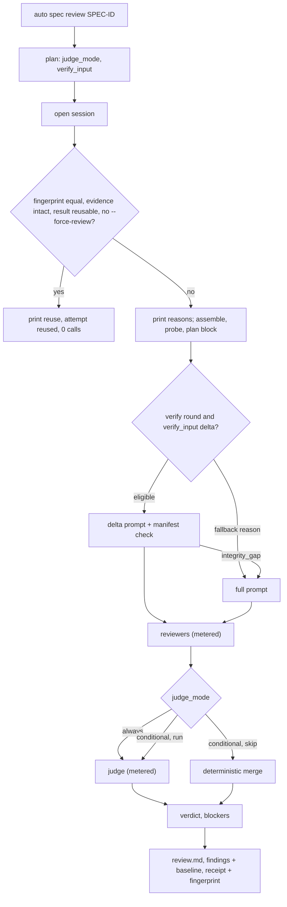

# SPEC-REVIEWREUSE-001 Implementation Plan

Statement classes used below: `requirement_invariant` (fixed by `spec.md`), `implementation_assumption` (how the code is expected to behave, probed before fan-out), `verified_fact` (confirmed by an execution recorded in `research.md`).

## Tasks

- [ ] T1: Add `[NEW] pkg/config/schema_review_modes.go` with `ReviewGateConf.JudgeMode` and `VerifyInput` (`omitempty`), their allowed values, and `Validate` errors naming the dotted key, called where `ReviewBudgetConf.Validate` is; add `--judge-mode` and `--verify-input` to `auto spec review`, resolve them in `resolveSpecReviewPlan` (flag over config over default) with refusal before any probe, and print the mode and its condition in the plan block. Regression test first: an unknown `judge_mode` loads on 48607ed2.
- [ ] T2: Add `[NEW] internal/cli/spec_review_judge_mode.go`: a pure `decideSpecReviewJudge(mode, reviews)` returning run or skip with the reasons of REQ-RR-JDG-03 and REQ-RR-JDG-04, built on per-review blocking and escalation predicates over the canonical rules.
- [ ] T3: Two-phase rounds under a conditional mode: run the reviewers through `specReviewRunOrchestra` with the judge disabled, decide, and run the judge through a `specReviewRunJudge` seam that wraps the same metered backend and `runStructuredSpecReviewJudge`, appending its response or failure to the round result so `applySpecReviewJudge` is unchanged; record `skipped` with its reason; `always` keeps the one-call path. Regression tests first: a consensus PASS under `on_disagreement` calls the judge on 48607ed2.
- [ ] T4: Deterministic merge in `pkg/spec` (`[NEW] review_merge.go`): group merge with most severe severity, escape hatch, and `Sources`; escalation groups bypass the threshold; `DeduplicateFindings` unions the same way; `ReviewFinding.Sources` added. Regression test first: the S5 critical row resolves PASS on 48607ed2.
- [ ] T5: `JudgeSummary.Mode` and `Decisions`, the receipt projection with truncated reasons, and plan call bounds that count a conditional judge as 0 to 1.
- [ ] T6: Add `[NEW] pkg/spec/review_fingerprint.go` (document digests with the spec.md status normalized, checklist body digest, prompt contract digest from a fixed probe SPEC) and `[NEW] internal/cli/spec_review_fingerprint.go` (git `HEAD` and working-tree digest excluding the SPEC directory, references, code context, policy, providers with the pinned rule, judge prompt and reviewer schema digests) with `complete` and reasons.
- [ ] T7: Compute the fingerprint at the start of each round, keep the final round's, and write it with the evidence digests into the receipt after `review.md` and `review-findings.json` are final.
- [ ] T8: Add `[NEW] internal/cli/spec_review_reuse.go`: the reuse decision of REQ-RR-REUSE-02 to REQ-RR-REUSE-04 before the attempt loop (after the session opens, before assembly probes), the reuse output, the session attempt end reason `reused`, the invalidation line, and `--force-review` with `forced_review` on the attempt and receipt. Regression test first: a second identical invocation makes 2 calls on 48607ed2.
- [ ] T9: Wire `verify_input` and `--verify-input` into the loop parameters.
- [ ] T10: Add `[NEW] pkg/spec/review_baseline.go`: the `spec_review_baseline.v1` record stored as `baseline` in `review-findings.json` (load and persist keep findings and coverage intact), written after each usable, uncut round.
- [ ] T11: Add `[NEW] pkg/spec/review_delta.go`: line diff with hunks, H2/H3 section mapping, risk-boundary detection, finding scope closure over the traceability matrix, and the ordered eligibility check of REQ-RR-DELTA-03 returning the first failed reason.
- [ ] T12: Add `[NEW] pkg/spec/review_delta_prompt.go`: the `spec_review_delta.v1` prompt with its manifest and the integrity validation of REQ-RR-DELTA-05; verify instructions and markers reused from the verify builder.
- [ ] T13: Loop integration: choose the input for each verify round, print and record `input` and `input_reason` per round, fall back to the unchanged full builder, and keep every call on the metered backend.
- [ ] T14: Documentation in `docs/spec-review-policy.md` and `docs/README.ko.md`; recapture the S16 receipt golden; run the verification table.

## Implementation Strategy

The conditional judge reuses every existing piece: the reviewers still run through `specReviewRunOrchestra`, and the judge still runs through `runStructuredSpecReviewJudge` on the metered backend, so call reasons, budget reservations, and the judge parser are unchanged; only the moment of the call moves after a pure decision over the parsed reviews. The merge fix lives where the defect is (`MergeSupermajority`), so every mode, including `judge none` and a failed judge, inherits it.

Reuse is a pure comparison of two fingerprints plus a result-class table, decided before the readiness probe so a hit costs nothing. The fingerprint is component-wise, so the refusal line can name what changed, and the prompt contract is a digest of prompts built for a fixed probe SPEC, so an ADK upgrade that changes prompt text invalidates old results without a hand-maintained version number.

Delta verify is a separate prompt builder behind an opt-in setting. The full builder, the context-delivery checks, and their tests are untouched; the delta path proves coverage with a manifest checked against the baseline and returns to the full builder on the first failed condition, so a wrong delta decision costs money, never coverage.

## Visual Planning Brief

## Feature Completion Scope

This Primary SPEC closes the Outcome Lock: T1 to T5 deliver R8, T6 to T8 deliver R11, T9 to T13 deliver R9, and T14 supplies documentation and evidence. No sibling SPEC is created. Reviewer-scoped verification is an explicit non-goal recorded under Evolution Ideas.

## Risk-First Integration Probe

| assumption_id | class | risk | boundary | input | oracle | isolation | status | reason | evidence |
|---------------|-------|------|----------|-------|--------|-----------|--------|--------|----------|
| A1 | implementation_assumption | high | judge call outside the structured runner | `rg -n` for the definitions and calls of `runStructuredSpecReviewJudge`, `meterSpecReviewBackend`, and `specReviewBackendFactory` in `internal/cli` without tests on 48607ed2 | one judge call site inside `runStructuredSpecReviewOrchestra`; the metered wrapper takes only a context and a backend | read-only | PASS | a second caller can wrap the same factory backend and pass the reviewer responses | research.md `## Probe Evidence` A1 |
| A2 | implementation_assumption | high | git as the code-baseline source | `git rev-parse HEAD` and `git status --porcelain=v1 -z --untracked-files=all` in a temporary repository with a modified, a new, and an ignored file | HEAD printed; the modified and the new file listed NUL-separated; the ignored file absent | temporary directory | PASS | the porcelain v1 format is stable and lists untracked files individually | research.md `## Probe Evidence` A2 |
| A3 | implementation_assumption | medium | prompt determinism for the contract digest | a scratch module (replace directive to this worktree) that loads SPEC-REVIEWPOLICY-001 and builds its discover prompt twice per process, run in two processes | equal within a process and the same SHA-256 across processes | scratchpad module, worktree untouched | PASS | identical inputs build byte-identical prompts | research.md `## Probe Evidence` A3 |

Gate applicability for the handoff is read from `{SPEC_DIR}/gate-applicability.json` written by `auto spec gates`, never declared here. The classifier keeps `security`, `validation`, `data_loss`, and `deterministic_oracle` required; no UI path is in the change set.

## Verification

| Step | Command | Gate |
|------|---------|------|
| Config | `go test ./pkg/config -run 'ReviewGate\|JudgeMode\|VerifyInput' -count=1` | S1, S13 |
| Spec | `go test ./pkg/spec/... -count=1` | S5, S8, S14, S15, S17, S18 |
| CLI | `go test ./internal/cli -run 'SpecReview\|Judge\|Reuse\|Fingerprint\|Delta' -count=1 -timeout 40m -p 2` | S1 to S18 |
| Race | `go test ./internal/cli ./pkg/spec -run 'JudgeMode\|Merge\|Fingerprint\|Reuse' -race -count=1` | S19 |
| Packages | `go test ./pkg/spec/... ./pkg/config ./templates ./pkg/content ./pkg/harneval -count=1 -timeout 40m -p 2` and `go test ./internal/cli -count=1 -timeout 90m -p 2` | S18, S19 |
| Size | `go run ./cmd/source-lines --max 300 --ext .go <changed .go files>` | S20 |
| SPEC | `go run ./cmd/auto spec validate .autopus/specs/SPEC-REVIEWREUSE-001 --strict` | zero errors |
