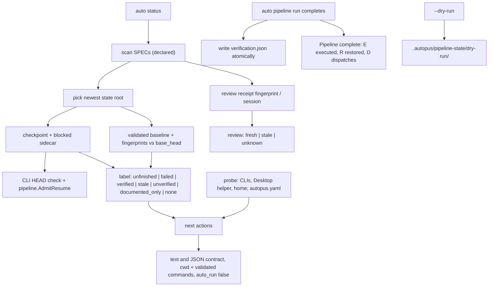

# SPEC-STATUSEVIDENCE-001 Implementation Plan

Status: draft

## Tasks

- T1: `[NEW] internal/cli/status_evidence.go`, `[NEW] status_evidence_roots.go`, `[NEW] status_evidence_resume.go`, `[NEW] status_evidence_verify.go`, `[NEW] status_evidence_review.go` — per-SPEC readers: the newest state root, the checkpoint and blocked sidecar (counts by dispatch, stop reason, owner from the receipt), the resume admission through `pipeline.AdmitResume`, baseline validation and freshness, and the review receipt and session.
- T2: `[NEW] internal/cli/spec_fingerprint.go`, `[NEW] pipeline_run_baseline.go`, `[NEW] pipeline_run_fingerprint.go` — the shared SPEC fingerprint helper with a golden test, the tree fingerprint with hidden-change detection, baseline validation, and the atomic baseline write after a completed run.
- T3: `[NEW] status_evidence_render.go`; `status.go`, `status_json.go` — the evidence lines under each SPEC row, the summary, the JSON contract, and probe injection.
- T4: `[NEW] status_next.go`, `[NEW] status_next_command.go`, `[NEW] status_next_env.go`; `pipeline_run_flags.go` — next actions with absolute directories, validated and quoted commands, installed CLIs against pipeline platforms, Desktop facts.
- T5: `pipeline_run.go`, `pipeline_run_resume.go`, `[NEW] pipeline_run_dryrun.go` — counts by dispatch, the stop-reason rule, the platform line, dry-run state apart from the canonical checkpoint; `[NEW] pkg/pipeline/resume_admission.go`.
- T6: `init.go` — standalone-first steps with the same facts as status actions; re-record the TUIUX goldens, whose writer shows that only the next-step lines of `init-yes.stdout` and `init-pipe.stdout` change (recapture section 19).
- T7: README rows; tests with engine-made checkpoints and an injected probe; executed admission probes; `go test ./internal/cli/... ./pkg/pipeline/...`; source-lines gate; scope check.

## Implementation Strategy

Status stays a reader. Each SPEC row gains three facts that never merge: what the document declares, what the last pipeline run did, and what the last review said. Resumability is the engine's own decision, reached through a read-only entry to its admission rather than a reimplementation. The only new file a run writes is the verification baseline next to the existing pipeline sidecars, and dry runs move to their own directory so they can no longer replace a real run's evidence. Next actions are derived from those facts plus what is installed, built only from validated values, printed with their directory, costs, and side effects, and never run.

## Visual Planning Brief



## Feature Completion Scope

This single Primary SPEC closes the Outcome Lock except review freshness for receipts that carry no `spec_fingerprint`, which status reports as unknown or stale and never fresh; recording that fingerprint belongs to the review writer and is listed as Completion Debt in research.md.

## Risk-First Integration Probe

| assumption_id | class | risk | boundary | input | oracle | isolation | status | reason | evidence |
|---------------|-------|------|----------|-------|--------|-----------|--------|--------|----------|
| B1 | implementation_assumption | high | tree fingerprint against a base commit | repository with an edit, an addition, a deletion, a commit, a later edit, an untracked file, a rename | equal before and after committing the verified tree; different after an edit or a new file; a rename lists both sides | temporary repository per test | PASS | diff plus untracked files covers content changes and is invariant under committing the same tree | `TestPipelineBaseline_FingerprintIgnoresCommitsAndCatchesEdits` |
| B2 | requirement_invariant | high | status resume admission against `--continue` | engine-made checkpoints: unchanged, HEAD moved, SPEC changed, output tampered, dependency broken, unknown version, route changed, no git | status admits exactly when `auto pipeline run <SPEC> --continue --dry-run` admits, and refuses with the CLI's or engine's reason | temporary repository per case; dry-run state apart | PASS | status calls the engine's own admission through `pipeline.AdmitResume` after the CLI's HEAD check | `TestStatusEvidence_AdmissionAgreesWithContinue`, `TestAdmitResume_AgreesWithTheEngine` |
| B3 | verified_fact | high | changes git does not report | a tracked file marked assume-unchanged or skip-worktree and edited; an executable bit flipped under `core.fileMode=false` | verification unknown for the flags; stale for the executable bit | temporary repository | PASS | git skips flagged files and mode-only changes unless forced | `TestStatusEvidence_HiddenChangesAreNeverFresh` |

## Verification

```sh
go test ./internal/cli/... ./pkg/pipeline/... -timeout 90m
go run ./cmd/source-lines --max 300 --ext .go <changed .go files>
TUIUX_WRITE_GOLDENS=1 go test ./internal/cli -run TestTUIUXBaseGoldens_FormlessPlacesKeepTheBaseOutput
```
