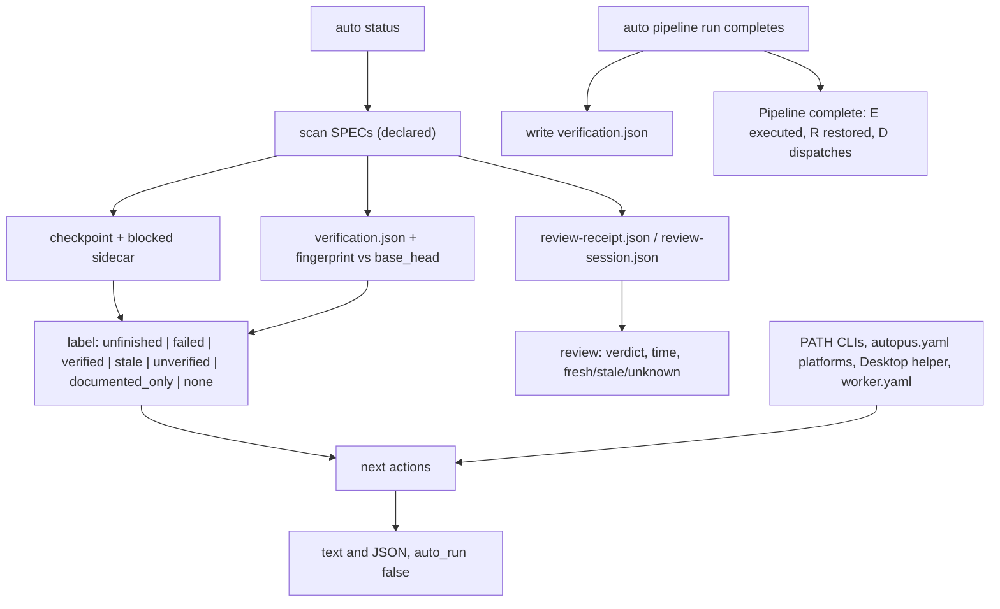

# SPEC-STATUSEVIDENCE-001 Implementation Plan

Status: draft

## Tasks

- T1: `[NEW] internal/cli/status_evidence.go`, `[NEW] status_evidence_verify.go`, and `[NEW] status_evidence_review.go` — per-SPEC readers: the pipeline checkpoint and blocked sidecar (counts, stop reason, attempt, resumability from `ValidateResume`, `ValidateResumeRoute`, the current snapshot, and HEAD), the review receipt and a tolerant `spec_review_session.v1` reader, and the overall label.
- T2: `[NEW] internal/cli/pipeline_run_baseline.go` — the SPEC and tree fingerprints and writing `<SPEC>.verification.json` after a completed run; the status-side freshness check with a per-base cache lives in `status_evidence_verify.go`.
- T3: `[NEW] status_evidence_render.go`; `status.go`, `status_json.go` — the evidence block under each SPEC row, the `documented done · verified` summary, and the same fields in JSON.
- T4: `[NEW] status_next.go`, `[NEW] status_next_env.go`; `pipeline_run_flags.go` — next actions with platform syntax, provider, calls, and writes; installed CLIs, configured platforms, the selection reason; Desktop helper and worker config facts through injectable probes.
- T5: `pipeline_run.go`, `pipeline_run_resume.go` — the executed, restored, and dispatch counts and the `Pipeline platform:` line.
- T6: `init.go` — standalone-first guidance and the optional Desktop line; re-record the TUIUX goldens (recapture section 18).
- T7: README and `docs/README.ko.md` status rows; tests; `go test ./internal/cli/...`; source-lines gate; scope check.

## Implementation Strategy

Status stays a reader. Each SPEC row gains three facts that never merge: what the document declares, what the last pipeline run did, and what the last review said. The only new file is the verification baseline next to the existing pipeline sidecars, written by `auto pipeline run` when a run completes; status recomputes the same fingerprint read-only and compares. Next actions are derived from those facts plus what is installed, printed with their costs and side effects, and never run.

## Visual Planning Brief



## Feature Completion Scope

This single Primary SPEC closes the Outcome Lock: T1 to T3 separate declared, execution, verification, and review evidence in text and JSON; T2 adds the baseline that makes staleness observable; T4 and T6 make the next commands match the install state with Desktop optional; T5 fixes the pipeline counts; T7 supplies the evidence. No sibling SPEC and no Completion Debt.

## Risk-First Integration Probe

| assumption_id | class | risk | boundary | input | oracle | isolation | status | reason | evidence |
|---------------|-------|------|----------|-------|--------|-----------|--------|--------|----------|
| B1 | implementation_assumption | high | tree fingerprint against a base commit | temp repo: base with a.go and b.go; edit a.go, add c.go, delete b.go; fingerprint; commit; edit; add an untracked file; restore | the fingerprint is equal before and after committing the verified tree, differs after an edit and after a new untracked file, and returns when they are undone | throwaway repo in the session scratchpad, deleted after | PASS | `git diff --name-only <base>` plus untracked files covers every content change and is invariant under committing the same tree | scratch probe on 2026-11-02: `verified=f35bfbb0`, `after-commit=f35bfbb0`, `after-edit=fd28fca1`, `after-untracked=29574ef0`, `restored=f35bfbb0` |
| B2 | implementation_assumption | medium | resumability without the engine | a checkpoint whose HEAD differs from the current one | `loadCheckpointIfContinue` refuses it as stale, so status can predict refusal from HEAD and `ValidateResume` alone | read of `internal/cli/pipeline.go` and `pkg/pipeline/checkpoint.go` | PASS | the CLI marks a checkpoint stale on a git hash mismatch before the engine reads outputs; output-record verification still happens at resume time and is reported then | code read on 2026-11-02 |
| B3 | implementation_assumption | medium | init goldens | the TUIUX init flows run with a temporary home and no worker config | only the `Next` lines of `init-yes.stdout` and `init-pipe.stdout` change, and no NPD changes | TUIUX writer at the branch tip | PASS | the guidance is static text, so only the two asserted stdout files change | writer run on 2026-11-02: one `Next:` line became three in both files, NPDs unchanged; recapture section 18 |

## Verification

```sh
go test ./internal/cli/... -timeout 90m
go run ./cmd/source-lines --max 300 --ext .go <changed .go files>
TUIUX_WRITE_GOLDENS=1 go test ./internal/cli -run TestTUIUXBaseGoldens_FormlessPlacesKeepTheBaseOutput
```
